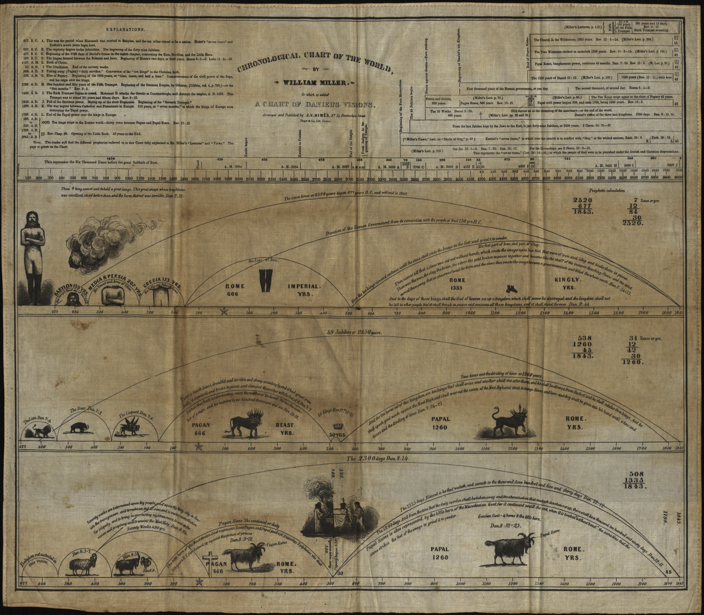
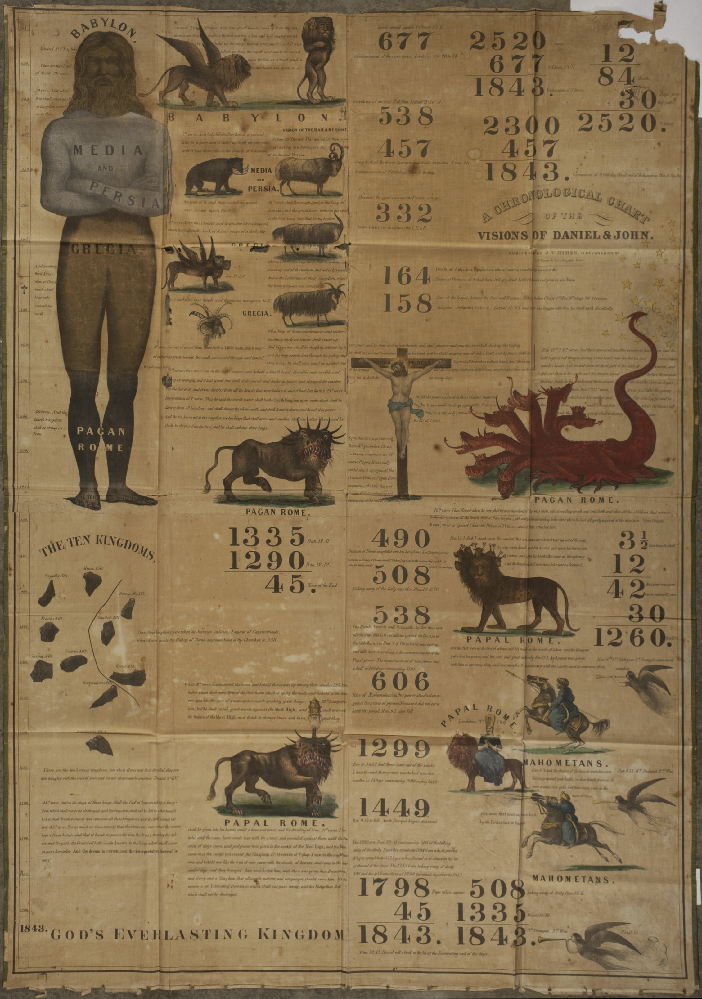

<!-- 
.. date: 2018-02-01
.. title: The Emergence of Seventh-day Adventism
.. slug: chapter-1
-->

>I told the view to our little band in Portland, who then fully believed it to be of God. It was a powerful time. The solemnity of eternity rested upon us. About one week after this the Lord gave me another view, and shewed me the trials I must pass through, and that I must go and relate to others what he had revealed to me, and that I should meet with great opposition, and suffer anguish of spirit by going. But said the angel "The grace of God is sufficient for you: he will hold you up." 
>
>Ellen White, 1851^[@White1851, pp. 5-6]

>And it shall come to pass afterward, that I will pour out my spirit upon all flesh; and your sons and your daughters shall prophesy, your old men shall dream dreams, your young men shall see visions
>
>Joel 2:28, King James Version

[chapter abstract]

## Setting the Stage: Women and the Revivals of the Early Republic

"Given Joel's prophecy, the sight of a woman standing in the pulpit had cosmic significance: she was a living symbol of the last days, a reminder that the end of the world had truly come."^[@Brekus1998, p. 320]

"Like earlier nineteenth-century female preachers, Millerite women solved the 'problem' of their gender by arguing that God had transformed their weakness into strength."^[@Brekus1998, p. 321]

"Despite their desire to recapture the spirit of the earlier revivals, the Millerite's were not identical to the sectarians of the 1810s and 1820s. Socially, they drew their membership from a higher economic class, and theologically, they placed almost as much emphasis on education as divine inspiration. Even though they did not require lecturers to be college-educated, they expected them to be able to interpret Miller's intricate prophetic charts. At a minimum, preachers were supposed to have mastered the books of Daniel and Revelation. Reflecting the larger constituency of the movement, most Millerite female preachers seem to have been better educated than their predecessors, and they were also economically more secure."^[@Brekus1998, p. 324]

"In contrast to earlier Freewill Baptists, Christians, and Methodists, the Millerites argued that *married* women, not single women, were best suited for careers in the pulpit. By claiming to speak as their husbands' helpmates, female preachers tried to counter accusations that they were promiscuous, shameless, or "masculine."^[@Brekus1998, p. 326]

<!-- + Stories of women in religious revivals

+ Theoretical framing
    + Smith-Rosenberg on antiritualism
    +  -->

## The Making of the Adventists
<!-- 
+ quick overview of the state of revivalism leading up to the Adventists
    + major 'revival' periods were 1740s and early 1800s
    + revivalism on the decline (Bratt) -->

Question to self: was the movement strongest in upstate New York? (claim by Brekus but unclearly supported.)

### The Religious Roots of Adventism

<!-- Themes:
+ Biblical literalism
+ Millennialism/apocalypticism
+ "Democratization" 
    + Hatch
+ Primitivism

Denominations:
+ Methodism
    + EGW's background
    + 
+ Christian Connection
    + James White's background
    + 
+ Baptists (and Seventh-day Baptists)
    + Bates' background
    + Miller's background (?)
+ Reform
    + Abzug here
    + Himes here. -->

### William Miller, Joshua Himes, and ....

"Even though earlier evangelicals had realized the potential of the press, the Millerites published tracts, memoirs, and newspapers on a scale never before imagined."^[@Brekus1998, p. 323]

Of the varied religious movements that developed during the nineteenth-century, one of the more notable were the Millerites, American Protestants drawn largely from Baptist and Methodist congregations who were convinced by the teaching of one William Miller that the Bible revealed that the second coming, or second advent, would take place around the year 1843. Miller, a commissioned militia officer during the War of 1812 and if his biographer is to be believed, a leading citizen of Poultney, Vermont, began his study of the Bible shortly after his conversion from Deism in an attempt to prove the reliability of the Bible by reconciling all apparent inconsistencies he discovered.^[Bliss (1853), pp. 18-25, 31, )] In 1818, he first came to the conclusion that the prophecies, particularly Daniel, revealed that the second coming would take place around year 1843. After spending five years confirming his interpretations and calculation, he began to share his conclusions, starting with family and friends, then reaching out to local ministers. Miller understood his findings as reinforcing the teachings of the churches and as part of the prevailing belief in the second coming and the need for salvation. He slowly began to receive invitations to preach in a variety of churches, including Baptist, Methodist, and Congregational.^[{Dick, 1998, \#15192@4}] In 1832, he published his findings in the *Vermont Telegraph* and in 1833, he was granted a preaching license from his Baptist church in Hampton, New York.^[{Judd, 1987, \#89117@22;25}; See also ... Miller gives the date of his being granted a license as 1834 in Mr. Miller's Apology and Defense.] He began preaching and lecturing in churches throughout New England throughout the 1830s and into the 1840s. He published a 64 page pamphlet of his interpretation in 1834 and a series of sixteen lectures in 1836. Between 1834 and 1839, when he began to with Joshua Himes, Miller recorded that he had given about 800 lectures on his interpretation of prophecy and his belief that the time of the second coming was at hand.^[Miller (1845), p. 3]

Despite publishing, traveling, and preaching widely, Miller's teachings would have remained one of many little known local religious movements of the nineteenth century if it were not for Joshua V. Himes. Prior to meeting Miller, Himes had a long history of embracing reform movements as the way to bring about the kingdom of God. Licensed to preach by the Christian Church, he was pastor of a church in Boston, was a Temperance lecturer, started a school for boys, was on the board of the Massachusetts Anti-Slavery Society, was an early supporter of William Lloyd Garrison, and distributed periodicals and other printed materials of the Disciples of Christ.^[{Arthur, 1987, \#72076@37-39}] Anticipating the coming millennium and already working hard to bring it about, Himes found Miller's teaching that it would arrive in a mere four years time both striking and deeply motivating. With Miller's blessing, Himes became his chief publicist, launching a campaign of print and conferences aimed at disseminating Miller's work as quickly and widely as possible.^[{Arthur, 1987, \#72076@39}] Publishing periodicals such as *Signs of the Times*, *The Midnight Cry*, the *Philadelphia Alarm*, and *The Western Midnight Cry*, among others, as newspapers of the movement, along with Miller's *The Second Advent* and memoirs, as well as tracts, hymns, and prophetic charts, Himes flooded religious readers with material expounding Miller's teachings. In doing so, he fostered a sense of religious community among adventist believers and created the mechanisms by which Miller's message could spread.^[{Arthur, 1987, \#72076@42-48}]

At the risk of projecting a modern concept onto the past, it is clear that Himes had an excellent sense of "marketing" --- he knew how to engage people in a cause and how to gain, if not converts, at least attention. He worked to ensure the widest possible reach for Miller's teachings, establishing periodicals in the key cities of Boston, New York, Philadelphia, and Cincinnati. He also understood the value of "showmanship," acting quickly on a decision to build a "great tent" --- one that seated 4,000 people and was one of the largest to be seen in America; publishing and selling colorful charts to illustrate the intricate (and obtuse) details of Miller's interpretation; and convincing Miller to offer a more definitive date. He also began holding regular conference meetings for those convinced by Miller's teachings. These gatherings provided a forum for the dispersed community to come together, to work to reach consensus on some of the contested details of Miller's teaching, and to agree on a strategy for spreading the word.^[Judd (1987), pp. 39-48.]

**Figure 1.1**: William Miller's "Chronological Chart of the World to which
is added, a Chart of Daniel's Visions" (1842). From the Adventist
Digital Library.
https://adventistdigitallibrary.org/adl-421835/chronological-chart-world.
Accessed 6 September 2017.

**Figure 1.2**: Charles Fitch's "A Chronological Chart of the Visions of
Daniel and John." (1843). From the Adventist Digital Library.
https://adventistdigitallibrary.org/adl-421834/chronological-chart-visions-daniel-and-john.
Accessed 6 September 2017.

The efforts of Himes launched Miller and his teachings into the public consciousness and created a community around the belief that the second coming would occur between March 21, 1843, and March 21, 1844. In 1842, just two years after he joined the cause, Himes claimed fifty-thousand readers for *Signs of the Times* and between three and four hundred ministers distributing the materials.^[Dick (1998), p. 6; {Arthur, 1987, \#72076@46}] By 1844, Himes had overseen the foundation of a number of serial publications, tracts, and pamphlets and had organized, attended, and spoken at conferences around the United States and Canada. As a result, Miller himself became highly sought-after speaker, claiming to have given about 4000 lectures in 500 hundred towns between 1840 and 1844. In addition to Miller and Himes, by Miller's calculations some 200 ministers in the United States and Canada had embraced his interpretation, and an additional 500 public lecturers circulated his view.^[Miller (1845), p. 4]

Miller did not set out to form a new movement or denomination. Rather he saw his teachings as within the bounds of the prevailing orthodoxy, as the logical conclusion of prevailing Protestant beliefs. He made no effort to start his own church and did not wish to be identified as a "sectarian leader," instead encouraging followers to stay within their home denominations. In claiming success, he notes that, as result of his early lecturing, "many churches thereby greatly added to their numbers," a statement that reinforces that he saw his goal as the revival of the local church, not the creation of his own.^[Miller (1845), p. 3] He saw his teaching of the imminent second coming to be a truth of general interest for all denominations, and one that would (or should) be embraced regardless of denominational affiliation.^[Judd (1987), p. 30-31]

This did not always go according to plan, as the experience of the Harmon family illustrates. In her autobiography, Ellen (Harmon) White reports, "At the age of eleven I was converted, and when twelve years old was baptized, and joined the Methodist church." Upon hearing William Miller lecture on the topic of the Second Advent at age of 13 (1841), she "then felt that I was not holy, not ready to see Jesus" and so "when the invitation was given for church members and sinners to come forward for prayer," she went forward in the belief that "I must have a great work done for me to fit me for Heaven."^[{White, 1851, \#9716@3}] Although already converted, baptized, and a member of the church, the news that the second coming would occur in two years time caused White to call her faith into question. She began regularly attending "Second Advent meetings," seeking "full and free salvation" from God.^[{White, 1851, \#9716@3}] She received the confirmation she sought when she obeyed God's prompting to "pray in a public prayer-meeting."^[{White, 1851, \#9716@4}]

Convinced of her salvation and full of anticipation for the return of Jesus, she returned to her Methodist class-meeting some six months later to share "what Jesus had done for me, and what a fullness I enjoyed through believing that the Lord was coming." This message, however, was not acceptable to the local Methodist class-leader, whom she reports interrupted her testimony to add "Through Methodism," an addition she rejected because "it was Christ and the hope of his soon coming that had made me free."^[{White, 1851, \#9716@4-5}] Eventually the tensions between Harmon family and the local Methodist minister over their Millerite convictions became too great and the family was "at one time cast out of the Methodist Church."^[White (1851), p. 5]

Local communities of adventist believers emphasized regular attendance at the local Protestant Sunday services, but also attended their own interdenominational meetings of those who believed the second coming was at hand. Dedicated to sharing the news of the second coming with their neighbors and religious fellows, members of Millerite associations often found themselves at odds with their local religious leaders.^[Dick (1998), p. 9.] Finding community among other adventists and meeting resistance in their local churches was often too much for individual believers, prompting them to leave their home denominations and claim an adventist identify. While Miller himself was quite distressed by this trend, it set the stage for new denominations to form in the wake of the disappointments of 1844.^[Judd (1987), p. 32]

Because of the non-denominational aspects of Miller's preaching and because multiple dates were eventually given for the second Advent, the total number of people who joined Miller in anticipating the second coming and the end of the world is difficult to determine. Miller estimated that there were 200 ministers and 500 lecturers who were had embraced his teachings. In the years after the 1844, the *New York Tribune* estimated that there were 30-40,000 Millerites at the movements peak. The high end of estimates puts the peak number at 100,000, though Miller himself claimed that about 50,000 embraced his message, calculating based on the number of conversions he witnessed in his lectures.^[Dick (1998), p. 27; Miller (1845), p. 4] These were the believers --- those who embraced Miller's interpretation as, quite literally, gospel truth. Given the massive amount of literature produced by Himes, however, it is likely that many more quietly marked the passage of 1844 with interested skepticism. What is clear is that, although Miller was able to preach to nearly 500,000 people, what propelled his teaching from local anticipation to an international movement was the coordinated publishing efforts of Himes.^[Dick (1998), p. 6]

As would be the case for the early Seventh-day Adventists, Himes recognized the power of print and effectively deployed it as the center around which the Millerite movement formed. Regular publications spread the content of Miller's interpretation, raising awareness of his findings. Those same publications provided the forum by which Himes organized the regular conferences, inviting interested people to gather together to coordinate their efforts to spread the news of the coming millennium, and advertised upcoming tent meetings. Reports about the successes of the camp meetings helped the community to take part in the events regardless of geographic proximity, and served as further proof of the truth and successfulness of the adventist message, for if God were not behind the movement, the events would not be successful. In addition, Himes strategically started multiple publications in different cultural and geographic centers on the U.S., increasing the coverage that the movement could achieve and catering to regional interests. This was a strategy that the Seventh-day Adventists would later emulate, first as they came together around the publication of a new interpretation of Miller's teachings and the events of 1844, and later as they sent out missionaries, establishing printing houses in each new geographic region they entered.

## Becoming Seventh-day Adventists

### The Fracturing of the Adventists

"The Albany Conference represented the beginning of the Adventist Christian Church, a new denomination with its own distinct beliefs and rituals. ... Replacing the flexibility of their earlier churches with greater structure and discipline, they discouraged visionary enthusiasm, established a professional clergy, and forbade women to serve as evangelists."^[@Brekus1998, p. 332]

As the period Miller identified between March 21, 1843 and March 21, 1844, passed, adventist believers began to develop a number of alternative theories to address the persistence of time. A temporary reprieve from the crisis caused by persistence of time was granted when a young man named Samuel Snow announced that he had identified the error in Miller's calculations and that October 22, 1844, was the correct date indicated for the second coming. While acceptance of that interpretation brought unity back to the movement for a time, with the passing of the October 22, which came to be known as the Great Disappointment, the tensions between the various groups of adventists became too great to maintain a unified movement.

The adventist community did not collapse immediately after the final disappointment of October 22, 1844. While Himes briefly suspended publication after the October 16 issue of *The Advent Herald and Signs of the Times Reporter*, in anticipation of the second coming, when the day passed without event, he quickly regathered, releasing a new issue on October 30, 1844. Still convinced of the truth of the core of the adventist message, that the time of the second coming was at hand, he offered a retelling of the history of the adventist movement that emphasized the nuances of their teachings around the date of the second coming and downplayed the significance of the October date.^[http://documents.adventistarchives.org/AdvRelated/AHM/AHM18441016-V08-11a.pdf, p1; https://adventistdigitallibrary.org/adl-422050/advent-herald-and-signs-times-reporter-october-30-1844, pp. 92-93.] However, understanding and explaining the persistence of time posed a significant challenge for the community.

Many of those who had joined the adventist cause leading up to the October date returned to their original religious homes, joined other movements, such as the Shakers, or left the faith all together. Among those who remained committed to Miller's teachings, the movement split into two main groups: those who held that the end was indeed near but they had been mistaken about the date; and those who held that the end was indeed near but that they had been mistaken about the significance of the date. The debates between these groups took place on the pages of the main adventist papers, as well as in the pages of new periodicals started to promote various interpretations of the nature and timing of the Second Advent.^[This is described in Arthur (1970), pp. 85-145, and particularly 128-129. Also Dick (1998, p. 25). The interpersonal tensions between the Adventist leaders is also discussed in Arthur (1970), chapter 6. For a description of the three major sects that emerged from the Adventist movement, see Arthur (1970), chapters 7-9.] While Miller himself continued to believe that his interpretation was correct and the second coming was at hand, he ceased to offer or support any definitive date predictions after 1844.^[empty citation ... figure out what was going here.]

Those who would come to form Seventh-day Adventism were part of the second category of movements to come out of adventism, believing that Miller had been correct in his interpretation of the Bible, and his endorsement of October 22, 1844, as the date prophesied but incorrect about what that date signified.^[Also in this group of Adventist, and whom SDA leaders such as Ellen White attempted to distinguish themselves from, were those who claimed that the Christ had returned spiritually on October 22, 1844 and that they were, as a result, both holy and immortal, a belief that seemed to give license for activities of questionable morality. See Vance (1999), p.26.] They embraced what were considered some of the more radical theological positions discussed in the wake of the 1844. First, they embraced the teaching of "conditional immortality," viewing the standard teaching of an immortal soul to be extra-biblical, arguing instead that people would be granted immortality (or not) at the resurrection. Second, this group of Adventists embraced the Seventh-day Baptist position on keeping Saturday, rather than Sunday, as the Sabbath. Third, rather than question the date Miller and Snow had given for the second coming, the founders of Seventh-day Adventism questioned the event that the date marked, holding what became known as the Sanctuary Doctrine. This was the belief that October 22, 1844, marked the beginning of Christ's work cleansing the sanctuary, which was "heavenly," rather than being the earth as Miller had assumed, and there Jesus was undertaking the work of "blotting out sins" ahead of his second coming. Fourth, they embraced the existence of prophetic gifts, the belief that God would speak directly through an individual to provide guidance and new revelation for a community. For the early Seventh-day Adventists, this gift was primarily limited to Ellen (Harmon) White, though early on a number of people claimed to have received visions. Finally, although this was eventually abandoned, they embraced the "shut door" doctrine, holding that October 22, 1844, marked a closing of the period of salvation and only those who had accepted adventism prior to the date could be saved.^[Vance (1999), pp. 26-27; Anderson, in Land (1998), pp. 30-33. This teaching originated with another two Seventh-day Adventist "pioneers" --- Hiram Edson and O. R. Crozier --- who re-examined Miller's teaching and concluded that the "sanctuary" to be "cleansed" was not the earth (in the second coming) but in heaven. And, as did so many of their contemporaries, they the spread that conclusion through their own publication, the *Day-Dawn.*] As with others who continued in the Adventist faith after 1844, all of these beliefs hinged on a core belief that the waiting time they were now in would be short and that the second coming would take place soon.

### Developing a Distinctive Theology
<!-- 
+ progressive revelation
+ seventh-day sabbath
+ conditional immortality -->

## Living at the End of Time

"Although White, Mussey, and Wellcome managed to preserve the Millerite legacy of female evangelism, they moved in increasingly conservative directions during the 1850s and 1860s."^[@Brekus1998, p. 333]

"According to Beulah Matthewson, who published an article and a book defending female preaching, women could speak as men's helpmates, but they certainly could not be ordained. Even though they could pray aloud, sing, witness, exhort, or preach, they were forbidden to "assume the leadership," or rob men of their rightful authority in the home and the church. ... Until history came to an end, they would have to humbly accept their subordination to men."^[@Brekus1998, p. 335]
