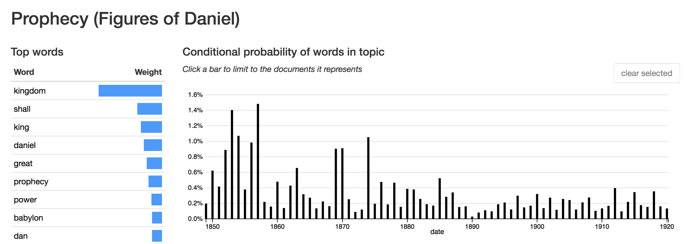
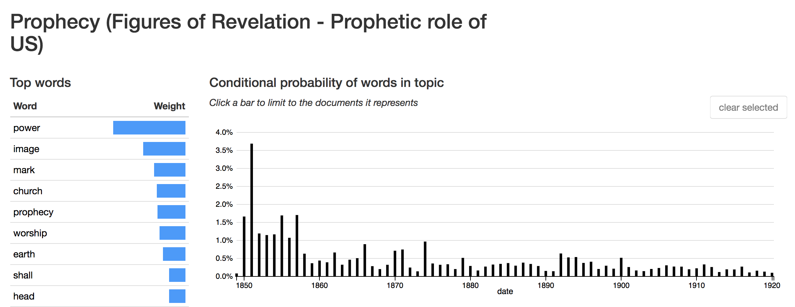
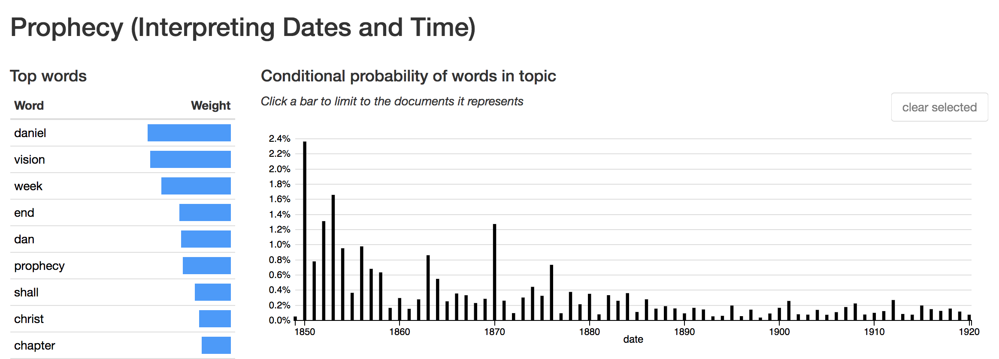
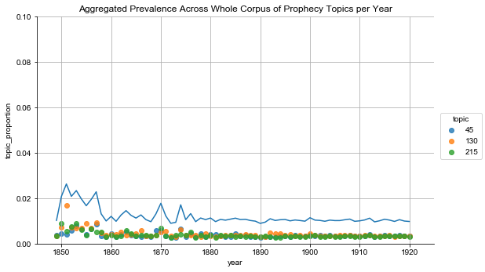
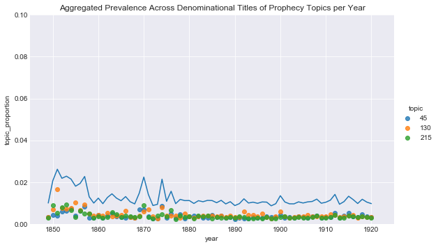

<!-- 
.. date: 2018-03-15
.. title: Anticipating the End of Time
.. slug: chapter-3
 -->

<!-- Research Questions: When does millennial expectation surge within Seventh-day Adventism after the great disappointment, i.e. when is their sense of time foreshortened? How does that expectation change over time and what follows after periods of heightened expectation when hierarchies were reestablished?

--- -->

>"We are living in the closing scenes of this earth's history. Prophecy is fast fulfilling. The hours of probation are fast passing. We have no time -- not a moment -- to loose."
>
>Ellen White. *Testimonies for the Church, Volume 8*, 1904^[@White1904, p. 252.]

Early Seventh-day Adventists were a people between times. Born out of the belief that Daniel and Revelations point to an end of prophetic time in 1844, this group of Protestant Christians understood themselves to be living in the last days, preparing for the rapidly approaching "second advent" of Jesus. Millennial expectation, however, is a difficult state to maintain. Although Seventh-day Adventists determined early on that setting dates was no longer viable, at various period throughout their early history they understood themselves to be at the brink of the second coming. As the second coming continued to be delayed, their interpretations of the events since 1844 shifted, as did the emphasis they placed on different religious practices.

This chapter explores when those periods of heightened expectation were and what denominational members emphasized in their wake through an examination of a 250 topic model of the periodical literature of the denomination. This exploration is built on the hypothesis that heightened expectation can be seen in the periodical literature of the denomination through spikes in the prevalence of language about end times. By charting the prevalence of end-time discourse, we can trace the gradual lengthening of the Seventh-day Adventist sense of time, while also identifying periods of disruption and re-establishment that shaped the development of their particular religious culture. 

## Methodology

In chapter two, which focuses on the more technical concerns of text analysis, I discuss my methods for corpus creation and modeling. Here I outline my interpretive strategy for moving from the statistical model to an argument for overall patterns in the denominational corpus. The full model, which you can engage via the [model browser](http://browser.dissertation.jeriwieringa.com/), parses the language of the denomination into 250 clusters of words that tend to co-occur on the pages of the periodicals. 

The modeling algorithm returns a topic identifier for each word in the documents, an account of the most prevalent words in each topic, and a report of the prevalence of each topic in the documents of the corpus, but is agnostic as to what those topics "mean." Standard practice is to use a topic label to summarize the language that a topic has grouped together, either by assigning it automatically from the most prevalent words in the topic or through manually assigning topic names.^[cite examples] Because the language used by Seventh-day Adventist authors tends to be abstract and formulaic, methods for automatic labeling that work well in the context of scientific articles or Wikipedia proved less than informative. As a result, I relied on a human authored approach for identifying and labeling the topics.

To mitigate the risk of reading too much into individual combinations of words clustered by the modeling algorithm, for each topic I read the ten to fifteen documents with the highest concentration of words assigned to that topic, and used that contextual information, together with the words of the topic, to construct the label. This method of close reading the topic results provided a more nuanced view of the pattern of word use the model had detected and helped me parse instances where similar words in the topic captured very different sets of documents. For example, [topic 6](http://browser.dissertation.jeriwieringa.com/#/topic/7) shares similar language with the "prophecy" topics that I discuss in the next section, such as the high prevalence of "daniel" and "babylon." However, in reading the documents associated with the topic, it was apparent that the words captured by this topic were most often found in pages that contained Old Testament stories, particularly those from the historical and prophetic books such as Daniel in the Lion's Den and the story of Esther. 

In addition, in order to more easily facilitate grouping related topics together, I created a controlled vocabulary of [x] terms. The vocabulary reflects the major topics of the periodical literature, as captured by the topic model, and forms the first part of the topic label. The second part of the label provides a more detailed description of the type of content within that general category. 

The labeling of the topics represents significant interpretive work based on close readings of the texts and the topic words. The labels in turn help readers navigate the model and provide the foundation for the work that follows where I trace the broader picture of the prevalence of particular subjects at different times. By moving back and forth between close readings of the text and the more abstract and distant reading of the model, we can start to understand and explore the overall patterns in the literature and use those patterns to identify areas for closer analysis.

[Note: This is a work in progress. Most of the current topic labels are a tentative "first draft" and are being reviewed according to the process described above.]

## The Language of End Time Expectation

[something - secondary literature to set this up.]

There are three interrelated themes that frequently occur when Seventh-day Adventist authors are concerned with and discuss the second coming. The [first is a more formal explication of the key prophetic texts](link to section) of Daniel and Revelations, where authors unpacked for the readers the meaning of the various figures and numbers in the biblical passages. [more] The [second is in formal descriptions of the second coming](link to section),[ details coming ]. And the [third is the parsing current and historical events](link to section) in terms of their fulfillment of prophecy, or analyzing the "signs of the times." United by the idea that "Prophecy is history in advance,"^[cite] Seventh-day Adventist authors and readers sought to understand where they stood in the temporal landscape, to verify their understanding of 1844 and their particular role in the unfolding of God's plan, and to explain the events of the day in light of the larger trajectory of God's plan.

### Explicating Prophetic Texts

For Seventh-day Adventist authors, the books of Daniel and Revelations offered the keys to understanding historical events and for anticipating those to come. Linking the fantastical creatures of Daniel and John's visions with geo-political powers, the authors sought to prove the reliability of the prophetic texts by showing them to have accurately predicted historical events and to use the texts to anticipate the events to come.

| Topic ID | Topic Words                                    |  Topic Label    |
| ---------| ---------------------------------------------- | --------------- |
|   [45](http://browser.dissertation.jeriwieringa.com/#/topic/46)     | kingdom shall king horn daniel great empire prophecy rome iron verse power babylon dan image beast fourth world given vision | Prophecy (Figures of Daniel) |
|   [130](http://browser.dissertation.jeriwieringa.com/#/topic/131)    | beast power image papacy rev mark church prophecy worship earth rome horn dragon shall head papal great state saint symbol | Prophecy (Figures of Revelation & the Prophetic role of the US) |
|   [215](http://browser.dissertation.jeriwieringa.com/#/topic/216)  | daniel vision week period end dan prophecy sanctuary date shall jerusalem christ chapter event seventy_weeks gabriel decree point angel messiah | Prophecy (Interpreting Dates and Time) |
: Topics Corresponding to the Explication of Prophetic Texts. Model Generated with Mallet, using 250 topics and random seed of 18497.

The creatures of the book of Daniel, captured in topic 45, and the progression of historical empires they represent are used by Seventh-day Adventist authors to demonstrate Daniel as a reliable prophet. Nebuchadnezzar's statue, described in Daniel 2 as being composed of a head of gold, breast and arms of silver, torso and thighs of bronze, legs of iron, and feet of iron and clay, was interpreted by Daniel to represent the progression of empires following the Babylonian empire, each inferior to the next. Daniel's first dream, described in Daniel 7, featured a succession of four beasts -- a lion with eagles wings that stood like a man; a bear with three ribs in its mouth; a leopard with four wings and four heads; and beast with iron teeth and ten horns -- was also interpreted within the text as representing the four great empires of the world. Daniel's second dream, described in Daniel 8, featured a ram overcome by a goat, interpreted as representing the Persian and Greek empires. All of these figures were understood to stand for the progression of empires from Babylon to the Persian, Greek, and Roman, all of which would eventually fall when Christ returned to establish God's kingdom on earth. In describing these visions and their interpretation, the authors established Daniel as a reliable prophetic witness of future events.

In addition to the figures of Daniel, Seventh-day Adventist authors turned to John's visions in Revelations, captured in topic 130, for further insight on the events preceding the second coming. In Revelations 12, Satan is depicted as a red dragon with "seven heads and ten horns" who sought to devour the child of the woman (or Jesus).^[cite Rev. 12] Revelations 13 introduces three additional figures: the beast from the sea, with ten horns and seven heads who speaks blasphemy and attacks the saints, the beast from the earth, with two horns who makes all worship the first beast, and the image of the beast, who requires all to receive the mark of the beast. For Seventh-day Adventist authors, these figures provided insight into the later events of Daniel's visions, which offer few details after the fall and break up of the Roman empire. Focusing on the union of religious and civil power as the key characteristic of those states determined to destroy the true church, Seventh-day Adventist theologians parsed these figures as representing "pagan Rome, papal Rome, and American Rome."^[@Jones1900, p. 185] The United States, as the "only nation on the earth at that time, or in all history since the book of Revelation was written, that did so begin, and that had no union of church and state," was interpreted as the only place where the image of the beast, or the union of church and state, could be subsequently created, an event that would mark the beginning of the end.^[@Jones1900, p. 184]

Finally, Seventh-day Adventist authors used the numbers in the prophetic texts to tie together the figures of Daniel and Revelations into arguments for when the events described through these images had and would occur. Key among these are the "2,300 evenings and mornings" before the restoring of the holy place of Daniel 8 and the "seventy weeks" to make an end of sin of Daniel 9.   

Charts, such as the one above, were used to bring together all of these elements and to make the case for 1843 (and later 1844) as the date revealed in prophecies, first understood as the date of Jesus' return (or second advent) and later as the beginning of Jesus' work in heaven. 

<!-- 
### Describing the Second Coming

[Second Coming Topics]

| Topic ID | Topic Words                                  |       Topic Label |
| ---------| -------------------------------------------- | ----------------- |
|    199, 182, 117, 92

### Interpreting the Signs of the Times

| Topic ID | Topic Words                                  |       Topic Label |
| ---------| -------------------------------------------- | ----------------- |

163, 39, 27, 17, 96, 100, 75, 30

-->

## Tracing Periods of Expectation
<!-- 

*Note: To avoid too many graphs, this will be an aggregation of all three topic areas*

 -->

## After Disappointment: Negotiating Religious Authority As Time Continues
