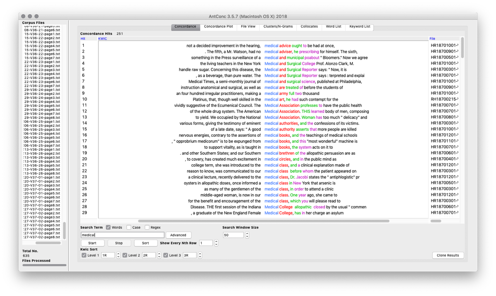
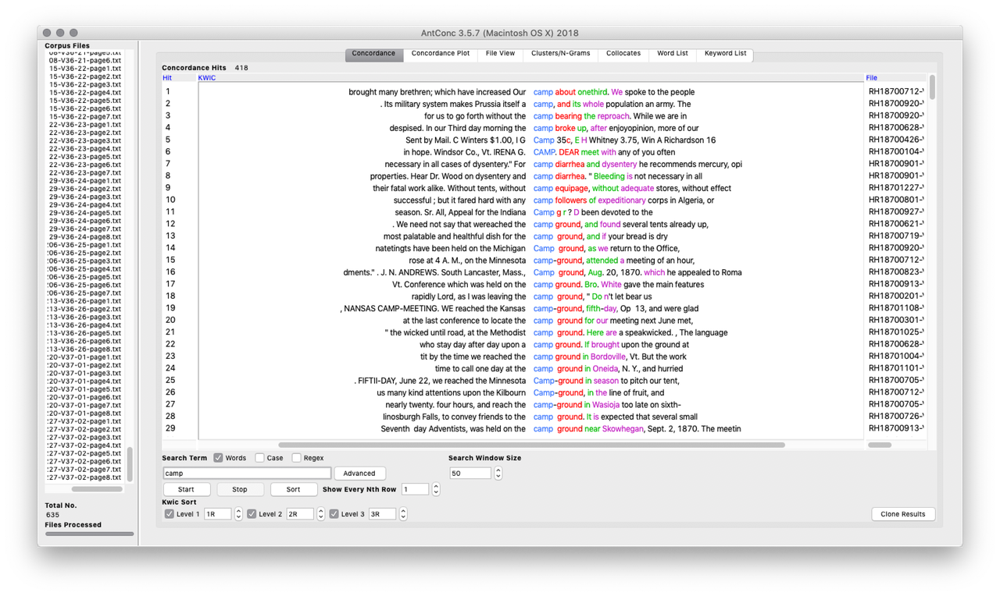
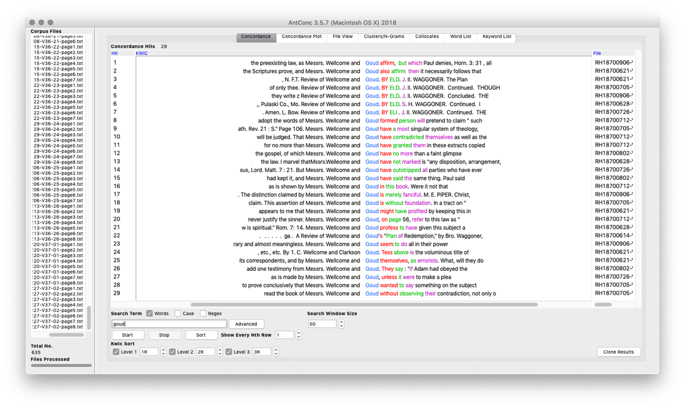
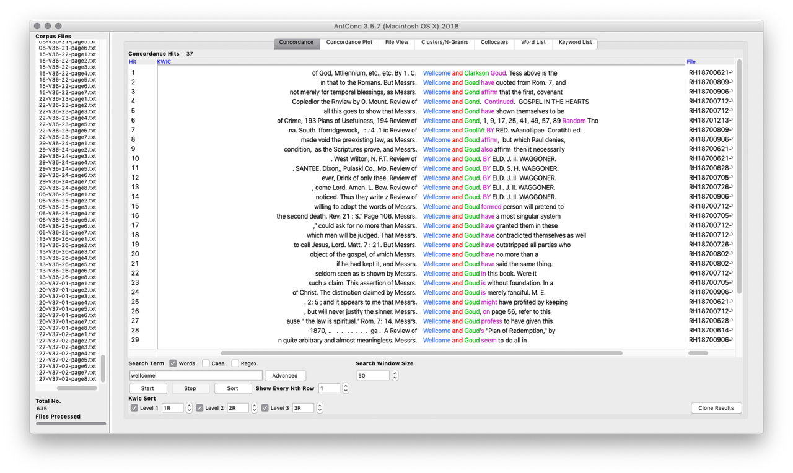
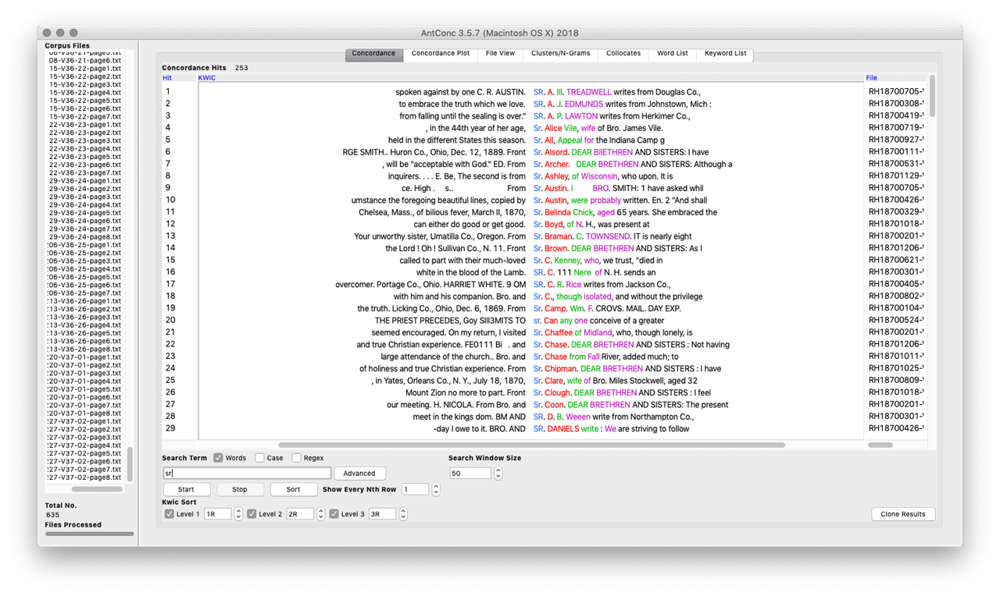
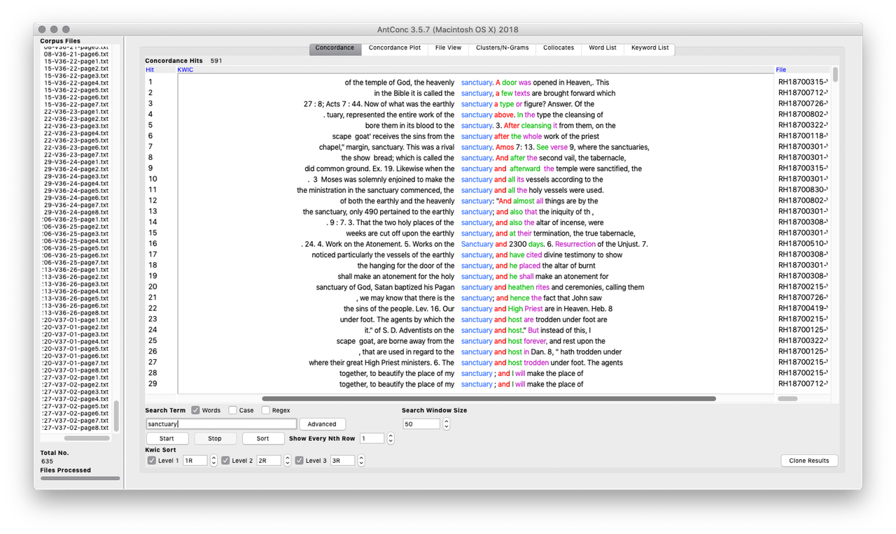
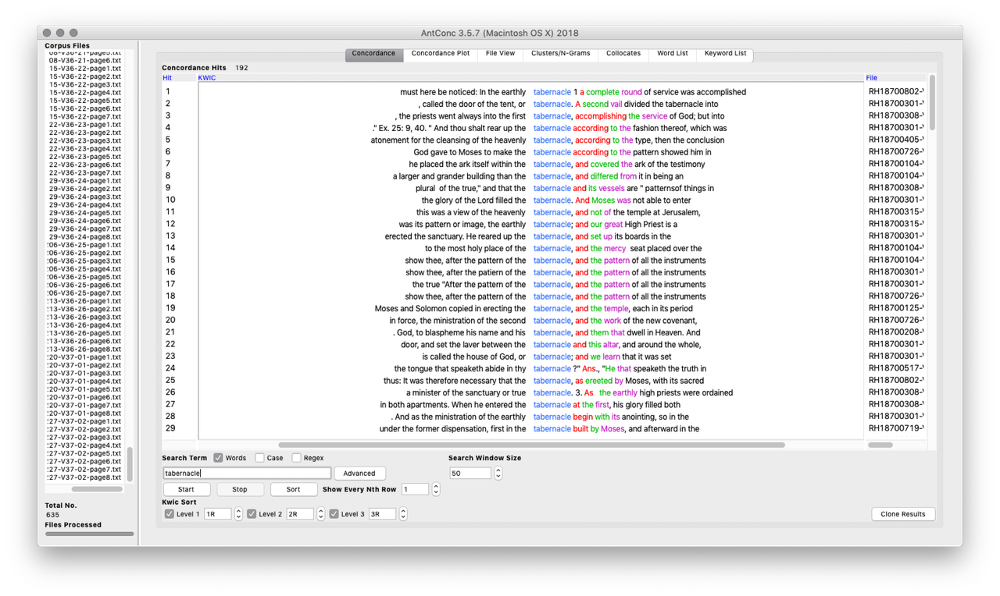
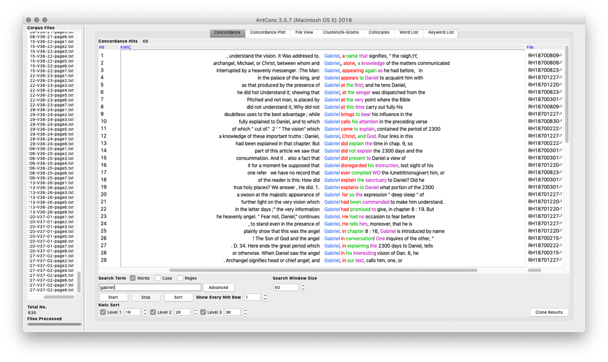
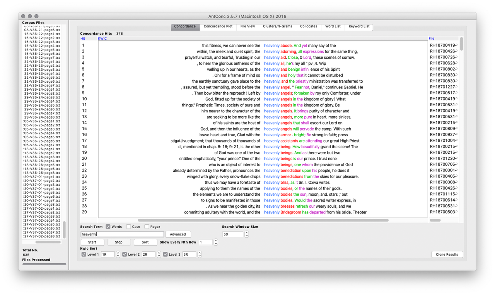
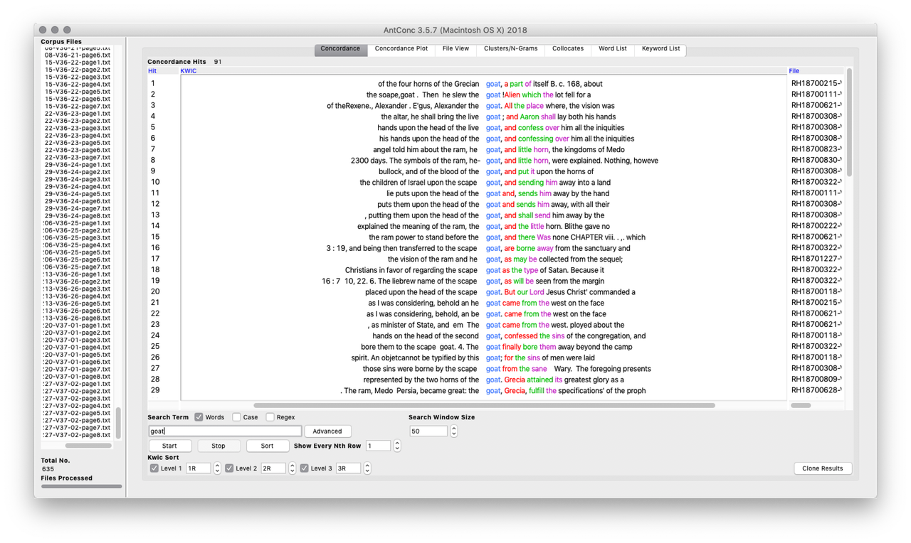

--- 
date: 2018-04-15 00:00:00 UTC
title: Anticipating the End of Time
slug: chapter-3
suppress-bibliography: true
# tag: toggle
---

>"We are living in the closing scenes of this earth's history. Prophecy is fast fulfilling. The hours of probation are fast passing. We have no time -- not a moment -- to lose."   Ellen White. *Testimonies for the Church, Volume 8*, 1904^[@White1904, p. 252.]

Early Seventh-day Adventists were a people between times. Born out of the belief that William Miller had correctly identified 1844 as the year revealed in the books of Daniel and Revelations, this group of Protestant Christians understood themselves to be living in the last days, preparing for the rapidly approaching "second advent" of Jesus. Millennial expectation, however, is a difficult state to maintain. Although Seventh-day Adventists determined early on that predicting new dates for the second coming was no longer viable, at various periods throughout their early history they understood themselves to be at the brink of the second coming. As the second coming continued to be delayed, their interpretations of the events since 1844 shifted, as did the emphasis they placed on different religious beliefs and practices. As a result, their theology and religious culture was shaped by "Jesus' nonappearance rather than his imminent reappearance," with the most productive periods of theological development tending to occur in order to explain the continuation of normal time.^[@Bull2006, p. 67]

The Seventh-day Adventist experience of time shaped the development of their religious culture in ways that reflected the general renegotiation of time that took place during the nineteenth century, but also challenged them. They held what they understood to be biblical organizations of time as the surrounding culture increasingly embraced the authority of mechanical standards for time; they rejected the long time scales required by evolution in favor of the shorter time frame of a literal understanding of the creation story; they interpreted the technological advances and political changes of the time within a framework of decline prior to the second coming, rather than as evidence of human progress. As a result, while the nineteenth century was generally marked by a "masculine" culture that privileged progress, history, and technological control over nature - from which women were largely excluded - the culture of Seventh-day Adventism offered an instructive alternative. While still shaped by religiously-informed patriarchal understandings of authority, their concurrent embrace of "natural" (or "Biblical") organizations of time, as well as of the physical health and salvation of embodied humans as the crux of the Christian message, created space for more "feminine" cultural features, such as an emphasis on community over personal gain and the importance of human development as part of Christian discipline, including parenting as well as care for neighbors.^[See @Bull2006, pp. 259-265.] As a result, while explicit support for women in leadership positions varied over the early years of denomination, on the whole the religious life encouraged by the denomination provided space for and recognition of the contribution of women to the religious and cultural goals of the denomination, particularly while it was guided by the leadership of Ellen G. White.

The development of this unique religious culture was shaped in large part by the shifting sense of urgency regarding the end of times. While formal predictions of the second coming were relatively rare and not encouraged after 1844, events both internal and external to the denomination sparked periods of heightened end-times expectation during the first seventy years of their history. Using the 250 topic model that I generated from the periodical literature of the denomination, I identify and discuss the cycles of expectation that mark the early development of the Seventh-day Adventist denomination. Using topics that capture Seventh-day Adventist language about end times as indicators of high periods of expectation, I argue that the religious group experienced three major cycles of expectation and adjustment between 1849 and 1920. In each cycle, new emphases emerged that shifted the focus of the denomination increasingly outward.

The goal of this chapter is to establish a method for working from text to historical interpretation through a topic model. Although topic modeling has received a high degree of attention within digital humanities scholarship, few projects have moved from the construction of a topic model to a more engaged use with a topic model as part of the historical process. As a result, it has been unclear what value topic models might provide to historical research practices and whether there are benefits to undertaking their construction as part of a historical research project. The latent interest in the second coming expressed in the Seventh-day Adventist periodical literature serves as a useful case-study for exploring methods for working from a topic model to historical interpretation. As this chapter demonstrates, I combined the data from topic modeling with interpretive labels, statistical methods from corpus linguistics, and traditional historical methods to identify, verify, and interpret patterns in language use over time across the corpus of periodical literature. These findings reinforce the value, as well as the limitations, of topic modeling as an approach to historical literature and set the framework for a final exploration of gender and time in the following chapter.

## Methodology

One of the ongoing challenges for digital humanities scholarship that brings together methods from multiple disciplines is articulating how the information derived through methods typically foreign to humanities practice meaningfully contributes to the process of meaning-making. As argued by Tanya Clement, the linking of theory and methods is crucial to the process of situating the intellectual work of interdisciplinary scholarship.^[@Clement2016] As part of bridging that gap, here I outline my interpretive strategy for moving from the topic model, a statistical representation of language patterns, to an argument for overall patterns in the denominational corpus.^[For a discussion of the more technical concerns of corpus creation and topic modeling, see chapter 2.] The full model, which you can engage via the [model browser](http://browser.dissertation.jeriwieringa.com/), parses the language of the denomination into 250 clusters of words that tend to co-occur on the pages of the periodicals. 

Topic modeling, as I discuss in chapter two, is a form of computational analysis that has been used in humanities context for descriptions of a collection of documents and for document discovery, but of which are few clear examples of use in historical analysis. Although tools like MALLET and Gensim make it easy to apply the algorithm to a set of texts, doing so in a way that generates useful and reliable results is more difficult, as is determining how to leverage those results as part of a historical argument. This project sets out to use a topic model of the denomination's periodical literature, following the suggestion of Sharon Block and David Newman's topic model explorations of the Pennsylvania Gazette, to highlight "topic trends over time and at different resolutions" and for gaining insight on "entire publications."^[@Block2006; @Newman2006, p. 766.] With this approach, I am focusing on using the model to gain a broad pictures of the patterns across the texts and to identify those texts that can shed light on different aspects of the developing culture of the denomination. 

The modeling algorithm returns a topic identifier for each content word in the documents, an account of the most prevalent words in each topic, and a report of the prevalence of each topic in the documents of the corpus, but is agnostic as to what those topics "mean." Standard practice is to use a topic label to summarize the language that a topic has grouped together, either by assigning it automatically from the most prevalent words in the topic or through manually assigning topic names.^[cite examples] Because the language used by Seventh-day Adventist authors tends to be abstract and formulaic, methods for automatic labeling proved less than informative. As a result, I relied on a human-authored approach for identifying and labeling the topics.

Labeling the topics represents significant interpretive work based on close readings of the topic words and the texts. To mitigate the risk of reading too much into individual combinations of words clustered by the modeling algorithm, for each topic I read the ten to fifteen documents with the highest concentration of words assigned to that topic, and used that contextual information, together with the words of the topic, to construct the label. This method of close reading the topic results provided a more nuanced view of the pattern of word use the model had detected and helped me parse instances where similar words in the topic captured very different sets of documents. For example, [topic 6](http://browser.dissertation.jeriwieringa.com/#/topic/7) (*king daniel babylon jerusalem lord kingdom nebuchadnezzar city temple men israel solomon nation prophet unto house judah came captivity jew*) shares similar language with the "prophecy" topics that I discuss in the next section, such as the high prevalence of "daniel" and "babylon." However, in reading the documents associated with the topic, it was apparent that the words captured by this topic were most often found in pages that contained Old Testament stories, particularly those from the historical and prophetic books such as Daniel in the Lion's Den and the story of Esther. 

Through the process of labeling the generated topics, I as the reader and interpreter bridged the gap between the model of the denominations literature created using a statistical algorithm and the models of literature created through traditional close-reading techniques. Working with set of text too large for me to read thoroughly and establish the categories of which on my own, I used the model to separate the texts into groups based on language use, used close reading of a select number of documents to understand the themes that the topic model has captured, and then used the model to get a sense of how that theme is present across all of the documents.

In addition, in order to more easily facilitate grouping related topics together, I created a controlled vocabulary of thirty-three terms. The vocabulary works to capture the major topics of the periodical literature, as separated by the topic model and identified through my evaluation. This structure is reflected in the final form of the topic label. For example, in the label for [topic 45](http://browser.dissertation.jeriwieringa.com/#/topic/46) - Prophecy (Figures of Daniel)  - the category term forms the first part of the topic label. The second part of the label provides a more detailed description of the type of content within that general category. I designed this labeling scheme in order to facilitate the research goals of the project. At 250 topics, the topic model of the periodical literature strikes a compromise between being generalized and being detailed. As a result, there is some overlap in topics. This provides the advantage of nuance and increases the opportunity to see shifts in language over time. However, it also makes the model more difficult to read and understand, as the fragmentation of theme over multiple topics makes it difficult to grasp broader trends. By using the labels to group topics together, I am able to add yet another lens through which to view the corpus literature.

The labels enable readers navigate the model and provide the foundation for the work that follows in which I trace the broader picture of the prevalence of particular subjects at different times. By moving back and forth between close readings of the text and the more abstract and distant reading of the model, the reader can begin to understand and explore the overall patterns in the literature and use those patterns to identify areas for closer analysis.

## Identifying Expectation

In order to capture periods when Seventh-day Adventist writers and readers were focused more than usual on the second coming, I identified and traced four interrelated themes that capture the language denominational members used when speaking of the second coming and the end of time.

+ The [first theme highlights more formal explications of the key prophetic texts](#explicating-prophetic-texts) of Daniel and Revelations, where authors unpacked for the readers the meaning of the various figures and numbers in the biblical passages. 
+ The [second contains descriptions of the second coming](#eschatology---describing-the-second-coming), where adventist writers worked to explain the events they anticipated occuring as part of the second coming and to encourage believers to strive for the goal of heaven. 
+ The [third is the parsing current and historical events](#interpreting-the-signs-of-the-times) in terms of their fulfillment of prophecy, or analyzing the "signs of the times." 
+ The [fourth theme captures the SDA's concern with the union of civic and religious authority](#threats-to-the-separation-of-church-and-state). 

United by the idea that "Prophecy is history in advance," in these themes Seventh-day Adventist authors and readers sought to understand where they stood in the temporal landscape, to verify their understanding of 1844 and their particular role in the unfolding of God's plan, and to explain the events of the day in light of the larger trajectory of God's plan.^[@Cook1850, p. 8]

In selecting these topics and organizing them into these four themes, I am offering an interpretation of the particular corpus, and Seventh-day Adventist literature in general, but also attempting to work with the strengths and limitations of the topic modeling algorithm. Topic modeling as a probabilistic algorithm, meaning that depending on where one starts, the algorithm can produce different results when run multiple times on the same corpus.^[link to section in chapter 2 on stability and reproducibility of this model.] As a result, individual words assigned to topic A in one model can be assigned to a very different topic M in another. As I discuss in the methodology, I have attempted to account for this in creating the topic labels by relying not only on the words assigned to the topic but by reading the documents where those words were drawn from. The process of organizing topics into themes provides a second strategy for balancing the probabilistic aspect of topic modeling. By grouping similar topics together, words that may have received multiple (related) topic assignments can be viewed together, making the results both clearer and more reliable.

### Explicating Prophetic Texts

For early Seventh-day Adventist authors, the biblical books of Daniel and Revelation contained the keys for situating themselves and their readers in time. Informed by their roots in Miller's "rationalist" approach to the Bible, whereby he held that all of the Bible has a clear meaning that can be understood by the faithful reader, they approached the Bible as a guidebook with clear if coded information.^[This approach was complicated with the embrace of Ellen White's prophetic gift as the means by which of clarifying ambiguity. See @Bull2006, pp. 26-29.] Building on a Protestant understanding of history as the linear unfolding of a divine plan that stretched from creation to the second coming, the early Seventh-day Adventists sought to identify their current position in that progression, leading up to their final salvation at Jesus' second coming. To do so, they looked particularly to the book of Daniel to explain events of the past and to the book of Revelations to explain current events and anticipate the events to come. In these books, part of the Apocalyptic literature of the Bible, the authors look forward in time and tell of the overthrow of world powers and the eventual establishment of God's kingdom.^[cite oxford dictionary of christian church, 69] Containing visions populated with fantastical symbolic creatures, from a leopard with four wings and four heads to beasts and dragons, the authors used coded language to encourage their audience with hope of the coming fall of oppressive powers and coming days of peace.^[I need to link to something ...Possibly John Collins.] 

Seventh-day Adventist authors derived their understanding of how to interpret these texts and what they represented from William Miller. With a faith grounded in a conversion experience, Miller turned his attention to understanding and articulating the reasonableness of that faith. Working from a set of fourteen rules, which he derived from biblical proof texts, he developed an interpretation of the Bible, and particularly the prophetic texts, that resolved its apparent contradictions and that also revealed the approximate date of the looked-for second coming: 1843.^[Judd provides a list of Miller's fourteen rules of interpretation in @Judd1987, pp. 20-21 These were: "1. Every word must have its proper bearing on the subject presented in the Bible. 2. All scripture is necessary, and may be understood by a diligent application and study. 3. Nothing revealed in the scripture can or will be hid from those who ask in faith, not wavering. 4. To understand doctrine, bring all the scripture together on the subject you wish to know; then let every word have its proper influence, and if you can form your theory without contradiction, you cannot be in error. 5. Scripture must be its own expositor, since it is a rule of itself. ... 6. God has revealed things to come, by visions, in figures and parables, and in this way the same things are oftentimes revealed again and again, by different visions, or in different figures, and parables. If you wish to understand them, you must combine them all in one. 7. Visions are always mentioned as such. 8. Figures always have a figurative meaning, and are used much in prophecy, to represent future things, times and events; such as *mountains*, meaning *governments*; *beasts*, meaning *kingdoms*; *waters*, meaning *people*; *lamp*, meaning *Word of God*; *day*, meaning *year*. 9. Parables are used as comparisons to illustrate subjects, and must be explained in the same ways as figures by the subject and Bible. 10. Figures sometimes have two or more significations, as day is used in a figurative senses to represent three different periods of time ... if you put on the right construction it will harmonize with the Bible and make good sense, otherwise it will not. 11. How to know when a word is used figuratively. If it makes good sense as it stands, and does no violence to the simple laws of nature, then it must be understood literally, if not, figuratively. 12. To learn the true meaning of figures, trace your figurative word through your Bible, and where you find it explained, put it on your finger, and if it makes good sense you need look no further, if not, look again. 13. To know whether we have the true historical event for the fulfillment of a prophecy. If you find every word of prophecy (after the figures are understood) is literally fulfilled, then you may now that your history is the true event. But if one word lacks fulfillment, then you must look for another event, or wait its future development ... 14. The most important rule of all is, that you must have *faith*. It must be a faith that requires a sacrifice, and, if tried would give up the dearest object on earth, the world and all its desires, character, living, occupation, friends, home, comforts, and worldly honors."] 

](/images/A_Chronological_Chart_of_the_Visions_of_Daniel_and_John.png)

<figcaption>**Figure 3.2:** Charles Fitch, *Chart of the Visions of Daniel and John.* Poster. Boston: 1843. From the [Adventist Digital Library](https://adventistdigitallibrary.org/adl-421834/chronological-chart-visions-daniel-and-john)</figcaption>

Charts, such as the one to the left, were used by Millerite preachers to explain to audiences how to interpret the prophecies in Daniel and Revelations. Part of the publishing and outreach efforts of Joshua V. Himes, the charts provided a visual representation of Miller's complicated, but methodical, interpretive work. In the upper left corner, the images from Daniel are depicted and aligned to show their correlation, with the head of the statue of Daniel, chapter 2, aligned with the lion of Daniel, chapter 7, the silver chest and arms of chapter 2 with the bear of chapter 7 and the ram of chapter 8 and so forth. Across the middle, the chart bridges between the books and Daniel and Revelations through the depictions of "Pagan Rome" - the iron legs of the statue in Daniel 2, the beast of Daniel 7, and the dragon of Revelations 12. The bottom half of the chart correlates the events of history since Jesus' death with the extended images of Revelations. All of these different elements are tied together through the dates and computations that associate the years of different historical events with the periods of time recorded in the prophetic texts.

Early Seventh-day Adventists reconciled the continuation of time after 1844 with Miller's interpretations by arguing that Miller had been basically correct, but that they had misunderstood the significance of October 22, 1844. While most Millerites either concluded that the dates had been miscalculated or that Miller's whole enterprise had been misguided, a small group embraced an interpretation put forward by Hiram Edson that the "cleansing of the sanctuary" referred not to the earth as Miller had thought but marked "a new phase of Christ's ministry in heaven that placed the earth under judgment."^[@Butler1974, p. 178.] How long this new phase would last was unknown, but believers could point to the fulfilled prophecies to know that they were indeed living in the last days.

As a result, the interpretation of Daniel and Revelations found in Millerite charts continued to play a central role to Seventh-day Adventist efforts to situate themselves temporally. Captured across three topics of the topic model, Seventh-day Adventist authors used the figures and dates of Daniel and Revelations throughout their writings to argue for their unique sense of time, to explain current events, and to anticipate events to come.

|Topic ID|  Topic Label          |   Topic Words                              |
| -------| --------------------- | ------------------------------------------ |
|   [45](http://browser.dissertation.jeriwieringa.com/#/topic/46)     | Prophecy (Figures of Daniel) |kingdom shall king horn daniel great empire prophecy rome iron verse power babylon dan image beast fourth world given vision | 
|   [130](http://browser.dissertation.jeriwieringa.com/#/topic/131) | Prophecy (Figures of Revelation) |  beast power image papacy rev mark church prophecy worship earth rome horn dragon shall head papal great state saint symbol | 
|   [215](http://browser.dissertation.jeriwieringa.com/#/topic/216)  | Prophecy (Interpreting Dates and Time) | daniel vision week period end dan prophecy sanctuary date shall jerusalem christ chapter event seventy_weeks gabriel decree point angel messiah | 
: **Table 3.1** Topics Corresponding to the Explication of Prophetic Texts. Model Generated with Mallet, using 250 topics and random seed of 18497.

<iframe class="large" src="/interact/Prophecy-Topics-Full-Corpus.html"></iframe>

<figcaption>**Figure 3.3**: Proportion of Words per Year in Full Corpus Associated with Prophecy Topics. [View full-size visualization](/interact/Prophecy-Topics-Full-Corpus.html)</figcaption>

<iframe class="large" src="/interact/Prophecy-Topics-Denominational-Titles.html"></iframe>

<figcaption>**Figure 3.4**: Proportion of Words per Year in Denominational Titles Associated with Prophecy Topics. [View full-size visualization](/interact/Prophecy-Topics-Denominational-Titles.html)</figcaption>

As indicated in the above charts, while descriptions of prophetic texts and the work of situating readers within the Seventh-day Adventist temporal imaginary has a continual presence within the periodical literature of the denomination, its prevalence relative to other concerns decreased over time. This is the case even when looking only at the central denominational titles, excluding the topical and regional titles that proliferated after the 1880s. This is not to say that SDA authors became less interested in or came to question the uses of these texts over time and the temporal imaginary they were used to construct. Full explications of the texts and republication of material from the 1850s can be seen well into the 20th century.^[For example, see @Dart1918.] The decline is better understood as reflecting the embrace of the SDA system for explicating the texts of Daniel and Revelations and the development of a standard interpretation of these texts. While later authors reminded their readers of the standard interpretations, they were building on existing beliefs, rather than striving to convince their readers of a new sense of time, and so required less discursive space to communicate their message.
 
### Eschatology - Describing the Second Coming

With their roots in the belief that 1844 marked the beginning of the final events before the second coming, eschatology, or the theological study of "last things," has a significant presence in SDA literature and in their temporal orientation. From Ellen White's seminal work, *The Great Controversy,* to some of their most distinctive theological contributions, including the Sanctuary Doctrine, Conditional Immortality, and the Sabbath Doctrine (discussed in [Chapter One](link://slug/chapter-1)), understanding and describing the world to come and the events leading up to it was the focus of much of the intellectual energy of the early Seventh-day Adventists. While most Christian groups anticipate Jesus' return in some form, for Seventh-day Adventists that return is central to their distinctive understanding of Scripture and their self-understanding as God's chosen people.

The topics I identified as relating to eschatology, or the study of end-times, fit into two general categories. The first set of topics, including [#170](http://browser.dissertation.jeriwieringa.com/#/topic/171), [#182](http://browser.dissertation.jeriwieringa.com/#/topic/183), and [#199](http://browser.dissertation.jeriwieringa.com/#/topic/200) offer descriptions of heaven and the experience of the second coming, using biblical passages and poetry to remind believers of the goal of the Adventist Christian life and warnings about anticipated hardships leading up to the second coming. The second set, which includes [#51](http://browser.dissertation.jeriwieringa.com/#/topic/52), [#117](http://browser.dissertation.jeriwieringa.com/#/topic/118), and [#145](http://browser.dissertation.jeriwieringa.com/#/topic/146), outlines some of the unique theological positions the denomination took with regard to the requirements for salvation. These topics remind readers of what to expect in the days leading up to the second coming. They also provide justifications as to why events did not unfold as previously expected, using the concept of progressive revelation to emphasize that God reveals his plan gradually and through imperfect messengers.

|Topic ID|  Topic Label          |   Topic Words                              |
| -------| --------------------- | ------------------------------------------ |
| [51](http://browser.dissertation.jeriwieringa.com/#/topic/52) |   Eschatology (Spreading the Third Angel's Message) |  message world gospel truth angel earth great lord nation movement coming light advent end adventist power seventh church generation sabbath |
| [117](http://browser.dissertation.jeriwieringa.com/#/topic/118)    | Eschatology (Parable of Bridegroom and Tarrying Time) | prophecy coming christ lord shall second advent sign event know word fulfilled end near thing fulfillment prophet generation unto world | 
| [145](http://browser.dissertation.jeriwieringa.com/#/topic/146)  |  Eschatology (Sanctuary Doctrine) |  sanctuary priest holy sin place christ offering blood service atonement sacrifice tabernacle temple heavenly heaven heb ark high_priest lord priesthood | 
| [170](http://browser.dissertation.jeriwieringa.com/#/topic/171)  |  Eschatology (Events of the Last Days) | angel judgment rev earth heaven seal message seven plague book wrath revelation great saw thousand babylon given mark men voice | 
| [182](http://browser.dissertation.jeriwieringa.com/#/topic/183)    | Eschatology (Description of Second Coming) | christ shall kingdom coming lord heaven second earth unto father throne jesus son saint glory king world man reign matt    | 
| [199](http://browser.dissertation.jeriwieringa.com/#/topic/200) |   Eschatology (Second Coming) |  shall lord jesus joy glory earth heaven let coming king praise heart saviour song soon love blessed glorious voice hope |
: **Table 3.2** Topics Corresponding to Descriptions of the Second Coming. Model Generated with Mallet, using 250 topics and random seed of 18497.

<iframe class="large" src="/interact/Eschatology-Topics-Full-Corpus.html"></iframe>

<figcaption>**Figure 3.5**: Proportion of Words per Year in Entire Corpus Associated with Eschatology Topics. [View full-size visualization](/interact/Eschatology-Topics-Full-Corpus.html)</figcaption>

<iframe class="large" src="/interact/Eschatology-Topics-Denominational-Titles.html"></iframe>

<figcaption>**Figure 3.6**: Proportion of Words per Year in Denominational Titles Associated with Eschatology Topics. [View full-size visualization](/interact/Eschatology-Topics-Denominational-Titles.html)</figcaption>

While the trajectory of these topics shows a slow decline over time of their prominence, this again does not mean that these topics disappear from the denominational literature. During the first few decades of the denomination, these topics were key to establishing what would become standard Seventh-day Adventist understandings of the soul, the work of salvation, and the role of Adventists in the final events before the second coming. As these concepts became more engrained in Adventist theology and became basic to their cultural imaginary, fewer words would have been needed to invoke these ideas for readers. 

### Interpreting the Signs of the Times

As a people eagerly awaiting the second coming and who believed that they could orient themselves in divine time by matching current events with events described in the Bible, denominational members closely watched news and world events. From cataloging catastrophic events and examples of government oversteps in regulating religious behavior to extended analyses of world events in light of prophecy, nearly every world event potentially signaled some new phase in the events leading up to the second coming. While commentators often warned readers against setting dates and reminded them that their knowledge was incomplete, the regularity of the topics reminded readers that they were indeed living in the last days. As such, readers were called on to make themselves ready and to share the Adventist message with the world.

The signs frequently mentioned by Adventist commentators range from concerns over sin and social ills to commentary on world events in light of prophecy. Spiritualism, then a prominent competitor in the religious space, and sin "as in the days of Noah" were of particular concern in the early years of the denomination (topics #26, #86). In later years, as the attention of the denomination shifted outwards, concerns about war and social unrest (topics #27, #39, #141, #163) were the primary markers of the current point in divine time. At the turn of the century, the growing influence of Progressive reformers and those advocating for Sunday observance laws loomed particularly large in the Adventist imaginary, as signs that the anticipated collusion between the United States and the Catholic Church to enforce Sunday worship and persecute Adventists was at hand (topics #158, #242). Among the more curious "signs" are those recorded in topic #100, which captures frequent retellings of the darkening of the sun on May 19, 1780 and accounts of stars falling on November 13, 1833, some of the more supernatural-seeming events portending the second coming. Throughout the period, authors warned readers to anticipate unrest and persecution in the time leading up to the Jesus' return (topic #179). World events were not just curiosities, but vital clues in tracing the unfolding of God's plan.

|Topic ID|  Topic Label          |   Topic Words                              |
| -------| --------------------- | ------------------------------------------ |
| [27](http://browser.dissertation.jeriwieringa.com/#/topic/28) | Signs of the Times ("Eastern Question") | russia turkey power russian europe war turkish turk constantinople england government france germany empire great austria sultan armenian european czar |
| [39](http://browser.dissertation.jeriwieringa.com/#/topic/40) | Signs of the Times (Social Unrest) | world great nation men condition new history social war america problem country movement present question force century political society hope |
| [86](http://browser.dissertation.jeriwieringa.com/#/topic/87) | Signs of the Times (Growing Iniquity as in Days of Noah) |   shall world noah men flood lord lot coming ark man earth lover sodom son sin away destruction tim word godliness |
| [100](http://browser.dissertation.jeriwieringa.com/#/topic/101) | Signs of the Times (Astronomy) | sun star earth moon light heaven hour darkness night planet sign world east line seen west great place sky phenomenon |
| [141](http://browser.dissertation.jeriwieringa.com/#/topic/142) | Signs of the Times (Crime and Immorality) | crime men evil moral society murder vice man criminal life law slave public woman slavery country world city bad worse |
| [158](http://browser.dissertation.jeriwieringa.com/#/topic/159) | Signs of the Times ("Catholic Threat") | catholic church pope rome protestant roman priest catholic_church papacy bishop cardinal papal power protestantism country authority state vatican america holy |
| [163](http://browser.dissertation.jeriwieringa.com/#/topic/164) | Signs of the Times (War)  |  war peace nation world men great shall earth europe battle let sword armageddon army prophecy preparation spirit strife conflict international |
| [179](http://browser.dissertation.jeriwieringa.com/#/topic/180) | Signs of the Times (Global Unrest) | shall world coming sign earth thing end nation lord great prophecy men event word trouble know near christ war destruction|
| [242](http://browser.dissertation.jeriwieringa.com/#/topic/243) | Signs of the Times (Enforcement of Sunday Laws) | sunday law case court judge state adventist seventh fine trial arrested county police city tennessee sabbath arrest persecution fined jail |
: **Table 3.3** Topics Corresponding to Interpreting the Signs of the Times. Model Generated with Mallet, using 250 topics and random seed of 18497.

<iframe class="large" src="/interact/Signs-of-the-Times-Topics-Full-Corpus.html"></iframe>

<figcaption>**Figure 3.7**: Proportion of Words per Year in Entire Corpus Associated with Signs of the Times Topics. [View full-size visualization](/interact/Signs-of-the-Times-Topics-Full-Corpus.html)</figcaption>

<iframe class="large" src="/interact/Signs-of-the-Times-Topics-Denominational-Titles.html"></iframe>

<figcaption>**Figure 3.8**: Proportion of Words per Year in Denominational Titles Associated with Signs of the Times Topics. [View full-size visualization](/interact/Signs-of-the-Times-Topics-Denominational-Titles.html)</figcaption>

Taken together, denominational concern with parsing events as signals on the road to the second coming remained generally consistent over the first seventy years of the denomination's development. While authors called attention to different types of signs at different points in time, the assumption remained that believers could and should interpret world events to identify their current position in divine time. 

### Threats to the Separation of Church and State

One particular topic of concern, and one that developed as Seventh-day Adventist began focusing more on the role of United States in the events leading up to the second coming, was the threat of the legal establishment of religion. This was a particular concern for early Seventh-day Adventists, as they had identified the first amendment and the prohibition against the establishment of religion as key aspects of the uniqueness of the United States, and the establishment of religion as the first step in the unfolding of the persecution of Adventists prior to the second coming. As resistance to the legislation of religion was understood to be one of the marks of true believers, believers tracked efforts to promote the passing of religion laws, and politically organized members to resist those efforts. 

|Topic ID|  Topic Label          |   Topic Words                              |
| -------| --------------------- | ------------------------------------------ |
| [42](http://browser.dissertation.jeriwieringa.com/#/topic/43)  |  Church & State (Opposition to Religious Legislation)  |  sunday state congress law petition liberty religious religious_liberty committee legislation senator district senate measure house united legislature representative amendment washington |
| [137](http://browser.dissertation.jeriwieringa.com/#/topic/138) | Church & State (Religious Amendments and National Reform Association) |  state christian national government church religion nation reform constitution law christianity principle union united religious power political country shall christ |
| [153](http://browser.dissertation.jeriwieringa.com/#/topic/154) | Church & State (Arguments against Sabbath Laws) | sunday law sabbath rest state religious observance right legislation civil week man church men labor religion seventh christian observe question |
| [166](http://browser.dissertation.jeriwieringa.com/#/topic/167) | Church & State (Sabbath Laws) |  sunday fair sabbath church world closing christian congress union rev chicago exposition law said association city american convention national open |
| [210](http://browser.dissertation.jeriwieringa.com/#/topic/211) | Church & State (Religion Legislation and the Courts)  |  law shall state court act decision person case constitution judge supreme_court united section statute labor provision public said sunday justice |
| [221](http://browser.dissertation.jeriwieringa.com/#/topic/222) | Church & State (Religion in Public Education) |  church state catholic religion protestant school religious public_school public roman government christian denomination country american baptist united mormon methodist presbyterian |
: **Table 3.4** Topics Corresponding to Concerns Regarding Union of Church and State. Model Generated with Mallet, using 250 topics and random seed of 18497.

<iframe class="large" src="/interact/Church-and-State-Topics-Full-Corpus.html"></iframe>

<figcaption>**Figure 3.9**: Proportion of Words per Year in Entire Corpus Associated with Church and State Topics. [View full-size visualization](/interact/Church-and-State-Topics-Full-Corpus.html)</figcaption>

<iframe class="large" src="/interact/Church-and-State-Topics-Denominational-Titles.html"></iframe>

<figcaption>**Figure 3.10**: Proportion of Words per Year in Denominational Titles Associated with Church and State Topics. [View full-size visualization](/interact/Church-and-State-Topics-Denominational-Titles.html)</figcaption>

During this period of study, the most prominent movements to legislate behavior and religious practice occurred during the closing decades of the nineteenth century. Often in connection with temperance movements, Protestant religious leaders promoted what they claimed to be laws promoting general morality and social norms regarding Sunday observance. While at times these laws were drafted granting exceptions for those who designated other days for religious worship, Seventh-day Adventist leaders and others decried them as attacks on freedom of religion and the principle of religious liberty. Any attempt to exercise state power in issues of religion marked the beginning of the end, both of the nation and of time, for Adventist commentators. 

So important was this issue to the Adventist readership that it received a series dedicated periodical titles - *Liberty*, and the *Sentinel of Liberty*. In looking at the overall prevalence of the topic, these individual titles exaggerate the prevalence of the topic particularly in the years surrounding 1890. However, even when looking just at these topics in the central denominational titles, an increase in attention is visible, first around 1890 and again around 1905, in concerns about church and state.

## Tracing Periods of Expectation

As is apparent from the charts of the individual topic categories above, different aspects of the Seventh-day Adventist end-times rhetoric were prominent at different points throughout the first seventy years of the denomination. For early writers, discussions of prophecy and descriptions of the events of the second coming dominated the discourse, as writers and readers wrestled with what would become the basic tenets of the faith - the meaning of old testament prophesies, the significance of the 1844 date, the centrality of Sabbath keeping, and the ongoing prophetic role of Ellen White. As time continued and these aspects of the faith stabilized, authors increasingly drew attention to other indicators of the temporal position of the denomination. Commentary on current and historical events reinforced the Seventh-day Adventist sense of time during periods when the formal theology was more stable, giving evidence that they were indeed right about their interpretation of history and their particular role in the story of salvation. 

Aggregating topic frequencies across all four of these topic areas, we can begin to see some overall patterns in the end times expectation expressed in the denominational literature. The results (below) reinforce the existence of a cyclical pattern of end-times expectation, together with a general decline in intensity over the period of study. Where as the early denominational literature focused heavily on questions of prophecy and the development of theology around end times, around 1886 the emphasis shifts to tracking signs of the times, and particularly to the question of church and state. While these direct discussions of the end of time constitute only a small percentage of the total word use of the denomination's periodicals, even in the early years, they shaped the underlying framework around time that guided denominational discussions of all other topics, including missions work, health, education, and church life.

(To see the individual topics for each year, use the individual category charts above.)

<iframe class="large" src="/interact/All-End-Times-Categories-Full-Corpus.html"></iframe>

<figcaption>**Figure 3.11**: Proportion of Words per Year in Entire Corpus Associated with All End Times Topics [View full-size visualization](/interact/All-End-Times-Categories-Full-Corpus.html)</figcaption>

<iframe class="large" src="/interact/All-End-Times-Categories-Denominational-Titles.html"></iframe>

<figcaption>**Figure 3.12**: Proportion of Words per Year in Denominational Titles Associated with All End Times Topics. [View full-size visualization](/interact/All-End-Times-Categories-Denominational-Titles.html)</figcaption>

Examining the prevalence of all of these topics across the first seventy years of the denomination, two general features emerge. First, over time the prevalence of these topics decreases, as denominational members settle into the realization that the work of redemption was going to require much more time than had been anticipated by early church leaders in 1850. The reflects on the one hand a "naturalizing" of the discourses of end times, as the understanding of end times events and the role of the Seventh-day Adventist people in preparing for Jesus' second coming entered into the realm of the "known" or the imaginary of the denomination. On the other hand, the decline also reflects a lengthening of the temporal imaginary, as the work facing denomination members - to reach the world with the third angel's message - was a large undertaking that would require both time and significant effort on the part of members. [As time continued, church leaders also began to embrace a more conditional understanding of the second coming, where Christ had not yet returned because "his people were not ready" and "because Adventists had not preached the gospel -- and by this they meant the three anges' messages -- as they had been commissioned to do." See @Bull2006, p. 67.]

While the overall trajectory is one of modest decline, charting the prevalence of end-times topics also suggests three general periods of end-times expectation and readjustment over the first 70 years of the denomination's history. The first, and the clearest, wave of expectation stretches from the start of the Seventh-day Adventist publishing endeavors in 1849 and reaches until approximately 1860. From 1860 to 1885, the discussions of end times remain relatively low, with the exception of two large spikes in "Eschatology" and "Signs of the Times" topics in 1869-1871 and 1874. After 1885, concerns regarding the passage of Sabbath (Saturday observance) laws become a major concern when looking across all denominational titles, particularly due to the creation of new titles devoted particularly to the topic. In looking at the major denominational titles, this topic is balanced by a spike in concerns regarding the "Signs of the Times," indicating two main spikes, one around 1890 and one after 1905.   

This pattern fits with, while also expands, the secondary literature on the development of the denomination. In *Seeking a Sanctuary*, authors Bull and Lockhart note that the Seventh-day Adventist community has historically tended to be relatively quiet about end-times during periods of disruption, such as war, while instead active in periods prior or following.^[@Bull2006, pp. 61-64.] This pattern matches that captured by the topic model, as periods of heightened discourse occur in the years following the Civil War, and the years leading up to the First World War. Although initially curious, the pattern makes sense given the particular attention to the union of church and state power as the key marker of the start of the final days, and members' self-understanding as the faithful remnant who would be persecuted at the end. Periods of war and conflict, while distressing and a sign of things to come, were not conducive to the type of global unification and establishment of religion that would mark the final confrontation. Additionally, the work to be accomplished by Seventh-day Adventists in bringing the gospel to the world was limited during periods of unrest, such as war. 

Similarly, the pattern matches the occurance of more formal predictions of the second coming that were espoused in the years after 1844. Adventist theologian Jon Paulien has identified over twenty attempts to predict the date of the second coming over the history of Seventh-day Adventism, from 1844 to the 1990s. Among these were repeated predictions between 1844 and 1851, a series of predictions between 1884 and 1894, and again in the leadup to the events of World War I. While he notes that Ellen White repeatedly discouraged the setting of dates after 1844, for a significant percentage of believers, these periods of local or global unrest and biblical interpretation seemed to line up in such a way to suggest that the time was at hand.^[@Paulien1994, 20-22] Overall, the corroboration between the secondary literature and the model suggests that the model is indeed capturing and coherently classifying the linguistic features of the denominations periodical literature and that the topics I isolated are productively showing those trends.

However, the spikes in end-times discourse in the 1870s raise important questions regarding the reliability of the model, as these cannot be linked to the formal end date predictions identified by Paulien. Here the topic model alone is not sufficient for exploring further the writing of the denomination, and its cultural significance. Instead, I have chosen to explore these periods using a more detailed word-level analysis of the documents that contribute to the captured spike in end-times expectation, coupled with close reading of the periodicals and the denominations conference minutes. Methodologically, this approach relies on the information within the topic model to identify the periodical pages of interest while coupling that with forms of close reading and interpretation more common in historical practice to make an interpretive claim about the sense of time captured in the aggregated topic model. This additional interpretive work has few examples in the standard digital humanities literature, as the work to prepare, create, label, and visualize a topic model of a corpus is both expansive and sufficient for publication in digital humanities outlets while the use of topic models for interpretation is often gestured toward, but rarely undertaken in its own right.^[For example, in her discussion of topic modeling, Sharon Block points to questions raised by the model, but that "the ability to quickly categorize the thematic appearance of various words can open new directions for investigation." @Block2006. In his 2011 *New York Times* opinion piece, Rob Nelson provides one example of using a topic model for interpretation, but his focus is on the overall patterns highlighted by the model, rather than a more fine-grained interpretation of the documents. @Nelson2011] Similarly, there is not yet a robust set of practices for the conduct of historical analysis based on preexisting topic models, and few historical projects currently start from such computational models.

As a legal and religious institution, the Seventh-day Adventist church kept rercords of their formal meetings, documenting the business of the church, the election of officers, and the passing of official resolutions that reflected and guided the positions of the denomination. These documents, which I included as part of the topic modeling corpus, provide a useful source for identifying the major concerns of the denomination in particular years. They date back to 1863, the year of the denomination's incorporation and provide a window onto the slow expansion of their concerns, both internal and in relation to external groups and movements. 

As noted by Bull and Lockhart, energy directed toward the second coming tended to occur among Seventh-day Adventists not during periods of general national crisis, but in the periods before and after. The Civil War was one such example. For many members, while they viewed slavery as the original sin of the United States, they took a conscientious objector stance against being drafted in the military, willing only to take non-combatant roles.^[This pattern repeats around the First World War, as members of the SDA who did enlist did so primarily as medical staff, with implication for the development of their health practices.] As the war came to a close, denominational leaders celebrated by the end of hostilities and noted that this marked the "opening the way for the progress of the message, we solemnly consecrate ourselves anew to this great work to which God has called us," with particular mention that the South "is now opened ... for labor among the colored people and should be entered upon according to our ability."^[@GC2007, pp. 13-14] For the early SDA church, while they applauded the Northern victory in the Civil War, the war itself marked an interruption in the progress of the cause, making it difficult to bring their message to those who needed to hear. 

This increase in outreach or evangelistic activity provides the context for the spikes in end-times topics seen in the early 1870s. Additionally, world events of the period earned special mention as part evidence that the time to complete that missionary work was short. In 1871, the General Conference sessions included calls for increased engagement with the work of spreading the message, with particular concern that all engage in missionary activity, particularly "the young," "not simply as ministers and lecturers, but as helpers in the various departments of the cause, in organizing Sabbath-schools, visiting from house to house, circulating books, etc., where our lecturers have first opened the way."^[@GC2007, p. 54] While public lectures were frequently the initial point for reaching new converts, the work of community development and conversion was seen as the responsibility for all members of the denomination. 

With such calls for increased engagement, denominational leaders also paid increased attention, particularly in 1871, to world events as indications of the need for focus and rapid action in spreading their message. In sessions held in February and December of 1871, the resolutions committee officially noted "the present condition of the Pope of Rome and the Sultan of Turkey, unmistakable evidence that we have reached the very conclusion of the great lines of prophecy, and that our confidence in the speedy advent of our Lord is unwavering" and "the events of the past year are peculiarly impressive; among which we enumerate the prostration of the papal civil power; the condition of the kingdoms of Europe, especially the humbling of those which have been supporters of the papacy; the present relation which Russia and Turkey sustain to each other; the work of spiritualism; the preparation for the formation of the image of Revelation 13:14, 15, in the Sunday movement; the terrible storms by sea and by land; the alarming increase of earthquakes; the fearful tidal waves; the wonderful "flame of devouring fire;" the likeness of our days, in point of crime, to those of Noah and of Lot; and finally the more extensive proclamation of the three predicted messages of warning of Revelation 14. And we express our deep conviction that all these things indicate the speedy approach of the final day ..."^[@GC2007, p. 54; 60] While not setting a date, the leadership of the denomination reinforced a clear belief that these were auspicious days, pointing to various signs and indications of the end of time to remind themselves of where they stood in time and the need for action to show themselves as faithful to their calling in such last days.

Examining the content from the periodical literature of 1870 reinforces the suggetion that the events of the last days were prevalent in the minds of community members during this period. To do this, I used two additional strategies for looking at the content of the periodical literature. With all 250 topics labeled and categorized, it is possible to aggregate the topic prevalence per category for each year, and in so doing to create a picture of the top general areas of concern in each. Looking across the whole corpus, we can see both continuities and clear shifts in the subject matter of the periodical literature of the denomination. 

<iframe class="xlarge" src="/interact/Yearly_Aggreg_Categories_1849_to_1920.html"></iframe>

<figcaption>**Figure 3.13**: Proportion of Words per Year in Entire Corpus Associated with the Top Five Topic Categories for the Year. [View full-size visualization](/interact/Yearly_Aggreg_Categories_1849_to_1920.html)</figcaption>

As evidenced in the chart above, throughout this period of study questions of theology and spiritual development were a consistent feature of the periodical literature of the SDA. These topics together contributed approximately 10% to 25% of the content produced in a given year. That these were the core concerns of denominational writers makes intuitive sense. In looking to establish and grow a community of faith, denominational leaders and members needed to devote time to articulating "correct" beliefs as well as to encouraging the development of behaviors and practices that would reinforce those beliefs and deepen the sense of community. Along with this core concern were issues tied both to the current events and the development of the denomination. Particular interest in eschatology and the sabbath featured strongly in the first years of denominational publishing, as these particular theological topics defined the SDA's reason for being and their message to the world. Additionally, correspondence from readers and concerns with apologetics provided a way for members to share their own religious journeys with one another and offered examples of how to respond to critics who might seek to undermine those beliefs. The later years of the denomination show a greater variety of topical concentration, with health, missions, and organizational concerns, appearing at different points. Here too we can see responses to external threats, particularly concern with the separation of church and state, or "religious freedom."

Looking closely at 1870 in particular, the graph shows a resurgence of tokens assigned to eschatology-related topics. While much of the content published that year was concerned with general theology, health, spiritual growth, and the status of the cause, eschatology related topics, defined earlier as topics 51, 117, 145, 170, 182, and 199, reappear in the top 5 categories, making up 6.6% of the tokens from that year. This graph provides another view onto the spike in end-times related topics seen in the earlier charts.

<iframe class="xlarge" src="/interact/Yearly_Aggreg_Categories_1867_to_1872.html"></iframe>

<figcaption>**Figure 3.13**: Proportion of Words per Year in Entire Corpus Associated with the Top Five Topic Categories for the Year 1870. [View full-size visualization](/interact/Yearly_Aggreg_Categories_1867_to_1872.html)</figcaption>

This approach still relies on the topic model to explore the patterns of language use in the corpus. To gain another perspective on the corpus, I also used utilized an approach from the world of corpus linguistics to identify words within the pages published in 1870 that were particularly significant for that year, as compared to a reference corpus: keyness. Keyness provides a measure for "saliency" of a word in a corpus by comparing the frequency is some test corpus with a reference corpus and computing the probability that the word was included in the test corpus due to random chance. Using different statistical tests and cutoff points, the user can create a workable list of keywords for the corpus.^[For an introduction to "keyness" and the different options users have for computing keyness scores, see @Baker2006, pp. 125-128. For a more general introduction to corpus linguistics using AntConc, see @Froehlich2015.] For the purposes of exploring the Seventh-day Adventist writings, I used the software AntConc to calculate the keywords for the documents from 1870, using the documents from  the five years prior and after as the test corpus.^[@Anthony2018. For documentation, see the [data files]. Within AntConc, I used the default values for p (p<0.05 (+Bonferroni)) and the default algorith, (log-likelihood) to compute the keywords for the corpus.] The top ten results from this calculation are recorded in Table 3.5 below.

| Rank | Frequency        | Keyness       | Effect        | Keyword        |
| -----| ---------------- | ------------- | ------------- | -------------- |
| 1    |	591	            | +	690.49	    | 0.0011	    | sanctuary                       |
| 2    |	192	            | +	412.52	    | 0.0004	    | tabernacle                      |
| 3     |	253	            | +	201.43	    | 0.0005	    | sr                              |
|4      |	91	            | +	176.16	    | 0.0002	    | goat                            |
|5      |	251	            | +	161.01	    | 0.0005	    | medical                         |
| 6     |	29	            | +	149.03  	| 0.0001	    | goud                            |
| 7     |	37	            | +	145.62	    | 0.0001	    | wellcome                        |
| 8     |	68	            | +	132	        | 0.0001	    | gabriel                         |
| 9     |	418	            | +	128.17	    | 0.0008	    | camp                            |
| 10    |	378	            | +	96.06	    | 0.0007	    | heavenly                        |
: **Table 3.5** Top Ten Keywords from 1870 Periodicals, Compared to Periodicals from 1865-1869 and 1871-1875. Generated with AntConc.

<figcaption>**Figure 3.14:** "Medical" Key Word in Context in 1870 Corpus. Generated with AntConc. </figcaption>

<figcaption>**Figure 3.15:** "Camp" Key Word in Context in 1870 Corpus. Generated with AntConc. </figcaption>

<figcaption>**Figure 3.16:** "Goud" Key Word in Context in 1870 Corpus. Generated with AntConc. </figcaption>

<figcaption>**Figure 3.17:** "Wellcome" Key Word in Context in 1870 Corpus. Generated with AntConc. </figcaption>

<figcaption>**Figure 3.18:** "Sr" Key Word in Context in 1870 Corpus. Generated with AntConc. </figcaption>

<figcaption>**Figure 3.19:** "Sanctuary" Key Word in Context in 1870 Corpus. Generated with AntConc. </figcaption>

<figcaption>**Figure 3.20:** "Tabernacle" Key Word in Context in 1870 Corpus. Generated with AntConc. </figcaption>

<figcaption>**Figure 3.21:** "Gabriel" Key Word in Context in 1870 Corpus. Generated with AntConc. </figcaption>

<figcaption>**Figure 3.22:** "Heavenly" Key Word in Context in 1870 Corpus. Generated with AntConc. </figcaption>

<figcaption>**Figure 3.23:** "Goat" Key Word in Context in 1870 Corpus. Generated with AntConc. </figcaption>

With the initial exception of "goat," these key words correspond well with the top topical categories for the year idenified in the topic model. Examining these words in context, using the Concordance view within AntConc, we can identify the subject matter that these words were most likely part of. "Medical" ties to ongoing conversations about health within the denomination, and particularly issues of education and standards for practice. "Camp" is tied to reports on the activities of church members, reports on their labors and their success in the field. "Goud" and "Wellcome" feature frequently together as authors of a book, *Plan of Redemption*, reviewed in serial by J.H. Waggoner, while "Sr," as an abbreviation for Sister, offers an intriguing suggetion that women were particularly present in the periodical literature of the year.^[(RH18700614-V35-26.pdf, p. 8)] Finally, "sanctuary, tabernacle, gabriel," and "heavenly" are all connected to discussion around theology, and particularly discussions of Jesus's ongoing work prior to the second coming. "Goat" also fits within this last topic of interest, as the authors worked to interpret the figures from the book of Daniel and correlate them with current events and political entities. These topics correlate to those identifed in the topic model, which associated a third of the words in the 1870 documents with "health," "reports on the cause," "theology," or "eschatology" topics. 

The methods of corpus linguistics, demonstrated here, provide another way to identifying patterns across a large scale of documents by comparing word use within one set of documents to that of another, reference, set. Looking within the narrow window of the decade surrounding 1870, this approach suggests that what stood out in that year, what was particularly salient to readers, was discussions of heaven, Jesus's work there, and the approaching second coming. While not a formal prediction, a general increase in conversation about the second coming suggests that these issues were pressing during this period on the minds of church leaders and members.

A survey of the documents where these words are particularly prevalent suggests why these words stand out in the periodical literature. During 1870, the *Review and Herald* published three major series of essays that focused on the distinctive elements of the Seventh-day Adventist faith, the book of Daniel, and the anticipated events of the second coming.^[The titles for there were "Our Faith and Hope; Or, Reasons Why We Believe as We Do", "Thoughts on the Book of Daniel", and "Order of Events in the Judgment."] In these series, the authors including James White, revisited key themes of the Seventh-day Adventism to remind readers of the two distinctive elements of their faith, that "As Adventists we are looking for the personal appearing and reign of Jesus Christ. And in seeking for that readiness necessary to meet our soon-coming Lord with joy, we have been led to the observance of the seventh day of the week as the hallowed rest-day of the Creator."^[@White1869, p. 162] In so doing, the authors returned to many of the main theological points of the denomination, including their understanding of the prophecies of Daniel, the current work of Jesus within the heavenly sanctuary, and their anticipated role in the judgment of the wicked at the second coming. While started the year prior, these titles were a regular and significant feature of the periodical in 1870.^[The first installment of "Our Faith and Hope" was published in the *Review and Herald* for November 16, 1869, "The Order of Events in the Judgement" for November 9, 1869, and "Thoughts on the Book of Daniel," first published from January 5, 1869 to June 15, 1869 and then resumed June 21, 1870. See @White1869, @Andrews1869, @Smith1869, and @Smith1870.]

Paired with the the growing emphasis on evangelistic activity on the part of denominational members, these serials suggest a reintroduction of the core elements of the Seventh-day Adventist faith and a reaffirming of the time in which they understood themselves to inhabit at a point of increasing missionary activity. While the second coming might still be seen as a far off event, anticipation thereof was a reinforced as a central component of the Seventh-day Adventist faith, along with "time" as a significant part of God's revelation to his people.^[something with piece on time RH18700215-V35-08,09.pdf, pp. 1-3.] While the primary focus of these particular articles is on the existence and signficance of the heavenly sanctuary, they serve to ground the faith back to Miller's interpretations of Daniel and their belief that the "2300 days" of Daniel ended in 1844 and in Christ ongoing ministry on behalf of the saved in heaven.

To further reinforce the reliability of the topic model, I similarly explored the second in spike end-times topics in 1874 by looking at the context within the bureaucratic documents of the denomination, the overall distribution of topics in the year, and the particularly salient words in that year's publication in comparison to the surrounding decade. While there were clear indications from the conference proceedings that end-times expectation was heightened in the years around 1870, the meetings in the years following reveal a more subtle continuation of the linking of end-times expectation and an emphasis on outreach through the publication and dissemination of SDA materials. The success of such missionary efforts of the denomination, first in California and Switzerland, and quickly throughout Europe, led to the establishment of the "Tract and Missionary Society," first in 1874 and revived in 1876, to coordinate efforts in disseminating the published materials of the denomination.^[@GC2007, p. 81; p. 107-8.] These efforts were framed in the General Conference discussions of 1875 in terms of the second coming, particularly in terms of fulfillment of prophecy. 

> WHEREAS,  The fulfillment of the message of Revelation 14:9, which is to go to nations, tongues, and peoples, and is to be fulfilled but once, is the highest evidence of the nearness of the end; therefore, 
>
> RESOLVED,  That the wonderful facts which have recently come to our knowledge relative to the springing up of the principles of this message in different parts of the world, almost without the aid of the living preacher, reveal to us, as nothing else could, the hand of God in this work, and call upon us for corresponding action.^[@GC2007, p. 87-88.]

This framework of prophetic time and the need for increased missionary activity led to the start of efforts in 1875 to launch a publishing office in Europe "to issue periodicals and publications in the French and German languages, and also to enter the openings presenting themselves in Great Britain, France, Germany, Holland, Italy, Hungary, Africa, and Australia."^[@GC2007, p. 88.] SDA leaders at the beginning of the 1870s focused on external factors as indicators of the closing of time and as evidence for the need for increased attention to outreach and sharing of the Adventist message. That theme continued through the 1870s, as the denomination focused on increasing their infrastructure for publishing and dissemination. The success of these endeavors were indicators that the believers were indeed on the right track, both in terms of their understanding of their place in time and their role in its unfolding.

<iframe class="xlarge" src="/interact/Yearly_Aggreg_Categories_1873_to_1878.html"></iframe>

<figcaption>**Figure 3.13**: Proportion of Words per Year in Entire Corpus Associated with the Top Five Topic Categories for the Year 1874. [View full-size visualization](/interact/Yearly_Aggreg_Categories_1873_to_1878.html)</figcaption>

The topical landscape of 1874 (shown above) suggests that in addition to this attention to the success of the cause, matters of theology and eschatology were also prevalent in the year's periodical literature. Together, "theology" and "eschatology" topics accounted for nearly 20% of the words published, as assigned by the topic model. Because, however, we are using the aggregated label, it is not clear yet what the content of these theological writings was.

To explore this further, I again used AntConc to compare the language from 1874 to that of the surrounding decade, from 1869 to 1879. As indicated by the keywords for the year, where the documents from 1870 were notable for the stress on the "santuary" and the process of redemption, concern about the coming kingdom and the interpretation of prophecy stood out in those from 1874. (See Table 3.6 below).^[We can also see evidence of the persistence of OCR errors in the corpus in the tokens "ve," "vhen," and "vhat" - tokens that are indeed distinctive but that show an uncommonly high rate of "w" misidentification rather than substantive content.]

| Rank  | Frequency | Keyness       | Effect    | Keyword   |
| ----- | ----------| ------------- | --------- | --------- |
| 1     |	1226    |   +   547.74  |	0.0014  |	kingdom |
| 2	    |   76638   |	+   459.51  |	0.0605	|   of      |
| 3	    |   363	    |   +	388.89  |   0.0004	|   ve      |
| 4     |	3721	|   +	351.4   |	0.0042  |   christ  |
| 5     |	80      |	+	259.73  |	0.0001  |	vhen    |
| 6     |	132945  |	+	251.81  |	0.0843  |	the     |
| 7     |	545     |	+	237.87  |	0.0006  |	beast   |
| 8     |	26150	|   +	236.48  |	0.0259  |	is      |
| 9     |	4558    |   +	226.77  |	0.0051  |	shall   |
| 10    |	59      |	+	216.87  |	0.0001  |	vhat    |
| 11    |	65      |	+	214.39  |	0.0001  |	pd      |
| 12    |	616     |	+	192.68  |	0.0007  |	satan   |
| 13    |	230     |	+	187.12  |	0.0003  |	kingdoms|
: **Table 3.6** Top 13 Keywords for 1874 Corpus, Compared to Documents from Surrounding Decade. Generated with AntConc.

Surveying the documents where these words occur most frequently, additional patterns emerge. Again, a number of serial titles dominate the discourse, including a series by James White on "Grace and Glory" parsing the "Kingdom of Grace" as the earthly plan and work of salvation and the "Kingdom of Glory" as the anticipated Kingdom established with the second coming; "The Judgement: Or, the Waymarks of Daniel to the Holy City" by James White that linked the prophecies of Daniel with events in the historical record; and a series by J.H. Waggoner on "The Kingdom of God" that sets out to "prove that *a kingdom* is yet future, and further, we quote the Scriptures to prove that it will be set up soon, or is near to come."^[@Waggoner1874] While history and prophecy were the primary focus of these writings, others tackled more immediate evidence that time was drawing to completion. Keywords such as "beast" concentrated in anti-Catholic articles, linking figures in the Book of Revelation to Rome and the Roman Catholic Church, an association tied to the Seventh-day Adventist self-understanding as those heeding the message of Scripture and resisting evil by keeping the Saturday Sabbath. In addition to anti-Catholic sentiment, the authors were increasingly vocal about their interpretation of "the two-horned beast" of Revelation 13 as refering to the government of the United States, reflecting increasing efforts during this time to pass Sabbath-keeping legislation.^[@Smith1874] Finally keywords such as "Satan" appear as Ellen White began to publish a series on "Redemption," which lays out both the Biblical narratives and western history in terms of the ongoing struggle between Satan and Christ, a theme that she developed in her *Conflict of the Ages* series, which were one of her most enduring contributions to the denominational literature. 

While the articles produced in 1874 do not suggest that Seventh-day Adventist writers anticipated the second coming in that particular year, the written rhetoric of the denomination suggests that the second coming was very much on the minds of authors and readers. Where in 1870 authors focused on the "sanctuary" as a means of explaining the current time and Jesus' work prior to the second coming, the emphasis in 1874 had shifted toward a concern with a history, with reiterating the understanding of time and history through the lens of prophecy fulfilled. In both cases, the key elements of the publications reinforced the Seventh-day Adventist self-understanding as a people inhabiting and seeking to be faithful through the final days of human history. This suggests that, although as Paulien has documented, there were no formal predictions of the second coming during the 1870s, the expansion of the denomination and its missionary efforts after the Civil War and the growing concern regarding Sabbath reform lead to the second coming and the fulfillment of prophecy being at the forefront of the minds of readers and denominational leaders.  

Identifying keywords using AntConc provides another lens onto the words of the texts and provides evidence that collaborates the topic model's suggestion that the language produced during 1870 and 1874 was strongly marked by concern with end times and the second coming. But what if that that correspondence is merely a matter of chance or not unique to those year? An examination of keywords during a period of reported low interest in end-times topics provides one additional mechanism to evaluate the reliability of the model for guiding our exploration of cycles of expectation during the development of the denomination. To do so, we can look ahead to 1880, a year within a relatively quiet period of end-times expectation according to the topic model.^[I choose this year because it was toward the middle of a number of years identified as having a low prevalence of aggregated end-times topic assignments between 1877 and 1885.] According to the aggregated topic model, shown below, the major topic categories for the year were "reports on the cause," "theology," "spiritual growth," "advertisements," and "bible" (or biblical citations). Of these, "advertisements" is the most notable introduction, with "bible" references a close second, having reappeared from an earlier spike in 1878, but still relatively new to the major discourses of the periodical literature.

<iframe class="xlarge" src="/interact/Yearly_Aggreg_Categories_1879_to_1884.html"></iframe>

<figcaption>**Figure 3.14**: Proportion of Words per Year in Entire Corpus Associated with the Top Five Topic Categories for the Year 1880. [View full-size visualization](/interact/Yearly_Aggreg_Categories_11879_to_1884.html)</figcaption>

Here again the results of comparing the words used in 1880 to the surrounding decade in AntConc seem to confirm the pattern from the topic model.

| Rank  | Frequency     | Keyness   | Effect    | Keyword       |
| ------| --------------| ----------| ----------| ------------- |
| 1     |	3125        | +2617.99  |	0.0018  |	pp          |
| 2     |	2039        | +1262.22  |	0.0012  |	elder       |
| 3	    |   658	        | +624.16   |	0.0004  |	ets         |
| 4     |	924         | +608.16   |	0.0005  |	eta         |
| 5     |	163         | +571.67   |	0.0001  |	reviewer    |
| 6     |	1033        | +345.08   |	0.0006  |	moses       |
| 7     |	180         | +325.59   |	0.0001  |	judson      |
| 8     |	697         | +246.03   |	0.0004  |	journal     |
| 9     |	1108        | +240.23   |	0.0006  |	copies      |   
| 10    |	53          | +231.87   |	0       |	winkleman   |
: **Table 3.7** Top 10 Keywords for 1880 Corpus, Compared to Documents from the Surrounding Decade. Generated with AntConc.

The first four results from the keyword calculation come primarily from listings of periodical literature for sale, with "pp" the abbreviation for "pages," and "ets" or "eta" are OCR errors for "cts" or the price of the listed material.^[RH18800122-V55-04.pdf, p. 15] While "Elder" appears in a number of contexts throughout the literature, the most frequent collocate is "by," appearing in attribution lines for denominational literature. Similarly, "journal" and "copies" frequently appear within the context of publication lists and sales records. The appearance of "Moses" among the keywords of the 1880 corpus, connected to quotes from the Old Testament and retellings of the life of Moses and his role in the establishment of the law, matches the theme captured in the topic model under "Bible." Together, the significant appearance of "Advertisement" and "Bible" related words within the literature of the year further reinforces that the topics identified through the aggregated topic model correspond with those identified through keyword measures.^[Link to data files from antconc?] 

By combining the aggregated topic model with the statistical methods from corpus linguistics and traditional historical methods, we can begin to uncover patterns within large text corpora. These  patterns can help us to frame questions, identify periods of change and continuity, and guide further research into the substance of the historical record. Using the topic model, we can divide the early literature of the denomination, and the development of the religious culture, into three general periods: an early period focused on belief and community; a middle period focused on practices and outreach; and a final period focused on world missions, organization, and the state. In each period the second coming was expected, but the emphasis shifted to reflect the current understanding of the requirements of salvation and the role of Seventh-day Adventists in the unfolding of the divine plan.
 <!--add later: shifts with implications for gender, should that pan out in chapter 4.-->

The advantage of a computational approach to the periodical literature of the denomination is that it enables us see deeper patterns within and across a large corpus of text. Formal predictions of the second coming, such as those identified by Paulien, provide clear evidence of interest in end times, but they are often linked to the harder to trace swells in end-times sentiment that, from time to time, take hold within religious communities such as Seventh-day Adventism. By tracing patterns in language use over time, we can begin to see and explore those underlying trends that gave rise to the formal predictions and other forms of official action and in so doing shaped the development of the religious culture.

## Conclusion

By bringing together a large corpus of Seventh-day Adventist periodical literature, topic modeling, and techniques from corpus linguistics, it becomes possible to identify and explore underlying trends in the language use of the denomination. That early Seventh-day Adventists were shaped by their relationship to time and their expectation of the second coming is known, both to early denominational leaders and commentators of the present. Additionally, it is known from the study of revivals that the heightened emotion that comes with end-times expectation is generally short-lived. Even when belief in the second coming is a structural component of the faith, that belief is more or less salient at different points, shaped by the perception of how soon the end is likely to arrive. Formal predictions offer one window onto such periods of saliency, but are problematic in the case of Seventh-day Adventism as denominational leaders, such as Ellen White, declared early on that with the close of the 2300 days of Daniel on October 22, 1844, the setting of dates was not the "test" that set apart true believers.^[@White1850, p. 87] While all anticipated the second Advent, the formal focus of the denomination was not on determining the when of that event (other than soon), but on the beliefs and practices that set them apart and shaped their particular message and their role in the unfolding of divine history.

This chapter explored whether there were underlying surges in end-times expectation that can be seen in the periodical literature of the denomination through topic modeling. Using the topic model, I identified four major categories of topics that reflected discussions about the second coming and the events leading up to it and aggregated these topics by year. The results suggest that the second coming, while always present in the minds and writing of Seventh-day Adventists, gradually receded into the background of the periodical literature as time continued and the publishing activities of the denomination expanded. The overall pattern of decline was coupled with periodic increases in end-times concern, tied to shifts in the understanding of the denomination's role in the unfolding of the final days and world events. 

To verify this pattern, I used two strategies: comparison to the existing secondary literature and other primary sources, as well as corroboration of the pattern through other computational strategies. The pattern generally matches what has been described in the secondary literature, both historical surveys of the denomination and works of historical theology, with a few exceptions. To examine these exceptions, particularly the spikes in 1870 and 1874, I turned to the meeting notes of the General Conference for additional context, noting a rising interest in the outreach mission of the denomination and attention to prophetically significant world events in the years surrounding. Additionally, drawing on the technique of keyword measures from corpus linguistics enabled me to identify statistically significant words for those years in comparison to their surrounding decade. These words, and the contexts in which they appeared in the journal articles, reinforced the claim that Seventh-day Adventist authors were focused on the second coming to a significant degree in those years. 

These methods provide a reasonable, interpretative case for the usefulness of the model and the patterns it highlights. They also highlight the constraints of topic modeling with regards to the types of questions the method is best suited to address. Topic modeling provides a useful interface for gaining an overall picture of a large collection of texts and for selecting out from that collection texts on particular topics for further study. For identifying the significance of those patterns, however, additional tools are needed, whether interpretive, computational, or some combination thereof. Topic models are useful for managing large collections of texts and for suggesting patterns that might yield further research questions. Their creation and labeling is a scholarly, interpretive act, one that like edited volumes, shapes the future scholarship that relies on it. A product of historical research and an aid to further research itself, computational remediations of texts, such as a topic model, inhabit an important though currently under-valued space within the world of historical scholarship and the digital humanities.