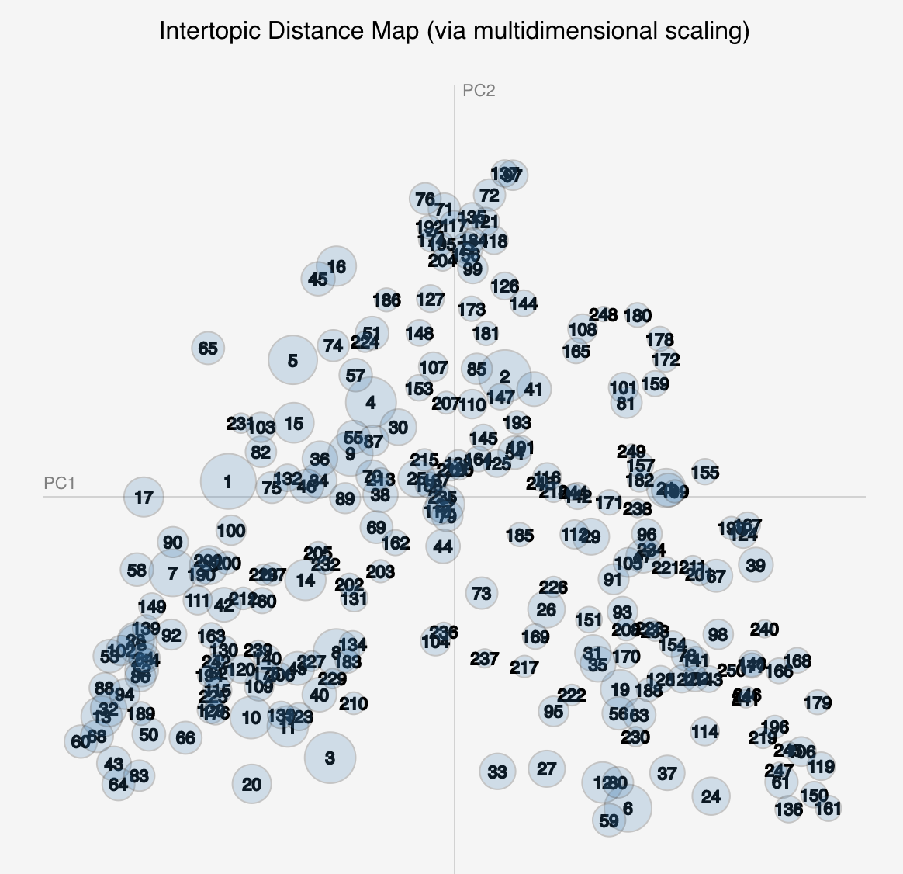

<!-- 
.. title: A Gospel of Health and Salvation
.. slug: home
.. date: 2017-08-07
.. description: 
.. type: text
-->

## Modeling the Religious Culture of Seventh-day Adventism, 1843 - 1920

A Dissertation  Submitted to the  Graduate Faculty  of  George Mason University  in Partial Fulfillment of  the Requirements for the Degree  of  Doctor of Philosophy  History 

Completed Summer 2019

By Jeri E. Wieringa

## Abstract

## Structure of the Dissertation

The dissertation is designed so that readers can focus on areas of interest, while interlinking between the pages connects the different components of the project. The opening navigation outlines the two tracks through the dissertation. Additionally, the top navigation provides access to each of the different components of the dissertation. 
 
+ The [model browser](link://slug/browser-about) provides access to the topic model at the center of this project.
+ The essays, along with the [introduction](link://slug/introduction) and [conclusion](link://slug/conclusions), contain the main written components of the project.
+ The [notebooks](link://slug/notebooks-overview) provide access to the code and data used in my analysis.
+ The [about](link://slug/about) pages includes the project bibliography and process statement.

The project site and component elements are archived in the [George Mason University Libraries' Archival Repository](), as well as in the [WayBack Machine](). Additionally, the source code for the components is available on [Github]().

## Track 1: Ellen White and Gender in Seventh-day Adventism

.](/images/Group-posing-at-the-Eagle-Lake-Campmeeting.jpg)

For readers interested primarily in my engagement with Ellen White and the gender history of Seventh-day Adventism, these essays explore the relationship between Seventh-day Adventism's beliefs about time and the culture of the movement. I argue that end-times expectation made possible the ongoing leadership of Ellen White and shaped the gender dynamics of the denomination.

- [Project Introduction](link://slug/introduction)
- [Chapter 1. The Emergence of Seventh-day Adventism](link://slug/chapter-1)
- [Chapter 3. Anticipating the End of Time](link://slug/chapter-3)
- [Chapter 4. The Gendered Work of Salvation at the End of Time](link://slug/chapter-4)
- [Conclusion](link://slug/conclusion)

## Track 2: Computational Methods in History

For readers interested in my methodological argument regarding the use of computational methods in history, these essays explore the possibilities and limitations of applying computational text analysis to historical inquiry. I argue for the careful consideration of the match between method and data, for the publication of methods as part of the scholarly output of such work, and for a more thorough study of the limitations that historical content place of the effectiveness of current processing algorithms.

- [Project Introduction](link://slug/introduction)
- [Chapter 2. Constructing Computational Models from Historical Texts](link://slug/chapter-2)
- [Chapter 3. Anticipating the End of Time](link://slug/chapter-3)
- [Conclusion](link://slug/conclusion)
- [Topic Model Browser](link://slug/browser-about)
- [Code Notebooks](link://slug/notebooks-overview) 
- [Process Statement](link://slug/about)
<!-- - [Python Library]() -->
<!-- - [Code Documentation]() -->

<!-- Born out of the religious and cultural upheavals of the early and mid-nineteenth century, the culture of Seventh-day Adventism stood in productive tension with that of the major Protestant denominations of the time. A prolific community, the early SDA community used print as a primary mechanism to bring together like-minded individuals and to develop distinctive religious beliefs and culture. 

Their extensive print record, a large portion of which has been digitized and made available by the denomination, provides a unique opportunity to explore the historical development of the religious movement as well as to interrogate the use of computational tools in historical analysis.  -->

<!-- In this dissertation I use text mining and historical analysis to explore the relationship between beliefs about the end of time and the development of the religious culture of Seventh-day Adventism. I argue that there were three cycles of rising and falling end-times expectation during the first seventy years of the denominations history. *These periods of increasing and decreasing expectation of shaped the development of Seventh-day Adventism's religious culture in ways that can be seen particularly in gender norms around the process and work of salvation.*

Using computational techniques to identify and explore this pattern of cultural development also raises questions of how to bridge the methods and epistemologies of history and data science. I argue that the relationship between these two approaches to knowledge is not straightforward. Combining computational methods and historical analysis requires attention to such details as corpus composition, data quality, code reproducibility, and methodology. 

Computational work in the humanities occupies the intersection of multiple methods of exploration and meaning-making, including statistical analysis, historical narrative, visual rhetoric, and computer programming. One consequence of that intersection is that for such works to be understood and evaluated, the various forms of meaning-making and their interrelations must be documented and published as part of the scholarly product. In this project, I do that work through the form and content of the project, which argues for and models bringing together digital sources, computational methods, and historical analysis, or code, documentation, and narrative, to explore the religious culture of Seventh-day Adventism in the nineteenth-century United States. -->

