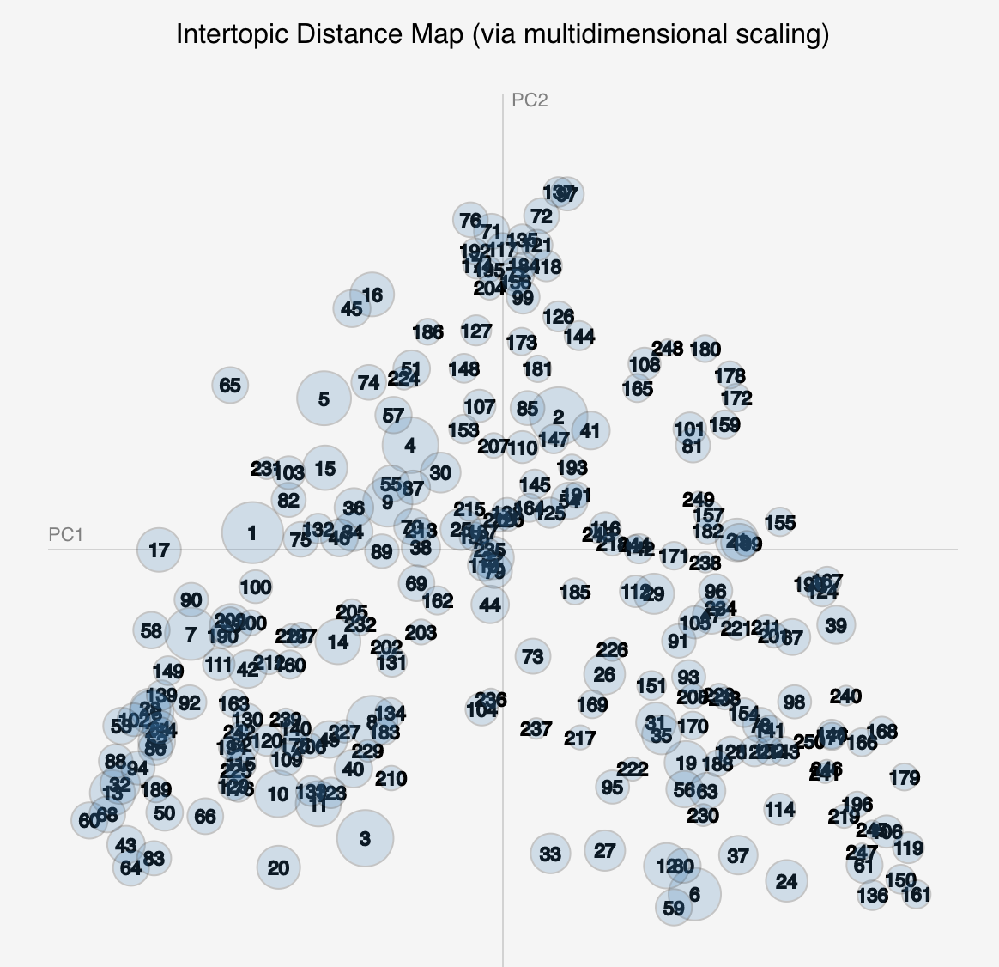

<!-- 
.. title: A Gospel of Health and Salvation
.. slug: index
.. date: 2017-08-07
.. description: 
.. type: text
.. suppress-bibliography: true

-->

## Modeling the Religious Culture of Seventh-day Adventism, 1843 - 1920

A Dissertation  Submitted to the  Graduate Faculty  of  George Mason University  in Partial Fulfillment of  the Requirements for the Degree  of  Doctor of Philosophy  History 

Completed Summer 2019

By Jeri E. Wieringa

## Abstract

*A Gospel of Health and Salvation* is a work of digital history &mdash; defined as the critical application of computational technologies to the study of the past &mdash; focused on the relationship between time and gender in Seventh-day Adventism. In it, I explore the puzzle of the denomination's prophet and religious leader, Ellen White, and her varied and seemingly contradictory writings on the role of women in the denomination. One of few women religious leaders in nineteenth-century America, White is difficult to place within the history of American religion. Rising to prominance at the end of the Second Great Awakening, White promoted a vision of gender and women's participation in the work of salvation that fails to fit neatly into either histories of American feminism or histories of domesticity. Discussing White and her place in American religious history requires a different approach. 

Using computational text analysis to find broad patterns in the denomination's periodical record, I highlight three cycles of end-times expectation that shaped the complex vision of gender articulated by White and other denomination leaders during the first seventy years of the denomination. These cycles enable me to bring together two theoretical frameworks often used to analyze the development of religious movements. Rather than a linear trajectory from religious sect to denomination, and concurrently from expansive understandings of gender to restrictive ones, the waves of end-times expectation opened space for alternative and expansive visions of gender at a number of points in the denomination's early history.

Additionally, I argue for the "scholarliness" of the computational work that grounds my historical analysis. Rather than neutral, the work of selecting the corpus, preparing the text for analysis, selecting a modeling algorithms, visualizing the resulting model, and interpreting the results represents the first phase of interpretation and shapes the possibilities of the overall project. To make this multilayered argument, I created the dissertation as a website, rather than a traditional document. Hosted at [http://dissertation.jeriwieringa.com](http://dissertation.jeriwieringa.com), the web interface interweaves the technical, visual, and narrative aspects of the dissertation arguments. This site brings together the topic model of the denomination's periodical literature, the code used to create and analyze the mode, and four interpretive essays. Together these constitute the body of work that is *A Gospel of Health and Salvation*.

## Structure of the Dissertation

The dissertation is designed so that readers can focus on areas of interest, while interlinking between the pages connects the different components of the project. The opening navigation outlines the two tracks through the dissertation. Additionally, the top navigation provides access to each of the different components of the dissertation. 
 
+ The [**Model Browser**](link://slug/browser-about) provides access to the topic model at the center of this project.
+ The **Essays**, along with the [Introduction](link://slug/introduction) and [Conclusion](link://slug/conclusion), contain the main written components of the project.
+ The [**Notebooks**](link://slug/notebooks-overview) provide access to the code and data used in my analysis.
+ The **About** pages includes the [Bibliography](link://slug/biblio-main), [an account of the structure of the dissertation](link://slug/structure), and the [Process Statement](link://slug/about).

The project site and component elements are archived in the [George Mason University Libraries' Archival Repository](), as well as in the [internet archive](https://web.archive.org/web/*/dissertation.jeriwieringa.com). Additionally, the source code for the components is available on [Github](https://github.com/search?q=user%3Ajerielizabeth+dissertation).

## Track 1: Ellen White and Gender in Seventh-day Adventism

.](/images/Group-posing-at-the-Eagle-Lake-Campmeeting.jpg)

For readers interested primarily in my engagement with Ellen White and the gender history of Seventh-day Adventism, these essays explore the relationship between Seventh-day Adventism's beliefs about time and the culture of the movement. I argue that end-times expectation made possible the ongoing leadership of Ellen White and shaped the gender dynamics of the denomination.

- [Project Introduction](link://slug/introduction)
- [Chapter 1. The Emergence of Seventh-day Adventism](link://slug/chapter-1)
- [Chapter 3. Anticipating the End of Time](link://slug/chapter-3)
- [Chapter 4. The Gendered Work of Salvation at the End of Time](link://slug/chapter-4)
- [Conclusion](link://slug/conclusion)

## Track 2: Computational Methods in History

For readers interested in my methodological argument regarding the use of computational methods in history, these essays explore the possibilities and limitations of applying computational text analysis to historical inquiry. I argue for the careful consideration of the match between method and data, for the publication of methods as part of the scholarly output of such work, and for a more thorough study of the limitations that historical content place of the effectiveness of current processing algorithms.

- [Project Introduction](link://slug/introduction)
- [Chapter 2. Constructing Computational Models from Historical Texts](link://slug/chapter-2)
- [Chapter 3. Anticipating the End of Time](link://slug/chapter-3)
- [Conclusion](link://slug/conclusion)
- [Topic Model Browser](link://slug/browser-about)
- [Code Notebooks](link://slug/notebooks-overview) 
- [Process Statement](link://slug/about)
- [Python Library](https://github.com/jerielizabeth/text2topics)

