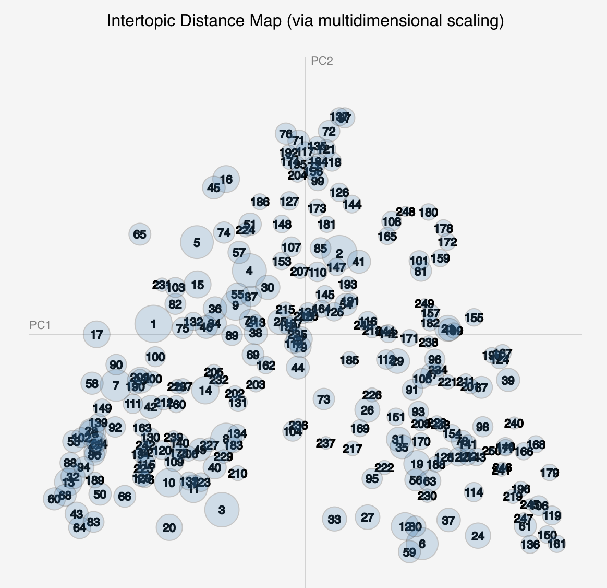

<!-- 
.. title: A Gospel of Health and Salvation
.. slug: index
.. date: 2017-08-07
.. description: 
.. type: text
-->

## Modeling the Religious Culture of Seventh-day Adventism, 1843 - 1920

Born out of the religious and cultural upheavals of the early and mid-nineteenth century, the beliefs and culture of Seventh-day Adventism stood in productive tension with those of the major Protestant denominations of the time. A prolific community, the early SDA community used print as a primary mechanism to bring together like-minded individuals and to develop distinctive religious beliefs and culture. This extensive print record, a large portion of which has been digitized and made available by the denomination, provides a unique opportunity to explore the historical development of the religious movement as well as to interrogate the use of computational tools in historical analysis. 

In this dissertation I use text mining and historical analysis to explore the relationship between beliefs about the end of time and the development of the religious culture of Seventh-day Adventism, particularly as seen in the gendered labor around salvation. Through text analysis, and particularly topic modeling, I argue that there were three identifiable cycles of rising and falling end-times expectation during the first seventy years of the denominations history. These periods of increasing and decreasing expectation of shaped the development of Seventh-day Adventism's religious culture in ways that can be seen particularly in gender norms around the process and work of salvation. Using computational techniques to identify and explore this pattern of cultural development also required engaging in questions of how to bridge the methods and epistemologies of history and data science. I argue that the relationship between these two approaches to knowledge is not straightforward and that there are numerous considerations including corpus composition, data quality, and code reproducibility that need to be addressed as part of the intellectual work of such projects. 

Computational work in the humanities occupies the intersection of multiple methods of exploration and meaning making, including statistical analysis, historical narrative, visual rhetoric, and computer programming. In this dissertation I argue that one consequence of that intersection is for such works to be understood and evaluated, the various forms of meaning-making and their interrelations must be documented and published as part of the scholarly product. In this project, I do that work through the form and content of the project, which argues for and models bringing together digital sources, computational methods, and historical analysis, or code, documentation, and narrative, to explore the religious culture of Seventh-day Adventism in the nineteenth-century United States. 

The dissertation is designed so that readers can focus on areas of interest to them, while interlinking between the pages denotes how the components of the project are interconnected. The navigation below outlines two main track through the dissertation: the first being a historical analysis of Seventh-day Adventism and the second being an analysis and demonstration of the use of computational methods in historical research. Additionally, the top navigation provides access to each of the different components of the dissertation. 

## Gender and End-times in Seventh-day Adventism

.](/images/Group-posing-at-the-Eagle-Lake-Campmeeting.jpg)

- [Project Introduction](link://slug/overview)
- [The Emergence of Seventh-day Adventism](link://slug/chapter-1)
- [Anticipating the End of Time](link://slug/chapter-3)
- [Conclusion](link://slug/conclusion)

## Computational Methods in History

- [Project Introduction](link://slug/overview)
- [Constructing Computational Models for Historical Text](link://slug/chapter-2)
- [Anticipating the End of Time](link://slug/chapter-3)
- [Topic Model Browser](link://slug/browser-about)
- [Code Notebooks](link://slug/notebooks-overview) 
- [Conclusion](link://slug/conclusion)
- [Process Statement](link://slug/about)
<!-- - [Python Library]() -->
<!-- - [Code Documentation]() -->

Anticipated completion date: Summer 2019.

This site is under active development. Please note that the content and links will be updated frequently.

