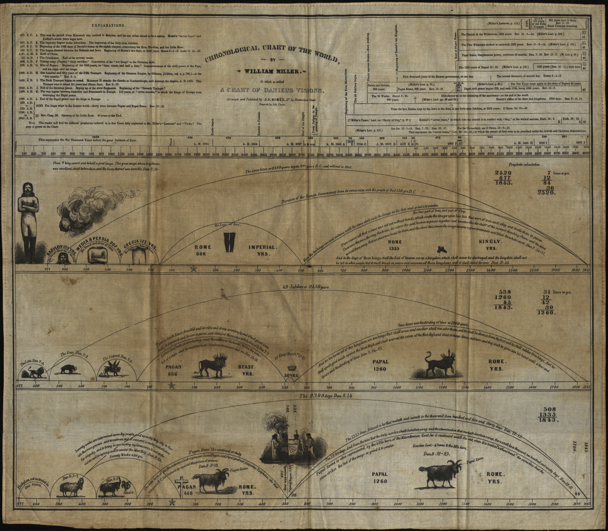
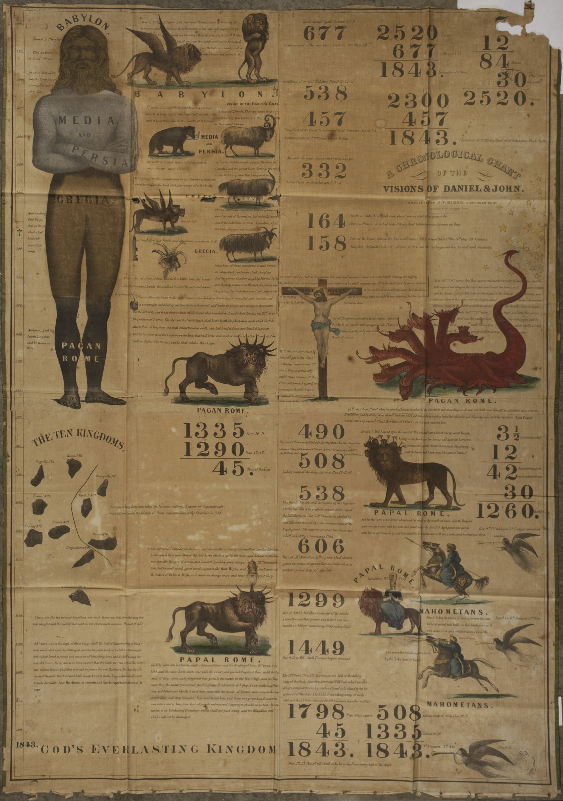

--- 
date: 2018-02-01 00:00:00 UTC
title: The Emergence of Seventh-day Adventism
slug: chapter-1
suppress-bibliography: true
tag: toggle
---

# Chapter 1: The Emergence of Seventh-day Adventism

>I told the view to our little band in Portland, who then fully believed it to be of God. It was a powerful time. The solemnity of eternity rested upon us. About one week after this the Lord gave me another view, and shewed me the trials I must pass through, and that I must go and relate to others what he had revealed to me, and that I should meet with great opposition, and suffer anguish of spirit by going. But said the angel "The grace of God is sufficient for you: he will hold you up."   Ellen White, 1851^[@White1851, pp. 5-6]

>And it shall come to pass afterward, that I will pour out my spirit upon all flesh; and your sons and your daughters shall prophesy, your old men shall dream dreams, your young men shall see visions   Joel 2:28, King James Bible
 
The early years of the nineteenth century were a period of religious innovation and revival in the United States, witnessing the rapid growth of previously small denominations such as Methodists and Baptists as well as the creation of new religious movements such as Barton Stone's Christians and Joseph Smith's Latter-day Saints. Known for revivals marked by enthusiastic and emotional displays, the period was characterized by the "democratization" of authority regarding religious truths, with careful individual study of the Bible, rather than religious training or position, held up as the primary source of authority.^[The seminal work on religion and the early republic is @Hatch1989.] It was also a period of heightened millennial expectation, as believers from a wide variety of Protestant backgrounds devoted themselves to bringing about the fulfillment of God's plans through the conversion of sinners, social reform, and personal piety. One often-cited example of this flurry of interest in the second coming was the end-times preaching of William Miller, a one-time deist and grandson of a Baptist minister whose study of the Bible led him to conclude that the second coming would take place between 1843 and 1844.^[Cite Hatch and others who invoke Miller within the context of 2GA.] Coming at the end of the period known as the Second Great Awakening, Miller's predictions and the responses to them shaped American Protestantism, encouraging conversions and revivals in the years leading up to 1844, while also reinforcing a cultural push back toward more structured and respectable expressions of religion as time continued.

Miller's teachings also gave rise to new religious denominations, as during the years after 1844 those who had embraced the "adventist" message wrestled with the meaning of the continuation of time and how to reconcile it with their belief that Miller's interpretations were correct. The largest and most successful of these new denominations was Seventh-day Adventism, which grew from a very modest 3,500 estimated members at the time of their incorporation in 1863 to over 20 million members worldwide as of 2016.^[@YB1905, p. 14; @Trim2018, p. 4] Despite their ongoing growth, Seventh-day Adventism has received little independent attention from scholars of American religious history. When mentioned, it is generally in relation to the SDA's roots in Miller's adventism, as the example of the continuing reach of Miller's teaching even after the failure of his 1844 prophecies.^[loaded historiographical footnote] Looking beyond their roots in Miller's millennial teaching, the study of Seventh-day Adventism offers another lens on cultural trends within nineteenth-century America, and particularly on the role of end-times expectation on the ways such trends were experienced and incorporated by religious and cultural groups. 

The development of Seventh-day Adventism offers a unique opportunity to examine the relationship between end-times beliefs and religious culture in American history, particularly as seen in ideas about gender, health, and salvation. On the one hand, Seventh-day Adventism fits many of the patterns that marked religious revivalism of the early to mid-nineteenth century: the embrace of a new understanding of the Bible that brought all into alignment, the charismatic leadership of Miller and then the husband and wife pair of Ellen and James White, a willingness to suspend typical gender norms as part of the evidence of last days and the mission of the denomination, and an urgent emphasis on salvation and the belief that the end times were at hand. However, such similarities also obscure some of the instructive differences between the denomination and nineteenth-century revivalism generally. While echoing the growing emphasis on women's role in the home, Seventh-day Adventists continued to honor a woman, Ellen White, as prophet and made space for women's labor as lecturers, missionaries, medical professionals, and teachers. Their approach to health included both an early emphasis on divine healing and a gradual embrace of medical intervention within the framework of following God's natural law. Their understanding of end-times and salvation positioned the government of the United States as the anticipated adversary, rather then the protagonist of God's unfolding plan.   

This chapter provides a broad historical context for understanding the development of the Seventh-day Adventist denomination. Embedded within the revival movements of the nineteenth-century, Seventh-day Adventists drew from and were a part of larger Protestant movements of the time. At the same time, their particular approaches to the social and theological problems of the day help illuminate the variety of American religious expression, as the religious culture they developed stands in contrast to many of the standard categories used to describe nineteenth-century religion. While the embrace of Miller's teaching fundamentally shaped their understanding of the Bible, the unfolding of time, and their place within God's plan for the world, the development of the denomination was also shaped by the melding of the diverse religious backgrounds of converts to the SDA, as well as the ongoing problem of reconciling the persistence of time with their interpretations of Scripture.

A note on terms: The labels used to describe the different groups of believers who anticipated the second coming in 1843/1844 vary in usage and require definition. For this study, I use "Millerite" to refer to those Protestant Christians who embraced William Miller's interpretation of the Bible and expected the second coming (or second advent) during the period from 1843 to 1844. In the years following, a number of religious groups formed out of the Great Disappointment, and I use "Adventist" to refer to those formal denominations formed after the Albany conference who concluded that they had been incorrect in their interpretation of biblical prophecy and the identification of the October 1844 date. Finally, Seventh-day Adventist or SDA refers to those believers who, after 1844, embraced the combination of adventist beliefs about end times with Seventh day Baptist teachings on Saturday as the day required by the commandments for Christian worship. 

## The Making of the Adventists

Of the variety of religious movements that developed during the nineteenth-century, one of the more notable were the Millerites. These were American Protestants drawn largely from Baptist and Methodist congregations who were convinced by the teaching of William Miller and believed that the Bible revealed that the date of the second coming, or second advent, to be around the year 1843. Miller, a commissioned militia officer during the War of 1812 and, if his biographer is to be believed, a leading citizen of Poultney, Vermont and later the nearby border town of Low Hampton, New York, began his study of the Bible shortly after his conversion from deism following his military service. His goal was to prove the reliability of the Bible by reconciling all apparent inconsistencies he discovered, and in so doing, counter some of the standard arguments against religion.^[@Bliss1853, pp. 18-25, 31, 63. The language of "deism" here is used by his biographer, [?], as well as by James White in his telling of Millerite history. While likely being used as a short hand for ... [cite JW] ] In 1818, he first came to the conclusion that the biblical prophecies, particularly those in the book of Daniel, revealed that the second coming would take place around year 1843. After spending five years confirming his interpretations and calculations, he began to share his conclusions, starting with family and friends, then reaching out to local ministers. Miller understood his findings as reinforcing the teachings of the churches and as part of the prevailing belief in the second coming. He slowly began to receive invitations to preach in a variety of settings, including Baptist, Methodist, and Congregational churches.^[@Dick1998, p. 4] In 1832, he published his findings in the *Vermont Telegraph* and in 1833, he was granted a preaching license from the Baptist church in Hampton, New York.^[@Judd1987, pp. 22, 25; Miller gives the date of his being granted a license as 1834 in Mr. Miller's Apology and Defense.] He began preaching and lecturing in churches throughout New England during the 1830s and into the 1840s, as well as published a 64 page pamphlet of his interpretation in 1834 and a series of sixteen lectures in 1836. Between 1834 and 1839, Miller recorded that he had given about 800 lectures on his interpretation of prophecy and his belief that the time of the second coming was at hand.^[@Miller1845, p. 3]

Despite publishing, traveling, and preaching widely, Miller's teachings would have remained one of many little known local religious movements of the nineteenth century if it were not for Joshua V. Himes. Prior to meeting Miller in 1839, Himes had a long history of embracing reform movements as the way to bring about the kingdom of God. Licensed to preach by the Christian Church, he was pastor of the Second Christian Church in Boston, was a Temperance lecturer, started a school for boys, was on the board of the Massachusetts Anti-Slavery Society, was an early supporter of William Lloyd Garrison, and distributed periodicals and other printed materials of the Disciples of Christ.^[@Arthur1987, pp. 37-39] Anticipating the coming millennium and already working hard to bring it about, Himes found Miller's teaching that the end would arrive in a mere four years' time both striking and deeply motivating. With Miller's blessing, Himes became his chief publicist, launching a print campaign and a series of conferences aimed at disseminating Miller's work as quickly and widely as possible.^[@Arthur1987, p. 39] Publishing periodicals such as *Signs of the Times*, *The Midnight Cry*, the *Philadelphia Alarm*, and *The Western Midnight Cry*, among others, as newspapers of the movement, along with  tracts, hymns, and prophetic charts, as well as Miller's *The Second Advent* and memoirs, Himes flooded religious readers with material expounding Miller's teachings. In doing so, he fostered a sense of religious community among Miller's followers and created the mechanisms by which Miller's message could spread.^[@Arthur1987, pp. 42-48]

It is clear that Himes had an excellent sense of "marketing" - he knew how to engage people in a cause and how to gain, if not converts, at least attention. He worked to ensure the widest possible reach for Miller's teachings, establishing periodicals in the key cities of Boston, New York, Philadelphia, and Cincinnati. He also understood the value of "showmanship," acting quickly on a decision to build a "great tent," one that seated 4,000 people and was one of the largest to be seen in America; publishing and selling colorful charts to illustrate the intricate (and obtuse) details of Miller's interpretation; and convincing Miller to offer a more definitive date. He also began holding regular conference meetings for those convinced by Miller's teachings. These gatherings provided a forum for the dispersed community to come together, to work to reach consensus on some of the contested details of Miller's teaching, and to agree on a strategy for spreading the word.^[@Judd1987, pp. 39-48.]

<figcaption>**Figure 1.1**: William Miller's "Chronological Chart of the World to which
is added, a Chart of Daniel's Visions" (1842). From the Adventist
Digital Library.
https://adventistdigitallibrary.org/adl-421835/chronological-chart-world.
Accessed 6 September 2017.</figcaption>

<figcaption>**Figure 1.2**: Charles Fitch's "A Chronological Chart of the Visions of
Daniel and John." (1843). From the Adventist Digital Library.
https://adventistdigitallibrary.org/adl-421834/chronological-chart-visions-daniel-and-john.
Accessed 6 September 2017.</figcaption>

The efforts of Himes launched Miller and his teachings into the public consciousness and created a community around the belief that the second coming would occur between March 21, 1843, and March 21, 1844. In 1842, just two years after he joined the cause, Himes claimed fifty-thousand readers for *Signs of the Times* and between three and four hundred ministers distributing the materials.^[@Dick1998, p. 6; @Arthur1987, p. 46] By 1844, Himes had overseen the foundation of a number of serial publications, tracts, and pamphlets and had organized, attended, and spoken at conferences around the United States and Canada. This scale of publication and organization is notable. While most evangelical movements of the time utilized the press to spread their message and unite believers, under the leadership of Himes, the Millerites "published tracts, memoirs, and newspapers on a scale never before imagined."^[@Brekus1998, p. 323] As a result of the successful publishing campaigns, Miller became a highly sought-after speaker, claiming to have given about 4000 lectures in five hundred towns between 1840 and 1844. In addition to Miller and Himes, by Miller's calculations some 200 ministers in the United States and Canada had embraced his interpretation, and an additional 500 public lecturers circulated his views.^[@Miller1845, p. 4]

Miller did not set out to form a new movement or denomination. Rather he saw his teachings as within the bounds of orthodoxy, as the logical conclusion of prevailing Protestant beliefs. He made no effort to start his own church and did not wish to be identified as a "sectarian leader," instead encouraging followers to stay within their home denominations. In claiming success, he notes that, as result of his early lecturing, "many churches thereby greatly added to their numbers," a statement that reinforces that he saw his goal as the revival of the local church, not the creation of his own.^[@Miller1845, p. 3] He saw his teaching of the imminent second coming to be a truth of general interest for all denominations, and one that would (or should) be embraced regardless of denominational affiliation.^[@Judd1987, p. 30-31]

This did not always go according to plan, as the experience of the Harmon family illustrates. In her autobiography, Ellen (Harmon) White reports, "At the age of eleven I was converted, and when twelve years old was baptized, and joined the Methodist church." Upon hearing William Miller lecture on the topic of the Second Advent at the age of 13 (1841), she "then felt that I was not holy, not ready to see Jesus" and so "when the invitation was given for church members and sinners to come forward for prayer," she went forward in the belief that "I must have a great work done for me to fit me for Heaven."^[@White1851, p. 3] Although already converted, baptized, and a member of the church, the news that the second coming would occur in two years' time caused White to call her salvation into question. She began regularly attending "Second Advent meetings," seeking "full and free salvation" from God.^[@White1851, p. 3] She received the confirmation she sought when she obeyed God's prompting to "pray in a public prayer-meeting."^[@White1851, p. 4]

Convinced of her salvation and full of anticipation for the return of Jesus, she returned to her Methodist class-meeting some six months later to share "what Jesus had done for me, and what a fullness I enjoyed through believing that the Lord was coming." Her message, however, was not acceptable to the local Methodist class-leader, whom she reports interrupted her testimony to add "Through Methodism," an addition she rejected because "it was Christ and the hope of his soon coming that had made me free."^[@White1851, pp. 4-5] Eventually the tensions between the Harmon family and the local Methodist minister over their Millerite convictions became too great and the family was "cast out of the Methodist Church."^[@White1851, p. 5]

Local communities of Millerites emphasized regular attendance at the local Protestant Sunday services, but also attended their own interdenominational meetings for those who believed the second coming was at hand. Dedicated to sharing the news of the second coming with their neighbors and religious fellows, members of Millerite associations often found themselves at odds with their local religious leaders.^[@Dick1998, p. 9.] Finding community among other Millerites and meeting resistance in their local churches was often too much for individual believers, prompting them to leave their home denominations and claim an adventist identity. While Miller himself was quite distressed by this trend, it set the stage for new denominations to form in the wake of the disappointments of 1844.^[@Judd1987, p. 32]

Because of the non-denominational aspects of Miller's preaching and because multiple dates were eventually given for the Second Advent, it is difficult to determine the total number of people who joined Miller in anticipating the second coming and the end of the world. Miller estimated that there were 200 ministers and 500 lecturers who had embraced his teachings. In the years after 1844, the *New York Tribune* estimated that there were 30-40,000 Millerites at the movement's peak. The high end of estimates puts the peak number at 100,000, though Miller himself claimed that about 50,000 embraced his message, calculating based on the number of conversions he witnessed in his lectures.^[@Dick1998, p. 27; @Miller1845, p. 4] These were the believers - those who embraced Miller's interpretation as, quite literally, gospel truth. Given the massive amount of literature produced by Himes, however, it is likely that many more quietly marked the passage of 1844 with interested skepticism. What is clear is that, although Miller was able to preach to nearly 500,000 people, what propelled his teaching from local anticipation to an international movement was the coordinated publishing efforts of Himes.^[@Dick1998, p. 6]

As would be the case for the early Seventh-day Adventists, Himes recognized the power of print and effectively deployed it as the center around which the Millerite movement formed. Regular publications spread the content of Miller's interpretation, raising awareness of his findings. Those same publications provided the forum by which Himes organized the regular conferences, inviting interested people to gather together to coordinate their efforts to spread the news of the coming millennium, and advertised upcoming tent meetings. Reports about the successes of the camp meetings helped the community to take part in the events regardless of geographic proximity, and served as further proof of the truth and successfulness of Miller's message, for if God were not behind the movement, the events would not have been successful. In addition, Himes strategically started multiple publications in different cultural and geographic centers of the U.S., increasing the coverage that the movement could achieve and catering to regional interests. This was a strategy that the Seventh-day Adventists would later emulate, first as they came together around the publication of a new interpretation of Miller's teachings and the events of 1844, and later as they sent out missionaries, establishing printing houses in each new geographic region they entered.

### The Religious Roots of Adventism

Building on the wider revival traditions of the time, adventism drew from and shared a number of key features that marked the religious awakenings of the period. Key among these were an emphasis on recapturing the religion of the early church, a commitment to a literal understanding of scripture, the embrace of millennialism, and an affinity for reform movements, from temperance and health reform to abolitionism. These shared commitments helped make Miller's teaching legible to his audiences and his promise that the second coming would soon occur fit within the religious understanding of many. Additionally, Miller's followers came from a number of Protestant traditions, and brought with them aspects of their early theological roots into what would develop into the Seventh-day Adventist church. In identifying these trends and sources of Millerite and Seventh-day Adventist theological thought, I lay the foundation for highlighting the continuities and discontinuities between this new religious denomination and the surrounding religious culture from which it developed. 

Shared across many of the religious movements that developed during the period of the Second Great Awakening was an underlying commitment to identifying and recovering the Christianity of the early church, an impulse known as primitivism or restorationism. This impulse was not new to the reformers of the early nineteenth-century, but the range and scope of its application is noteworthy. While the impulse to cut out elements of religious faith and practice that were seen as unscriptural additions had marked Protestant Christianity since the Reformation, by the early nineteenth-century seemingly all aspects of  faith were open to challenge and reevaluation, as religious leaders sought to recover and reinstate "the truth" of Christianity as expressed in the days of the apostles. 

In exploring the particularly strong hold of this approach to the past within the nineteenth century and American Protestantism more broadly, scholars have looked to identify the distinctive features of the environment that made primitivism particularly potent. Historian Nathan Hatch has attached the particularly strong manifestation of restorationism of the period to two new conditions of the time: the breakdown of older systems of authority with the democratic revolutions of the age and the experience of religious pluralism. On the one hand, the political environment with the establishment of a democratic system and the rejection of older, monarchical forms of government was seen as having implications within the sphere of religion, with the need to also overthrow older, more authoritarian forms of religious organization. On the other hand, the very abundance of forms of religious expression seemed to indicate that the truth was not yet found. As a result, religious leaders and innovators sought to bring order to the surrounding chaos, preaching that they had found, through careful study of Scripture or through direct revelation, God's true purpose and desired form of religious observance.^[@Hatch1989, pp. 167-170]

The primary guide for efforts to recover and restore the early church was the Bible. Dating back to the eighteenth-century revivals of the Great Awakening and the earlier Reformation creed of *Sola Scriptura* or "Scripture Alone," Protestant Christians had long taught and internalized the belief that the Bible offered a clear guide to the Christian life, and more broadly, revealed God's plan for the world. Rather than creeds or traditions, the Bible was held up as the sole arbiter of true faith and the primary mechanism for salvation.^[@Butler1990, p. 172.] For the Bible alone to serve as the central guide of Christian life, however, it needed to be a reliable and clear source for religious truth. Religious leaders such as Alexander Campbell (Disciples of Christ) preached the Bible as "a book of 'plain facts' to be read and apprehended by all,"  with careful and engaged study the solution to all differences of interpretation.^[Quoted in @Hatch1989, p. 163.] A position embraced by clergy to counter the religious power of the Roman Catholic Church and later used to question points of theological orthodoxy such as the Trinity and limited atonement (the belief that only some are saved), by the nineteenth century lay believers had come to embrace the belief that the Bible, and individual interpretation thereof, was the final authority in matters of religious truth.^[See @Hatch1989, pp. 179-184.]  

One topic where this shift to approaching the Bible as a literal guide to truth was felt particularly strongly was in the embrace of millennialism, or the belief in the second coming and thousand year reign of Christ on earth. While a minority belief during much of church history, interest in end times and the millennium increased in the years following the American and French Revolutions, as the power of the Pope was seen to be on the decline. New studies of prophecies fueled speculation that linked the decline of the church with the restoration of the Jewish people in Palestine and saw the prophesied judgment as focused on Christendom, particularly the Roman Catholic Church.^[@Sandeen1974, 109.] This interpretation of scripture was informed and shaped by the embrace among millennial believers of literalism in their approach to the Bible. Where earlier interpretations of the prophetic books of Daniel and Revelation focused on their content as symbolic or allegorical, eighteenth and nineteenth century millennialists focused on the same passages as communicating a literal second coming marked by signs both strange and miraculous.^[@Sandeen1974, p. 113]

Nineteenth-century revivalism tended to embrace one of two different visions of the millennium. The first, associated with more reform-minded religious leaders, anticipated the thousand year reign of Christ on earth, to be brought about by the increasing piety and conversion of the (particularly American) people. Encouraged by the success of the American Revolution in bringing about a dramatic change in style of government, these believers anticipated a similar revolution in the social sphere, one that would bring about a culture marked by justice, equality, and virtuous behavior.^[Of course, one ongoing challenge for this approach is that each group had a different vision of the characteristics that marked this millennial society.] The gradual conversion and salvation of the world was the historical arc foretold in Scripture and it was the role of believers to help bring about the gradual redemption of society. The second, embraced by Miller and others, took a more pessimistic view and posited that the second coming of Christ would precede the establishment of the thousand year period of peace. For Miller, this second coming would arrive swiftly and for later Seventh-day Adventists, would come at the close of a period of intense persecution of those who followed the law and worshiped on Saturday. For Millerite and Seventh-day Adventist, the historical arc was one of struggle between the faithful and the world, between God and Satan, and would end in the sudden return and triumph of Jesus. The role of believers in this vision was to be prepared and faithful, as well as to convert others to the faith, for the second coming could not occur until all destined for salvation had the opportunity to be saved.^[In his essay on "Millennialism" in *The Rise of Adventism*, Ernest Sandeen offers a useful overview of the variations of Christian millennial belief as split on "near or distant," "silent or cataclysmic," and "gradual or swift," with the combination of "near, cataclysmic, and swift" being defined as "apocalypticism." @Sandeen1974, pp. 105-106.]

End times expectation was not unique to Miller and his followers. In the face of the social and political changes that shaped post-Revolutionary American society, many religious revivalists embraced some form of millennial rhetoric and expectation. Noted preacher Charles Finney went so far as to claim in his 1835 *Lectures on Revival* that should the church embrace revivals and bring about the necessary conversions, "the millennium may come in this country in three years."^[Quoted by James Bratt in @Bratt2004, p. 83] Even among religious movements that positioned themselves in contrast to the general culture, such as Latter Day Saints, there still existed an underlying impulse to nationalistic millennialism, as members believed that "God's kingdom would yet rise in America ... and their endeavors would serve as decisive leaven."^[@Hatch1989, p. 188] Committed to the truth of their particular religious interpretation, believers from multiple traditions set out to make ready the way ahead of their soon to be returning savior and to prepare themselves in advance of the coming judgment.

One final cultural contributor to the development of Seventh-day Adventism is reform, from abolitionism to temperance, health reform to women's rights. In addition to a flurry of religious innovation, the early nineteenth century also saw the rise of numerous reform efforts, groups of citizen organizing together to bring about some sort of societal change. These efforts were often framed in religious terms, as reformers saw themselves as part of the divine plan for the unfolding of the world. The beginning and end of this plan were known: creation began in the garden of Eden and would end with the establishment of God's eternal kingdom. Human actors lived through and contributed to that progression, setting in motion the events that propelled God's plan and used their vision of the unfolding "cosmic drama" to guide their actions and interpret the events of their lives.^[The relationship between reformers and this religious vision of the unfolding of human history is discussed in @Abzug1994, pp. 4-8 and 30-35.]

Reformers sought to bring about order and to right social wrongs within the context of an increasingly diverse and decentralized society and as such were often drawn to millennial visions. From temperance reform to abolitionism, reformers were "bent upon sacralizing all the world's order in accordance with their vision of God's plan."^[@Abzug1994, p. 4] Once the reform goal was achieved, the next phase of God's plan - the second coming or the millennial period - could come into being. However, as reformers often discovered, their mission to redeem the world was difficult at best. Convinced that their work was within God's plan, reformers were left searching for reasons they were not more successful, or, when they were, for reasons that such successes did not usher in the millennium as anticipated. This tension fueled the embrace of multiple reform efforts but also pushed members to the edges of their belief in the millennial vision. Advocates for women's rights, for example, while initially inspired by the millennial beliefs of the early nineteenth century often found themselves outside the bounds of their initial religious homes and seeking a transformation outside the bounds of Christian millennialism. Still looking to right the social wrongs and bring about a different organization of the world, they left behind the particulars of the old religious framework, finding new understandings of sin and the path to salvation in communitarian experiments, in transcendentalism, in Spiritualism, and in other "post-Christian faiths."^[@Abzug1994, p. 229]

These themes were prevalent throughout the revival movements of the nineteenth century, though emphasized differently among different denominations and religious groups. Those who were attracted to Miller's teaching, and later to Seventh-day Adventism, came from variety of denominational backgrounds, and brought with them elements of their home traditions, all of which contributed to shaping the distinctive approach and theology of the SDA. As a result, understanding the eventual development of Seventh-day Adventist theology requires a brief accounting of those major traditions. Of particular significance are Methodism, and particularly the "shouting Methodist" tradition, in which Ellen White was raised; Baptist, the ecclesiastical home of William Miller, and particularly Seventh Day Baptist traditions; and the Christian Church or Christian Connection movement of the early nineteenth-century, the roots of James White, Joseph Bates, and Joshua Himes.^[This list is echoed in Bull and Lockhart's survey of the SDA. See @Bull2006, p. 101]

#### Methodists

One of the largest and most discussed denominations that contributed members to the SDA was Methodism. The denomination traces its roots back to John Wesley and his emphasis on "the witness of the Spirit," or a perceptible experience of the divine, as the central component of the Christian experience.^[@Taves1999, p. 50-51] Educated and ordained within the  Church of England in the 1720s, John and his brother Charles merged rigorous devotional practices with an emphasis on religious experience. While initially a revival movement within the church, Methodism eventually separated to form an independent denomination.^[@Ahlstrom1972, pp. 234-237] The early Methodist community was organized in a hierarchical structure, with the local "bands" or "class meetings" organized into "societies," which in turn reported to an itinerant preacher assigned to the area. That itinerant preacher reported to the annual conference, and specifically to the general superintendent - Francis Asbury and Thomas Coke - who reported to John Wesley.^[See Ann Taves' account of Methodism in @Taves1999, p. 84] This structure enabled local communities to develop even when there were few ordained ministers, with those in leadership positions responsible for local and regional meetings that included multiple local communities, a structure echoed in the later organization of Seventh-day Adventism.

Within the young Methodist tradition, there was a variety of opinion about the proper role of "enthusiasm" in the religious life. While some amount of "extravagant emotions and bodily exercises" were generally accepted, particularly within the context of conversion or private devotion, Methodist leaders typically stressed more reserved religious behavior in the context of public worship.^[@Taves1999, p. 76] However, not all agreed with that distinction, stressing experiential and emotional religious expression as central to worship. This form of Methodism, which came to be known as the shout tradition or Shouting Methodism, developed out of the multicultural context of the revivals of the eighteenth and early nineteenth centuries, shaped particularly by the combination of African and European styles around "singing, preaching, the use of the body, and the level and meaning of interaction in worship."^[@Taves1999, p. 80] This more enthusiastic style of worship was often found in the camp meetings of the nineteenth century and was the source of some division between those who desired more "respectable" expressions of religion and those they deemed "fanatical."^[@Taves2014, p. 30] 

Ellen White and her family were members of the Methodist church in Portland, Maine and it was into that tradition that White was converted and baptized when she was eleven and twelve years of age. In her early memoir, White recounts how she experienced an outpouring of grace - a sought-after experience within the Methodist tradition - upon embracing and speaking publicly regarding the Milerite message. White's emphasis on religious experience, her visions, and her embrace of such practices as foot-washing in the years after 1844 have led scholars such as Ann Taves to identify her with the Shouting Methodist tradition.^[Taves argues that one of the sources of tension between White and more moderate Adventists such as Himes is her background among the Shouting Methodists, particularly with respect to the general acceptance of visions and other signs among Methodists, where such things were held suspect among other religious traditions of the time. See @Taves2014, p. 35-39]

#### Baptists

The second primary contributor to adventism, and Seventh-day Adventism, was the Baptist tradition. Due to the strong emphasis on the autonomy of local churches, the history of the Baptist movement is both varied and contested. The roots of the Baptist movement trace, however, to England and to efforts in the seventeenth century to reform the Church of England. Baptist preachers emphasized the Church as the community of those who professed individual belief and the baptism of believers as a sign of that profession, as well as the Bible as the guide for the Christian life. Early Baptists were frequently the target of government and social censure, as their criticism of the Church of England and their particular interpretation of the Christian faith were threatening to existing cultural norms and power structures. As a result, early Baptists emphasized religious liberty, arguing that belief should be judged by God and not by the state. They also emphasized the autonomy of the local church, relying on the mechanism of voluntary societies for organizing their efforts to collaborate on questions of missions or other shared endeavors. These emphases, particularly on the community of professing individuals, the Bible as the guide of Christian practice, religious liberty, and on organizing for shared concerns through the mechanism of associations, appear again in the development of Seventh-day Adventism.^[For a brief history of the Baptist movements, see @Leonard2005, pp. 7-32]  

Among Millerites, Baptists made up a substantial percentage of the ministers and congregants. Studies of those who identified as Millerite suggest between 27 and 63 percent of ministers and lecturers were affiliated with the Baptist church.^[Range shaped by whether one looks at national-level data or regional, such as New York State. See @Rowe1987, p. 9] Most significantly, Miller himself was affiliated with the Baptist church, joining the denomination during the period of his conversion back to Christianity from deism, and receiving a preaching license from the Hampton, New York Baptist Church in 1833.^[@Judd1987, p. 25] His Baptist tendencies can be seen in his approach to interpreting Scripture, from insisting on the Bible as the only guide to embracing a literal interpretation of its content, including the prophetic texts.^[@Judd1987, p. 19-20] That ongoing commitment to Biblical interpretation through identifying the clear and literal meaning would continue to the shape the theological development of Seventh-day Adventism.

While Miller and the Adventists followed more traditional Baptists beliefs and practices, one Baptist sect, the Seventh Day Baptists, had a particular influence on the development of Seventh-day Adventism. The Seventh Day Baptist tradition also dates back to seventeenth century England. While similar in practices to Baptists, Seventh Day Baptists interpreted elements of the Old Testament law to apply to the current time, particularly the need to honor the particular day of the Sabbath (Saturday) as well as some of the dietary laws.^[@Leonard2005, p. 10] Early Seventh Day Baptists were among those to establish early churches in the American colonies, with communities in Rhode Island, New Jersey, and Pennsylvania.^[@Leonard2005, p. 97] The traditions of the Seventh Day Baptists and the Millerites began to intersect as Baptist members embraced the interpretations of Miller and began to advocate for a Seventh Day understanding of the Sabbath within Adventist communities. A small subset of Adventists began to observe Saturday Sabbath and to publish on the issue, which in turn converted one of the prominent preachers within the Millerite movement, Joseph Bates. It is Bates who is credited with introducing Ellen and James White to the arguments for Sabbatarianism, which they adopted in 1846, and was also an early adopter of hygienic principles, having given up meats and stimulating foods already in 1843.^[@Anderson1998, p. 31; @Bates1877, p. 314. For a denominational history of Bates and his adoption of Sabbatarian principles, see @Knight2004, pp. 93-111.] While the Seventh Day Baptist tradition continues to the present, the Seventh-day Adventist church has become one of the largest proponents of the Saturday Sabbath interpretation within the modern Protestant churches. 

#### "Christians"

A number of converts made their way to Seventh-day Adventism through other emerging revival traditions, particularly the Christian Church or "Christians." Broadly speaking, the label is applied to three or four different revival traditions that developed during the period of the Second Great Awakening and eventually merged. Led by Elias Smith in New England, James O'Kelly in Virginia, Barton Stone in Kentucky, and Alexander Campbell in Pennsylvania, Protestant Christians from Baptist, Methodist, and Presbyterian churches began to question the standard hierarchy of the denominational structure, focusing instead on the Bible as the only guide for faith. Of particular concern for those who joined the Christian movement was the rejection of formal ministerial training and of denominations in general, and instead focusing on the "priesthood of all believers" and the need to return to the purity of the early church.^[@Hatch1989, p. 69] For those who converted to the Christian churches, one central theme was that of liberty, both political and religious, and the sovereignty of "the people" in contrast to the tyranny of elites, the clergy, and institutions.^[@Hatch1989, pp. 76-77] These teachings pushed the logic of the revolution and the revivals of the time, advocating a complete break with the past in order to return to the Christianity of the early church. One key element of the success of the Christians was their embrace of print. Leaders such as Smith and Campbell early on identified the advantages of print for spreading their teachings, and put it to use in promoting their cause. From starting the first religious newspaper in the U.S. to producing pamphlets and papers designed for circulation and mass readership, the Christian leaders sought to disrupt the existing denominations by bringing their ideas to lay readers directly.^[@Hatch1989, pp. 73-74] This focus on liberty, on the Bible and its plain meaning, as well as the use of print, shaped the religious intuitions of future Seventh-day Adventist leaders such as James White and Joseph Bates, who were both initially preachers in the Christian Church, as well as Joshua Himes, Miller's primary publisher and promoter. 

The early nineteenth century was generally a period of religious unrest and innovation, as individuals struggled to make sense of the changes brought about by the American Revolution and by the proliferation of religious expression. A product of the end of this period of revival, both Miller's Adventists and Seventh-day Adventism were built upon and reflect a number of the traditions and innovations of the period. Drawing on believers from across denominational boundaries, the new movements were faced with reconciling the differences between  multiple understandings of the Christian tradition. For the early Seventh-day Adventists the process was challenging as a new set of theological commitments needed to be formed out of the various source traditions of its leaders and the end-times teachings of Miller. Rather than a straightforward product of any one tradition, Seventh-day Adventism represents the culmination of various strands of Second Great Awakening revivalism and the merging of those beliefs into something new.

## Becoming Seventh-day Adventists

As the period Miller identified between March 21, 1843, and March 21, 1844, passed, adventist believers began to develop a number of alternative theories to address the persistence of time. A temporary reprieve from the crisis was granted when a young man named Samuel Snow announced that he had identified the error in Miller's calculations and that October 22, 1844, was the correct date indicated for the second coming. While acceptance of that interpretation brought unity back to the movement for a time, the passing of October 22, which came to be known as the Great Disappointment, exposed tensions between the various groups of adventists that had become too great to maintain a unified movement.

The adventist community did not collapse immediately after the final disappointment of October 22, 1844. While Himes briefly suspended publication after the October 16 issue of *The Advent Herald and Signs of the Times Reporter* in anticipation of the second coming, when the day passed without event, he quickly regathered, releasing a new issue on October 30, 1844. Still convinced of the truth at the core of the adventist message, that the time of the second coming was at hand, he offered a retelling of the history of the adventist movement that emphasized the nuances of their teachings around the date of the second coming and downplayed the significance of the October date.^[@Himes1844a, p81; @Himes1844, pp. 92-93.] However, understanding and explaining the persistence of time posed a significant challenge for the community.

Among those who remained committed to Miller's teachings, the movement split into two main groups: those who held that the end was indeed near but they had been mistaken about the date; and those who held that the end was indeed near but that they had been mistaken about the significance of the date. The debates between these groups took place on the pages of the main adventist papers, as well as in the pages of new periodicals started to promote various interpretations of the nature and timing of the Second Advent. These two groups were also characterized by distinct religious cultures, with those who reinterpreted the meaning of the October 22nd date embracing more radical forms of religious expression, including more exuberant forms of worship, foot-washings, and exchanging the "holy kiss."^[This is described in @Arthur1970, pp. 85-145, and particularly 128-129. Also @Dick1998, p. 25. The interpersonal tensions between the Adventist leaders is also discussed in @Arthur1970, chapter 6. For a description of the three major sects that emerged from the adventist movement, see @Arthur1970, chapters 7-9.] In 1845, some of the major figures in the adventist movement met in Albany to formalize an official interpretation of the events of 1843-1844 and to clarify acceptable and unacceptable theology and religious practices. Led by Joshua Himes, and supported by William Miller, the Albany Conference marked the beginning of the Adventist Christian Church and the formalization of a more "traditional" religious structure, one that "discouraged visionary enthusiasm, established a professional clergy, and forbade women to serve as evangelists."^[@Brekus1998, p. 332]

Many of those who had joined the adventist cause leading up to the October date returned to their original religious homes, joined other radical movements, such as the Shakers, or left the faith alltogether. In the years following 1844, William Miller continued to believe that his interpretation was correct and the second coming was at hand, but he ceased to offer or support any definitive date predictions after 1844. He never endorsed any denominational response to his teaching; instead he persisted in his belief that the truth of his message was one that would bring an end to religious sects. He continued to expect the second coming to be close at hand until his death in 1849.^[Although Miller never endorsed any of the groups that developed after 1844, each group was keenly interested claiming the legacy of Miller. Framing themselves as descendants of Miller was one of the primary goals of the White's early publishing work, so much so that Miller's home in New York is included among the "Adventist Heritage Sites" maintained by the SDA. @Judd1987, pp. 30-33; @Bliss1853, p. 383; @Ministry2018.] While Miller remained outside of the denominational disputes that unfolded in the 1840s, Joshua Himes continued the work of publishing adventist materials and traveling around the disbursed community. One of the leading figures in the Albany Conference, he, like Miller, backed away from additional date setting and worked with the Evangelical Adventists and the Advent Christians for many years after 1844. He was critical of the more theologically radical groups within adventism, including the Whites and the developing Seventh-day Adventist Church. Eventually Himes joined the ranks of those who returned to an established denomination, becoming ordained in the Episcopal Church in 1878 and serving in South Dakota until his death in 1895.^[@Arthur1987, p. 56.]

Those who would come to form Seventh-day Adventism were part of the second category of movements to come out of adventism, believing that Miller had been correct in his interpretation of the Bible, and his endorsement of October 22, 1844, as the date prophesied but incorrect about what that date signified.^[Also in this group of adventist, and whom SDA leaders such as Ellen White attempted to distinguish themselves from, were those who claimed that the Christ had returned spiritually on October 22, 1844 and that they were, as a result, both holy and immortal, a belief that seemed to give license for activities of questionable morality. See @Vance1999, p.26.] They embraced what were considered some of the more radical theological positions discussed in the wake of 1844. 
+ First, they embraced the teaching of "conditional immortality," viewing the standard teaching of an immortal soul to be extra-biblical, arguing instead that people would be granted immortality (or not) at the resurrection. 
+ Second, this group of Adventists embraced the Seventh-day Baptist position on keeping Saturday, rather than Sunday, as the Sabbath. 
+ Third, rather than question the date Miller and Snow had given for the second coming, the founders of Seventh-day Adventism questioned the event that the date marked, holding what became known as the Sanctuary Doctrine. The prophecies that Miller interpreted spoke of the "sanctuary" being cleansed at the end of 2300 days. This "sanctuary" was assumed by the adventist believers to be the earth, which needed to be cleansed of sin for the millennium to begin. When October 22, 1844, passed with no second coming and dramatic "cleansing" of the earth, those who embraced the Sanctuary Doctrine reinterpreted not the date, but the event, positing that the sanctuary was instead in heaven, and that starting October 22, 1844, Jesus was undertaking the work of "blotting out sins" ahead of his second coming. 
+ Fourth, they embraced the existence of prophetic gifts, the belief that God spoke directly through an individual to provide guidance and new revelation for a community. For the early Seventh-day Adventists, this gift was primarily limited to Ellen (Harmon) White, though early on a number of people claimed to have received visions. 
+ Finally, although this was eventually abandoned, they embraced the "shut door" doctrine, holding that October 22, 1844, marked a closing of the period of salvation and only those who had accepted adventism prior to the date could be saved.^[@Vance1999, pp. 26-27; @Anderson1998, pp. 30-33. This teaching originated with another two Seventh-day Adventist "pioneers" - Hiram Edson and O. R. Crozier - who re-examined Miller's teaching and concluded that the "sanctuary" to be "cleansed" was not the earth (in the second coming) but in heaven. And, as did so many of their contemporaries, they the spread that conclusion through their own publication, the *Day-Dawn.*] 
As with others who continued in the Adventist faith after 1844, all of these beliefs hinged on a core belief that the waiting time they were now in would be short and that the second coming would take place soon.

### The Gathering of Seventh-day Believers

As with many of their adventist contemporaries, publishing was central to the efforts of the nascent Seventh-day Adventist community to articulate and share their views. While there were a number of figures who contributed to what would become the main points of Seventh-day Adventist theology, the key figures for understanding the development of the denomination and the use of print to unite and grow the community of believers are James and Ellen (Harmon) White. Ellen Harmon White established herself early on as an authoritative prophetic voice for the adventist community struggling to understand how to reconcile their interpretation of the Bible and the events they experienced. James White, who had worked as a Millerite lecturer and correspondent, was one of her earliest converts and became her primary publicist. It is through their combined efforts that the Seventh-day Adventist church coalesced and grew in the years after 1844.

Both James and Ellen (Harmon) White were familiar with the adventist strategies for evangelism, which combined print, itinerant lecturing and testimony sharing, and periodic tent meetings and local conferences. James White had been an active Millerite lecturer during the years leading up to 1844 and continued as an active correspondent with adventist periodicals in the years after the Great Disappointment, including the *Advent Herald,* the *Advent Herald and Bible Advocate,* and *The Second Advent Watchman,* papers that represented three of the major groups that developed out of adventism.^[(cite a smattering of the pieces found in EBSCO)] In these he reported back to the community about camp-meetings held and argued for theological positions, such as conditional immortality. Ellen had also been active in the local Millerite community, speaking at local churches and class meetings prior to the events of 1844 about her experience and her belief in the approaching second coming.^[@Numbers2008, p. 53; @White1851, p. 4]

In addition to giving testimony in person, Harmon wrote of her visions to a number of adventist leaders and publishers. In December of 1845, one year after her first post-Disappointment visions, Ellen Harmon wrote a letter to Enoch Jacobs, editor and publisher of *The Day Star,* originally the adventist publication, *Western Midnight Herald,* describing her vision of "the Advent people" on their journey along the narrow way toward heaven and affirming that those who had embraced Miller's teachings were indeed on the "narrow path" to heaven.^[@Harmon1846, p. 31.] As noted in the issue of *The Day Star*, and a subsequent letter by Harmon, this letter was purportedly not intended for publication, however, White quickly followed up with a second publication to further clarify her message and affirm that the church had now entered a waiting period before Christ's second coming. With her visions now circulating among the adventist communities through *The Day Star* and other periodicals, the couple also began to produce their own materials to share Ellen's particular vision. In 1847, noting that the publication in which they had intended to publish with was no longer producing new issues, James began to produce pamphlets and broadsheets offering his exegesis and Ellen's visions to help the adventist community make sense of their current position in the unfolding of the end times.^[Often these pamphlets combined multiple previously published accounts, gathered together for ease of distribution. See @White1932.] In 1846, Ellen met Joseph Bates, a leader among the Millerites and a proponent of "Seventh-day" sabbatarianism, or the belief that Saturday, rather than Sunday, was the commanded day of Christian observance. While initially skeptical of Ellen's visions, Bates was eventually convinced, and published an account of them in 1847 with his own introduction of her as a prophet to the adventist community.^[@White1847] The evangelistic culture of the Millerites and adventists provided James and Ellen a template for how to reach the community with their particular message, and the opportunity to leverage existing networks of print and public speaking to reach a wider audience with their good news.^[In this, I argue for more intentionality in the White's use of publishing than Arthur Patrick suggests in his account of Ellen White as "Author." See Arthur Patrick, "Author" in *Ellen Harmon White: American Prophet*, p. 91]

[revisit footnotes]

While the early publishing efforts of the White's took the form of singular publications, or relied on existing adventist outlets, in 1849 James White began to produce his own title, *The Present Truth.* His goal for the title, as described in its initial issue, was to reach the "scattered flock" with the "present truth" as quickly as possible, for the second coming was at hand.^[@Anonymous1849; @White1849a] Central to that "present truth" was the necessity of keeping the Decalogue (the ten commandments) and the teaching that the commandment to "honor the Sabbath day" required Christian observance on Saturday (Friday sundown to Saturday sundown) rather than Sunday.^[In Seventh-day Adventist terminology, the Sabbath and the requirements for Sabbath observance in separating the saved from the lost is known as *the third angel's message.* (link to snippet explaining the three angels and their messages?)] In 1850, and at least partially in response to some criticism of the White's efforts to create a new publication, Ellen published an account of her vision on September 23 of that year where she was shown that they were in the "gathering time" where God was bringing his people together and to a shared understanding of the adventist message, an effort that required "that the truth be published in a paper, as preached."^[White1850a. See also Floyd Greenleaf and Jerry Moon, "Builder" in *Ellen Harmon White: American Prophet*, p. 126-7; p. 140 notes 2 and 6. Subsequent versions of this history present a more direct link between Ellen's visions and James' publishing.]

James and Ellen saw these publications initially as a short term endeavor - anticipating the quick success of their mission to bring together the adventist community around the belief that October 22 had marked the beginning of an interim period of Christ's "investigative judgment."^[Fritz Guy, "Theology" in *Ellen Harmon White*, p. 152] But as time continued and interest in the publication grew, it became clear that this would be a longer endeavor. While the initial issues were overall uni-directional, offering arguments for the Sabbath and accounts of Ellen's visions, by the third and fourth issue of *The Present Truth*, the publication began to take on a community building function. In Volume 1.3, published August 1849, James printed a notice about upcoming conference meetings to be held in Vermont and Maine by Joseph Bates. In Volume 1.4, published September 1849, he included a letter from "J. C. Bowles" who wrote from Jackson, Michigan to send word that they had received *The Present Truth,* report on the success of Bates' trip west, and suggest that James "insert extracts of the letters you may receive from the brethren" as it would be "comforting ... to hear from others" and "may induce some to examine the subject, that would not otherwise."^[@Bowles1849] While James notes that he did not intend initially to publish letters from the "brethren," such quickly became a regular feature of *The Present Truth*  and its successor, *The Second Advent Review and Sabbath Herald* (generally referred to as *The Review and Herald*). By the last issue of *The Present Truth* -- Volume 1.11, published November 1850 -- over half of the publication is devoted to letters from readers and fellow seventh-day proponents, responses to controversies within the community (in this case regarding the eating of pork), news about recent and upcoming meetings, and the sale of other literature, including hymnals and prophetic charts.^[aside: In addition to publishing *The Present Truth*, James White published a five issue series called *The Advent Review*, which featured pieces originally published by Millerite leaders in the years surrounding the end-times anticipation of 1843 and 1844. Through this publication, James White and the rest of the editorial committee connected the teaching of the seventh-day adventists to the early leaders of the adventist movement, position their interpretation as an (if not "the") authentic inheritors of the adventist tradition.]

The publication location of the White's initial periodicals reflect the family's, and the religious community's, movement from upper New England toward the West. Initially based out of Maine, where the Harmon family was located, as early as 1849 their teaching had been brought as far west as Michigan through the preaching of Joseph Bates. In 1851, in order to make it easier to travel to the far reaches of the dispersed community and to more cheaply distribute the periodical, the Whites moved their publishing operation to upstate New York, first to Saratoga Springs, and in 1852 to Rochester.^[@Bates1851; @White1852.] Repeating the Millerite strategy of combining publications, traveling lecturers, and tent meetings to create and hold the community together, the editors of *The Review and Herald* understood the role of the paper as central to their efforts, that for a people "thus scattered, and surrounded by unbelief and opposition, you certainly need the weekly visits of a paper devoted to the present truth."^[@White1852a.] In 1855, the community in Battle Creek, Michigan, offered to establish a more permanent home for the denomination's publishing efforts, including a press. By October of that year, James and Ellen relocated to Battle Creek, and the community called a general conference to decide who would run the daily operations of the publication.^[@Palmer1855] Battle Creek would remain the cultural and political center of the denomination through the rest of the century.

So central was publishing to the religious movement, that by 1860, the logistical concerns of running a successful publishing operation pushed James White and others toward discussing legal incorporation of the press and the denomination. During a general conference held in Battle Creek in the fall of 1860, called in order to discuss "the proper method of holding church property, the want of our Office of publication, &c.," James White presented the case for incorporation.^[@White1860] Noting that, as it stood, he was the sole owner of the "REVIEW office" and his desire to see the property owned instead by the church, James White led the argument for legal incorporation. However, this proved a culturally contentious issue for the community of adventists, many of whom understood separation from the state and the rejection of denominations as central to their charge to be a separate people. While individual churches might establish a legal presence for building ownership, the press presented a different challenge for the emerging denomination - a commonly held asset that required some form of central management. Eventually a compromise was reached, creating an "association" for the purposes of legal incorporation of the publishing office and its holdings, while making membership in that association an optional aspect of church membership.^[An example of this can be seen in James White's response to a letter from a "Brother R. Miles" calling for the end of the Review in light of their organization efforts. See @White1860a. The debates regarding church organization were published in issues 16.21-23 of the *Advent Review and Sabbath Herald* for October of 1860. For more on this, see @Butler1974, p. 178-180] On May 3, 1861, the Seventh-day Adventist Publishing Association was legally incorporated in Battle Creek Michigan.^[@Smith1861] In May 1863, during the annual meeting in Battle Creek, delegates voted to create the General Conference of Seventh-day Adventists to formally organize the political structure of the denomination and outline the relationship between the smaller state conferences and the larger national organization. This structure enabled them to coordinate efforts for the ordination of ministers and the sharing of the Seventh-day Adventist message, including the distribution of denominational literature.^[@Byington1863]

### Developing a Distinctive Theology

Within the pages of the denominational periodicals, church leaders discussed and at times debated the developing theological commitments of the emerging denomination. Building on the religious traditions and assumptions from the variety of religious traditions of the founders and members, Seventh-day Adventism developed less as a branch of a single denomination, and more as a melding of the religious upheavals of the early nineteenth-century.^[Bull and Lockhart claim that Seventh-day Adventism is "not the estranged child of Methodism or any other mainstream American Protestant body. It is rather an orphaned offspring of the brief liaison of the several Protestant groups that made up the Millerite movement." This metaphor suggests a high degree of separation between the SDA and its denominational sources, which requires further study, but reinforces the SDA self-perception as a unique religious movement, rather than a branch of an existing denomination. @Bull2006, p. 102.] As a result of coming into existence through a combining of traditions, their theological commitments were in flux in ways that differ from groups that split off from a home denomination. While I discuss the development of SDA theology around health and gender in more detail in later chapters, here I outline some of the other unique theological positions of the denomination to help frame the later discussion of their development.

Some of the initial debates within the adventist community were around the issues of the Sabbath, and of the immortality of the soul. These were the key theological elements that distinguished Seventh-day Adventist from other Adventist denominations that developed after 1844. As noted earlier, Sabbath-keeping came into adventism through the Seventh Day Baptist tradition and particularly through the writing and teaching of Joseph Bates. Once adopted, Sabbath-keeping quickly became the distinguishing characteristic for the emerging religious movement. James and Ellen White's first publication, *The Present Truth*, devoted most of its early pages to arguments for the keeping of Saturday Sabbath as the current "test" delineating true believers from non. Over time, the understanding of Sabbath-keeping expanded, seen as "a memorial of the six-day creation described in Genesis," as "a continuing symbol of loyalty to God's law," as a sign of valuing "the Bible above the authority of the papacy," and as "at the center of the conflict between Christ and Satan."^[@Bull2006 p. 42] 

The doctrine of conditional immortality was also a prominent theme in the early periodicals. Rather than viewing humans as composed of a physical body and a separate immortal soul, early Seventh-day Adventists viewed humans as "indivisible beings who did not possess natural immortality."^[@Bull2006, p. 89] Rather than a default state, immortality was a gift that would be granted or denied at the Second Coming and at the resurrection and judgment.^[Additionally, those saved, "the saints," would receive immortality at the Second Coming (process described as translation) and would reign with Christ during the millennium. Only after this period would all the dead be raised, judged,and destroyed. See @Bull2006, pp. 89-90.] This view of human beings as unitary and material beings and of immortality as the gift to be granted or denied at the final judgment (rather than the sentencing of a soul to heaven or hell for eternity) was one of the emerging denomination's more significant points of departure from standard Protestant theology. It also set the intellectual stage for the development of their emphasis on health as part of the religious life of believers.

As time continued, the Seventh-day Adventist theological literature began to consider the nature of revelation, the ways by which God communicated with his people. This included both a defense of the particular prophetic role of Ellen White and the development of the idea of "progressive revelation" to describe God's incremental unveiling of his plan over time. While Ellen White's prophetic gifts were foundational to establishing her religious authority in the years after 1844, by the 1850s, there was much less consensus within the adventist communities regarding the role of visions.^[cite Bate's publishing of her letter] Within the *Review and Herald,* as published by her husband James, Ellen's visions were largely absent between 1851 and 1855 as James emphasized the Bible as the guide for the Christian life.^[@Anderson1998, p. 35] By the 1860s, however, and in part due to pressure from other leading figures in the movement, the newly forming denomination reached the consensus that would become part of their theological foundations: that "prophetic counsel" or "the spirit of prophecy" was a "gift to the church," one specifically delivered through the visions of Ellen White.^[@Anderson1998, pp. 35-36; @Bull2006, p. 44] While formally always secondary to the Bible, Ellen White's writings functioned as a secondary source of divine revelation that further distinguished the young Seventh-day Adventists from their Adventist and Protestant peers.

Another concern that shaped Seventh-day Adventist theology was the problem of incorporating shifts in their understanding of time and their understanding of the Christian life. The need for theological flexibility was part of the group's basic character from early on, as believers successfully shifted from understanding October 22, 1844, as the date of Jesus' physical second coming to understanding it as the beginning of his work of atonement within the heavenly Sanctuary and in embracing Sabbath-keeping as the new sign or test distinguishing true believers. While Seventh-day Adventist historian LeRoy Froom is credited with first acknowledging the slow shifts in Seventh-day Adventist theology and attributing them to "progressive revelation," the framework for expecting understanding to change over time had deep roots.^[@Bull2006, p. 103] Writing in the third issue of the *Present Truth*, Ellen White lays out the beginning of this framework when she notes that those who passed away before the 1844 and the revelation of the true Sabbath "for they had not the light, and the test on the Sabbath, which we now have ..."^[@White1849c, p. 21.] While believers would now be judged on their keeping of the commandments, specifically the seventh-day sabbath, that requirement did not apply to those who had died before hearing the message, for it had not yet been revealed. While God and the Bible were consistent, human understanding was limited and error prone; eventually, all would become clear. This framework provided the theological flexibility needed for the community to continue to cope with the delay of the second coming, as well as reinforced the need for and value of Ellen White's prophetic ministry as a source of additional light to gradually clarify the group's role in the unfolding of sacred history.
<!-- removed: In a sermon from 1893 before the General Conference, Elder A.T. Jones encouraged his listeners and readers to deal with apparent contradiction in the Bible by remembering that "instead of trying to harmonize the supposed contradiction, I am going to say that the Lord knows all about that; and I am going to wait until he gives me breadth of mind enough to see it is no contradiction there at all."[**Alternative : RH18581014-V12-21**]^[@Jones1893, p. 361] -->

One final distinctive element of early Seventh-day Adventist theology was their understanding of the role of the United States government in the unfolding of the divine plan. Whereas most Protestant and revivalist groups of the nineteenth century interpreted the American revolution and the creation of the United States as a key positive development in the unfolding of divine history, early Seventh-day Adventists adopted an opposing interpretation. While the United States still featured as a key player in the events of the last day, the role of the nation was as a persecutor of the saints, rather than as a positive force bringing about the millennium. Interpreting the creatures described in the book of Revelation, SDA theologians identified the Catholic Church as "the first beast ... The United States, in this view, is the second beast and has "two horns like a lamb" but speaks "as a dragon," and Babylon is composed of the papacy, Protestantism, and spiritualism."^[@Bull2006, p. 54] As with many emerging religious traditions, early Seventh-day Adventists saw themselves rather than the nation as "God's chosen people" and so their theology reframed the prophetic role of the state, not denying that the United States had a particular role in the events to come, but reinterpreting what that role would be.^[For additional analysis, see @Bull2006, pp. 57-58.]

These distinctive elements of their theology - Sabbath-keeping, conditional immortality, prophecy, progressive revelation, and their reinterpretation of eschatology - placed early Seventh-day Adventists in tension with the broader non-Seventh-day Adventist community and with American Protestantism at large. Described as fanatics by those who joined the Adventist church and as heretical at best and a cult at worst by those within Protestant denominations, early Seventh-day Adventists were located on the cultural fringes of Protestant America during the nineteenth and early twentieth centuries. On the one hand, this tension proved reaffirming to the young community - proof that they were indeed on the narrow road to the kingdom of heaven. Over time, however, those tensions have lessened, particularly in the years after the death of Ellen White in 1915. While more recent theologians such as Froom attribute these shifts to progressive revelation moving the SDA closer to evangelical Protestantism, others have seen this shift as a sign of declension, of the falling away of the SDA from its initial "purity" through a process of accommodation and secularization (or modernization).^[@Bull2006, p. 103] Even as the denomination has found common ground with evangelical Protestantism, particularly on issues of Biblical literalism and conservative gender roles, they have also retained these distinctive aspects of their theology as well as their particular emphasis on health.

## Conclusion: Living at the End of Time

Seventh-day Adventism poses an instructive puzzle for standard accounts of nineteenth-century religion. On the one hand, the emphasis on prophecy, the role of Ellen White, and their use of periodical literature and camp meetings to bring together a community of believers fits within the standard pattern of the Second Great Awakening revival tradition. Their roots in Miller's adventism reinforce this connection, as Miller is often invoked as a prime example of the excesses of the revivalism of the period.^[Hatch takes this approach in his coverage of Miller.] And yet, the place of Seventh-day Adventism within the history of religion in the United States and the broader cultural trends that they illuminate are not straightforwardly those of early nineteenth-century revivalism. 

Historians James Bratt and Ruth Doan have both argued that Miller and the adventist movement should be interpreted as marking the culmination and turning point for the revivalism of the Second Great Awakening. In his study of the Bible, William Miller in many ways reflected the religious and cultural impulses of religion in the early republic. The rapid social and political changes brought about by the revolution made feasible the idea that the second coming and religious revolution were also on the horizon. However, the enthusiasm that marked the revivals of the period also spurred the development of anti-revival sentiment among religious leaders. Bratt locates the climax of anti-revivalism in 1845, right as Miller's adventists were coming to terms with the failure of their prophetic interpretation.^[@Bratt2004, p. 78.] As part of the third wave of anti-revivalism, he identifies Miller's teaching as precipitating a re-evaluation of enthusiasm and revival methods within Methodism.^[@Bratt2004, p. 90] Miller's teaching that the second coming was not just close but to be anticipated at a close-at-hand date is linked to a wave of revivals between 1843 and 1844, as "the promise and threat of meeting the Lord at any moment brought audiences to a pitch of excitement."^[@Doan1987a, p. 122] Miller functioned, in this interpretation, as the logical conclusion of the revivalism of the early republic period.

The pervasiveness of Miller's teachings raised an instructive challenge for the established Protestant denominations of the early republic, and served pushed many Protestant groups to their breaking point, articulating a vision too dissonant with the prevailing norms to be embraced. In response to Miller, the emphasis within the established churches shifted from individuals back to institutions, and from sudden transformations to the slow process of character development.^[@Bratt2004, p. 102; @Doan1987, p. 29.] While expectations for a sudden return of Jesus continued among many Protestant believers, overall the cultural of millennial expectation shifted to one of a "millennium of the heart" and toward a "more steady, gradual, and unimpeded evolution" of the individual and society.^[These approach reached its maturity with the Social Gospel movement of the late nineteenth and early twentieth centuries. @Doan1987a, p. 130; @Doan1987, p. 29.] Rather than part of an ongoing thread of revivalistic religion, Bratt and Doan locate Miller at the end of a period of upheaval, as marking the beginning of a cultural shift away from the exuberant, individualistic, and emotional religion of the revivals and toward the more structured, institutionalized, and character-focused religion of the mid and late nineteenth century.

This developing shift can be seen particularly clearly in attitudes toward women within both adventism and later Seventh-day Adventism. On the whole, where earlier radical revivals were often seen as appealing to poorer classes of society, Miller's followers were largely more economically stable and educated. While emotional appeal was certainly still part of the movement's success, the emphasis for lecturers and others was on correct interpretation of the prophetic texts. This requirement extended to the women who lectured on Miller's interpretations and contributed to the movement's publications.^[Scholar Catherine Brekus provides an account of several adventist women who contributed theological treatises and letters to Millerite periodicals. A number of the noted women were school teachers and principles, or came from wealthy families, backgrounds that shifted their rhetoric and style to a more demure tone. See @Brekus1998, pp. 323-327.] Additionally, the vision of female religious involvement within early adventism was one tempered by the growing cultural emphasis on female domesticity. Many women adventist preachers pursued their callings from within the context of marriage, arguing "that *married* women, not single women, were best suited for careers in the pulpit. By claiming to speak as their husbands' helpmates, female preachers tried to counter accusations that they were promiscuous, shameless, or "masculine.""^[@Brekus1998, p. 326] This strategy enabled women to continue to claim a role for their particular gifts, even during a period when gender boundaries were resolidifying. At the same time, however, the adventist belief in the swiftly approaching second coming also tempered the encouragement toward marriage for young adherents. Ellen White's prophetic career launched without the benefits of marriage, and she was initially reluctant to marry James White lest it imply "a denial of faith in an imminent second coming."^[@Butler1991, pp. 15-16, 19.] As in this case, for many early adventists, navigating the opposing pulls of cultural norms and religious beliefs often proved challenging, and required creative reinterpretations of both.

As a product of Miller's teachings as well as of these new cultural emphases, Seventh-day Adventism is less a late expression of Second Great Awakening revivalism than a result of the ongoing reshaping of that tradition in light of these later cultural shifts. The ongoing renegotiation of religious and cultural norms can be seen particularly strongly in the theological shift from the primacy of experiencing assurance of salvation to the importance of the law, including Sabbath law and "laws of nature" around issues of health, as well as in the ongoing renegotiation of women's roles within the movement. Similar to Phoebe Palmer's emphasis on personal piety and perfection, Ellen White and the early Seventh-day Adventists focused on Sabbath-keeping and the Old Testament law as the crux of faith.^[@Bratt2004, p. 93.] And "although White ... managed to preserve the Millerite legacy of female evangelism," she and other adventist women "moved in increasingly conservative directions during the 1850s and 1860s."^[@Brekus1998, p. 333] Sabbath-keeping and health became central to the professed requirements for salvation, a shift away from the more emotion-focused assurance of salvation and belief in the second coming that marked adventism. This corresponded with an increase in institution building and an increasingly robust denominational structure.

Early Seventh-day Adventists continued to believe that they were living in the last days of human history, that October 22, 1844, marked the beginning of the end and that the events of the present were part of the ongoing fulfillment of prophecy ahead of Jesus' return. That belief fundamentally shaped their experience of time, their approach to the events of the present, and the development of their faith. Culturally, it provided a long lasting link to the revival culture of the early nineteenth century, framing their embrace of the prophetic role of Ellen White. But the edge of anticipation is a difficult state to maintain, and as time continued Seventh-day Adventist believers found themselves needing to reexamine their understanding of their faith and their position in divine history. In doing so, they drew from prevailing cultural norms, using a framework of progressive revelation to interpret God's truth as unchanging but human understanding to be partial and progressive. 

As a result, the culture of Seventh-day Adventism is a reflection of neither Second Great Awakening revivalism nor of mid and late nineteenth-century pietism and social activism. Instead, it sits between these two and provides an instructive example of how these general trends in religious culture were experienced not as a sudden shift, but as a slow process of renegotiation and reinterpretation. Guided by their beliefs about and experiences of time, they were neither separate from their surrounding culture, nor determined by it. Rather they gradually and creatively incorporated new cultural norms into their religious system, embracing some, reinterpreting some, and defining themselves in opposition to others. Although a minority religious denomination, as a result of this ongoing process, the development of Seventh-day Adventist culture provides a window onto a more general experience of religion during this period.

