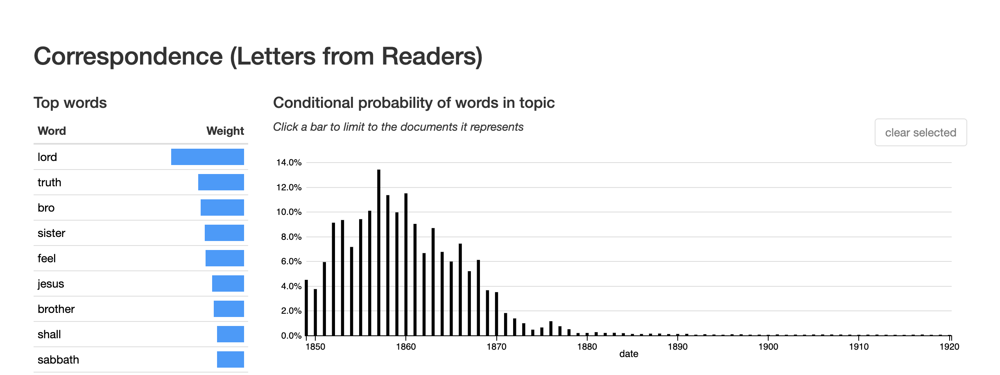

<!-- 
.. date: 2019-01-15
.. title: The Gendered Work of Salvation
.. slug: chapter-4
.. tag: draft
 -->

>As a people who claim to have advanced light, we are to devise ways and means by which to bring forth a corps of educated workmen for the various departments of the work of God. We need a well-disci­plined, cultivated class of young men and women in the Sanitarium, in the medical missionary work, in the office of publica­tion, in the conferences of different states, and in the field at large.^[ADV19030201-V05-02, p. 3. Attributed to EGW]

> Woman, especially the woman of to-day, is too apt to become discontented with the quiet of home life and home-making. There is danger that the sentiment which is encouraging women to enter the professions and take a place in business life, will engender distaste for the nobler profession of home and character-building.^[PHJ18990701-V14-07, p. 6]

The role of women in Seventh-day Adventism, and the gender dynamics within the denomination more broadly, pose a curious puzzle. On the one hand, the leadership of Ellen White and the emphasis on health with the concurrent need for women nurses and physicians to share the faith through health care, provided a robust framework for women to take an active role in the religious life of the denomination. At the same time, a focus on family and the home as the primary site of women's labor and the exclusion of women from ordained ministry reflected and reinforced more patriarchal power structures and a "separate sphere" for women's religious practice. As a result, church members heard multiple and often conflicting messages about the labor they were called to undertake in seeking their own salvation and that of those around them.

These multifaceted, and often-time contradictory, influences provide an instructive example of the complexities of gender and religion during the nineteenth-century. Here religion is neither necessarily liberating, providing women with opportunities denied elsewhere, nor necessarily conservative, disempowering women through rhetoric of difference and domesticity. Instead, it is both. For Seventh-day Adventist women, their work was frequently tied to the mission of the church, whether that be in spreading the message and giving testimony of their experiences, raising children and providing for their physical and spiritual health through food, or working for the cause as a physician or in the distribution of literature as a colporteur. Though not ordained, women were granted teaching and missionary licenses to preach, served in leadership positions at all levels of the denomination, and, in the person of Ellen White, served as the conduit for the divine.^[The denominational yearbooks provide an instructive view of the practical roles women held in the denomination over time. http://documents.adventistarchives.org/Yearbooks/Forms/AllItems.aspx?View={4f91f652-a406-4143-b3a5-016648adff11}&SortField=LinkFilename&SortDir=Asc]  

This chapter focuses on the relationship between time and gender seen in the religious culture of Seventh-day Adventism as a lens onto broader dynamics of gender and belief in nineteenth-century America. Building on the cycles of end-times expectation identified in [Chapter 3](link:slug//chapter-3), I explore the implications of the temporal imaginary on the culture of the denomination through close readings of the periodical literature. Time during the nineteenth century was undergoing fundamental shifts due to the increasing standardization and mechanization, as well as due to scientific discoveries regarding the age of the earth and the processes of evolution. Concurrently, notions of masculinity and femininity shifted, coding the scientific and technical mastery of time in terms of masculinity, and the older, "natural" but also irregular organization of time as "feminine."^[Cite Murphy] In the face of these changes, Seventh-day Adventists posited their own reorganizations of time, holding Saturday as the day of rest that began not with the striking of the clock but with the setting of the sun on Friday. They also rejected the emerging scientific consensus from fields such as geology and biology that the earth was billions of years old, rather than the thousands of years typically held to be indicated by Scripture. This organization of time was motivated by their belief that they were living in the last days of human history, as indicated in prophecy, and that the second coming would occur very soon.

Religion in the nineteenth-century has been studied in terms of the opportunities for power disruption made possible during periods of revival or radical expression, as well as in terms of the sequestering of women's influence into the domestic space brought about by the "feminization" of religion.^[Loaded footnote here with CSR and Ann Douglas.] Within Seventh-day Adventism, we see  both. Inhabiting an alternative temporal imaginary and repeatedly anticipating the second coming, they maintained a level of disruption that created space for the development of alternative gender constructions. At the same time, as time continued and pressures for respectability pushed against the radical impulses necessitated by the second coming, more separated and patriarchal gender constructions were advocated. This tension has resulted in a contested legacy around gender within the denomination. Additionally, this dynamic between beliefs and gender, particularly visible within Seventh-day Adventism, sheds light on tangible effects of beliefs on the culture of a particular community. The second coming and its particular were not abstract theological concepts for early Seventh-day Adventists but foundational realities with implications for how they inhabited the world with regard to time, how they structured their community, and how they developed culturally.

## Time and the Religious Culture of Seventh-day Adventism

The early Seventh-day Adventist church provides a useful entry point to the relationship between "time" and culture, as the denomination developed during a period of reorganization of previously standard conceptions of time while also organizing itself around a particular set of beliefs regarding time: that time was nearly at an end and that salvation was linked to a proper ordering of time. Although rarely thought about directly, time is an unstable feature of human experience and one that is profoundly shaped by the conceptual and narrative frameworks through which one interprets the world. While debates regarding the organization of time were not unique to the nineteenth century, the century was one of particular upheaval in terms of standard assumptions about time, as understandings of history, of progress, of government, and of Christianity all underwent significant revision in the face of political revolutions and advances in science and technology. Older assumptions of time as cyclical, already under stress from the changes of the Reformation and the Enlightenment, gave way to a sense of time as linear, as unique and irreversible. Under a linear framework, the dramatic political reorganizations could be understood as unique, and as representing progress from the older model of the divine rights of kings to all men being created equal, capable of and entitled to self-government. History itself, in this context, became the work of identifying and articulating that progress (through narrative).^[For additional discussions of the move from more cyclical to more linear organizations of time and its implications for conceptions of history, Christianity, and progress, see @Murphy2001, pp. 15-23. Hayden White describes a similar shift in "The Value of Narrativity in the Representation of Reality," when he describes older forms such as the annal and the chronicle as representing not "imperfect" histories but alternative conceptions of history, one where the framework by which events are given meaning is assumed, rather than explicitly stated as it is in narrative forms. See @White1980, p. 10. Interestingly, the tendency of Seventh-day Adventist authors to provide list of global events (largely catastrophes or other examples of suffering) functions similarly to the older chronicle - the reader is expected to understand these events within the context of prophecy being fulfilled, as evidence that the second coming is near.] 

Within the realm of religion, standard practices and assumptions of Christianity, which had historically contained both cyclical and linear patterns of time, shifted to privileging the linear. Emphasizing Genesis to Revelations as a describing the start and end of historical time, nineteenth-century Christians, particularly Protestants, were primed to interpret their lives and world events as part of a divine historical drama moving quickly toward its completion.^[One of Ellen White's most enduring contributions to the literature of the denomination is *The Great Controversy*, which provides a historical retelling of the span of time between Jesus' death and 1844 as the slow unfolding of God's plan, as understood by Seventh-day Adventist believers.] For many, this embrace of linear time also corresponded with an embrace of a narrative of progress, couched in religious terms as hope in human perfectibility or of the potential for ushering in the millennium through conversions.  

The development of technology and science also contributed to significant changes in the conception and experience of time during the nineteenth century. Central to these shifts was the growing prevalence of and reliance on clocks as devices that not just reflected time, but were the source and arbiter of time itself. Previous generations conceptualized time as determined first by the sun, and then captured by the clock, and as a result, time was understood to vary by locality, depending on ones position relative to the earth's orbit. This system worked well enough when most people remained within a relatively geographic space. The development and spread of the railroad, however, introduced new logistical challenges to the keeping of time, enabling persons and goods to move long distances quickly and in doing so moving through multiple local times. The slow adoption to standardized time and the current timezone configurations was part of a reshaping of notions of time, from a natural feature of the world marked by the sun and other regular rhythms of agriculture and human bodies to an abstract, mechanical reality set by some authority and disconnected from the variations of the physical world.^[The slow transition from time being rooted in natural phenomena, such as the orbit of the sun, to being kept through reliance on time pieces is traced in @OMalley1990, particularly chapters 1 and 4.]

While technology in the form of clocks and railroads reshaped the daily experience of time, the broader understanding of historical time, of the extent of the past, was also coming under revision with advances in science, particularly with the development of the publication of Darwin's *On the Origin of Species* in 1859. Previously the sense of cosmic time was guided by the Genesis story, where the world came into being through divine command approximately four thousand years ago and established for the dominion of "man." Darwin's theory of evolution, as well as other scientific developments in areas such as geology, challenged that religiously derived sense of time. These theories forwarded a long and largely impersonal historical account, one in which human beings appeared only briefly and which seemed governed more by chance than by the careful plan of a benevolent god. As a means of confronting this more chaotic picture of time, many embraced a historical narrative of progress, with evolutionary processes leading toward the improvement and gradual perfection of human beings and society.^[In her discussion of time and gender in Victorian novels, Patricia Murphy notes that this positive, progressive interpretation of evolution began to diminish toward the end of the century, as the negative and "devolution" potential of evolutionary change also became clear. @Murphy2001, p. 22-23.] 

Making sense of time and creating narratives that would give meaning to experience in the face of such upheaval presented a major challenge for nineteenth-century authors. One strategy was to turn to gender as a means of creating and clarifying the new relationship with history, with technology, and with religion. For many American (male) intellectuals, gaining mastery over the new conceptions of time frequently entailed reinforcing binaries, such as those between men and women, between races, and between cultures. As a result, literary authors and others relied on tropes that associated "the male with history and the female with ahistoricity; the male with intellectual acuity and the female with mental deficiency, based on Darwinian presumptions; the male with progressive civilization and the female with stultifying primitivism; or the male with Christianity and the female with paganism."^[@Murphy2001, p. 24] While the social and political world was organized along a vision of linear and progressive time, as determined by the "objective" arbiters of science and technology, "women's time" was different and was composed of "the cyclical time that conforms to nature through gestation, regularity, and biological rhythms, and the monumental time that evokes infinity through its affiliation with myth, mysticism, and the cosmos."^[@Murphy2001, p. 26] Bound to monthly cycles as well as the cycles of childbearing, women were presented as a foil against which masculine mastery over time was brought into being. In fact, all those who embraced other organizations of time found themselves outside of the cultural mainstream and its power structures, including the early Seventh-day Adventists.

## Reconstructing Time in Seventh-day Adventism

For Seventh-day Adventists, these shifting temporal markers shaped the religious culture of the denomination, as members worked to articulate their own understandings of time, one that rooted time in the natural world as understood through a literal interpretation of the Bible, while also enabling believers to inhabit the increasingly mechanistic world of the late 19th and early 20th centuries. Their conception of time developed along a number of different lines, grounded on a literal interpretation of the biblical accounts of time and creation and seen in their orientation of the week around Saturday, the day around the sun, and historical time on a literal creationism. Uniting these approaches, their orientation toward standard time and toward historical time was informed by their beliefs about the second coming and eschatological time, and their belief that history was moving rapidly toward its completion, marked not by gradual progress but by the persecution of Seventh-day Adventists and their salvation through the Second Coming of Jesus. 

While all those who followed Miller shared the the belief that they were living during the last moments of human history, Seventh-day Adventism expanded their reorientation of time to the week and the day. Referred to as the "third angel's message," early Seventh-day Adventists turned to the book of Revelation to interpret the events surrounding 1844. As summarized by George Holt, 

> From 1840 to 1843, we heard the angel, [Rev. xiv, 6, 7,] "Saying with a loud voice. Fear God and give glory to him; for the hour of his judgement is come," &c. This angel proclaimed the vision as it was written on the chart, and brought us to the tarrying time. "And there followed another angel saying, Babylon is fallen is fallen." "Come out of her, my people." This second message brought us out from the different churches to which we belonged, or from Babylon. These two angels brought us to the tenth day of the seventh month, 1844, where the 2300 days ended. ... Now we have the message of the third angel, which was to immediately follow the others, "Saying with a loud voice, If any man worship the beast and his image, and receive his mark on his forehead, or in his hand, the same shall drink the wine of the wrath of God." This third angel is also saying, "Here is the patience of the saints; here are they that keep the commandments of God and the faith of Jesus."^[@Holt1850]

The first message, that the second coming was at hand, was taught by William Miller in his interpretation of the "2300 days" mentioned in the book of Daniel. This, together with the second, that they should leave the churches of which they were members, brought them to October 22, 1844. Now they found themselves living under the "message of the third angel," that the sign of the faithful was to keep the commandments, and specifically keeping the Sabbath on the seventh day of the week, rather than following "the beast and his image" &mdash; understood as the Roman Catholic Church &mdash; in observing Sunday.^[Although the early SDA commentators were aware of time as a relative measure as seen in their discussion of the "day" as a unit of measure, their literal approach to the Bible guided their interpretation of the "seventh" day. That the week itself was also a construct is not addressed. For a discussion of the history of the week, see @Zerubavel1985.] Convinced that they were indeed living in the last days, they introduced a second shift in their temporal framework, and linked their salvation to reorganizing the week.

Where the adoption of Saturday Sabbath involved a reorientation of the week, determining the start of the Sabbath required church members to also consider the organization of the day. Although they inhabited a world increasingly structured by standard time, Seventh-day Adventists chose to maintain older cyclical rhythms around their religious practice, using the sun, rather than the clock, to mark the start of the Sabbath on Friday evening. Having gathered a community convinced that Sunday worship was an extra-biblical change, the next question that arose was when the Sabbath in fact began. In 1855, James White commissioned and published a study by J.N. Andrews,  on the proper method for marking the start of the Sabbath in the *The Advent Review and Sabbath Herald*. While there had been some debate up to this point regarding what marked the start of the Sabbath -- with options including 6 p.m. local time, sunrise, and  sundown -- both Andrews and White came to the conclusion that following the natural rhythm of the sun was more in keeping with the Genesis description of the "day" and therefore the proper indicator for the community to embrace.^[@White1855; @Andrews1855.] In his assessment of the arguments for 6 p.m., Andrews notes that "The hours in the New Testament are not the same as our hours. With us an hour is 60 minutes, and is never more nor less. But in the New Testament it is the twelfth part of the space between sunrise and sunset ... The division of the day into hours was not of divine appointment, but originated with the heathen!!!"^[@Andrews1855, p. 77.] 

Time, Andrews notes, is a variable construct, and one marked differently in the Biblical literature. He sets up a hierarchy of modes of marking time, linking the sun to a Biblically endorsed ordering of time and a reliance on clocks, with regular hours and minutes, to the heathen or the ungodly. While the conclusion by Andrews guided the religious practice going forward, the tension between these different modes of keeping time resurfaced over the early years of the denomination. As the faith spread beyond the United States, the logistics of marking time by the sunset received renewed consideration in the context of the northern altitudes. Discussing the case of Norway in response to a church-member's inquiry, the editors note, "Now the query sometimes arises, As the Sabbath is to begin at sunset, and the sun here does not set at all, where is the end or the be- ginning of the day ? But the sun does virtually set. It reaches the lowest point in its circuit. ... and so the revolution of the earth, which measures the day, can be marked then as accurately as before."^[RH18960414-V73-15, p. 9] In this way, the case of the perpetual sunlight experienced at the poles was dismissed as an argument against the "natural," sun-based system of marking time, for the day, defined as the rotation of the earth on its axis, was still discernible. 

In addition to re-ordering the week and the day around what they understood to be a biblical vision of historical time, early Seventh-day Adventists also advocated for an alternative sense of historical time. They rejected the evidence of geology for the length of history and the evidence of evolutionary sciences regarding the development of life, with their concurrent reorganization of historical time, and insisted instead on the creation narrative understood in terms of literal days, with nature created as complete at the time of creation, and on a temporally short period of the history of the world.^[This discourse is captured in [topic 119 - Apologetics (Geology and Evolution)](http://browser.dissertation.jeriwieringa.com/#/topic/120) of the topic model.] For Seventh-day Adventist commentators, the developing sciences of geology and evolutionary biology posed a direct threat to their faith; either science or the Bible was correct. "It is a well-known fact that most of the geological theories extent impinge against the plain teachings of God's word. Geologists would have us to know that their theory is correct, no matter what prophets and apostles may say to the contrary; thus divine truth must be sacrificed on the altar of geological speculations."^[RH18651003-V26-21, p. 1] So begins an introduction to "The Blunders of Geologists," an article from *Evangelical Repository* reprinted in the *Advent Review and Sabbath Herald* in 1865 that critiques the practices and knowledge claims of geology. 

A similar antagonism between the Bible and science is invoked in discussions of evolution: "So just as surely as evolution is "directly antagonistic to the doctrine of creation," so surely are those who hold to evolution placed "directly antagonistic" to the Bible."^[ST18850611-V11-23, p. 4] The extended vision of the history of the world offered by these sciences was seen by Seventh-day Adventists and others as in direct contradiction with the account of creation given in the Bible. Not only did these sciences pose a threat to the veracity of the Biblical account, but they also threatened the Seventh-day Adventist understanding of time. The calculation of the "2300 days" of Daniel and the identification of the start of Jesus' work in the Sanctuary depended on the Bible being a reliable historical source. Were the world indeed old and its inhabitants the result of the slow process of evolution rather than discrete acts of creation, the whole temporal framework of their faith was suspect.

Faced with the incompatibility of scientific theories and their belief system, Seventh-day Adventist leaders defaulted to their religious beliefs, and in so doing inhabited an alternative historical narrative to that of their surrounding culture. Other Protestant groups adapted the logic of progress that the sciences seemed to encourage to the Christian narrative, preaching the increasing salvation of souls and the righting of social ills in the years leading up to the second coming.^[Quote secondary here.] By contrast, Seventh-day Adventists anticipated increasing corruption and their persecution at the hands of state due to their alternative temporal framework.

>In these statements the principle enunciated by Jesus of Nazareth in the words, "Render therefore unto Caesar the things which are Caesar's, and unto God the things that are God's," is recognized, and church and state are completely separated. Well would it be for this great republic if these righteous principles would always be recognized. So long as they are, its foundation stands sure.

>But the prophecy indicates a change....
    
>An image to the beast would be something made which resembled the beast. The papal beast was a union of church and state. The church controlled the state, and ecclesiastical decrees were enforced by the civil power, at the dictation of the church. The dungeon, the stake, and all the terrible work of the Inquisition during all the dreary years of its existence, tell the sequel.

>Making an image to the beast is, therefore, reversing the principles upon which the republic has been founded for more than a century, and effecting a union of church and state. This means the destruction of liberty, and the enthronement instead of a despotism which will invade the citadel of conscience, and tyrannize over the souls of men.
    
>More than fifty years ago the people now known as the Seventh-day Adventists took the position, based upon their interpretation of prophecy, that this nation would turn away from the principles upon which it was founded, make an image to the beast, and become a persecuting power.^[LibM19080701-V03-03, pp. 24-25 (22-23)]

Holding the good of the United States to be the strict division of religion and governmental powers, rather than the establishment of a religious "city on the hill" that their Protestant neighbors celebrated, Seventh-day Adventists anticipated that the state would one day (soon) begin to enforce religion, and particularly the keeping of Sunday Sabbath. In so doing, the state would become "an image to the beast," understood as the Roman Catholic Church, and the persecution of the Seventh-day Adventists for their Sabbath-keeping practices would begin. Rather than progress, Seventh-day Adventists anticipated a falling from grace for the nation and the trial of their faith in the process. 

Through their embrace of different temporal paradigms, early Seventh-day Adventists created a religious culture that was in tension with that of other nineteenth-century Protestants, one where alternative orderings of gender were able to thrive at various times in their development. From a weekly rhythm guided by the natural "time" of the sun to a historical and cosmic narrative focused not on progress but on disruption leading up to the rapidly approaching completion of history. While always in conversation with the progress-oriented, evolutionary, and standardized time of their surrounding culture, the distinctive temporal imaginary of the Seventh-day Adventists created space for the continued leadership of Ellen White, and for a sharing of the labor of preparing for the second coming, both within the context of the home and family and in the context of the missions.

## The Gendered Work of Salvation at the End of Time

Maintaining an alternative temporal imaginary and cultural framework is no small task. As the nineteenth century progressed, arguments over the organization of time also heightened as seen in a variety of social issues, from agitation for Sunday observance laws to public debates over evolution in the Scopes Trial. For Seventh-day Adventists, such challenges to their sense of time were understood in religious terms, particularly in terms of eschatology or the overarching narrative of salvation and the end of time. In fact, it seems likely that denominational leaders ongoing commitment to that foundational temporal arrangement - the impending end of the world - helped reinforce their alternative sense of lived and historical time.

However, expectation of the end of the world is difficult to sustain over long periods of time. In his Foreword to William McLoughlin's *Revivals, Awakening and Reform*, historian Martin Marty notes that "Individuals do not ordinarily live their lives at a single pitch of intensity. Periods of high drama are interspersed among longer periods of mild boredom. After times of vitality come stretches of exhaustion. As with individuals, so with cultures."^[@McLoughlin2013, Loc. 34.] End-times expectation, that sense of living at the monumental close of history, is one such period of high drama and one that has reoccurred at various points in Christian history, and is particularly entwined with the history of Protestantism in the United States.^[@McLoughlin2013, loc. 127.] For Seventh-day Adventists, who trace their roots to one of the more notable surges in end-times expectation at the close of the Second Great Awakening, time and end times expectation is core to their religious culture. However, just as with their contemporaries, the pitch of expectation varied over their history. As a result, rather than a consistent awareness of and focus on the second coming, we would expect to see a cyclical pattern around periods when the second coming seemed, for one reason or another, particularly likely.

Such cycles also contribute to instability in other cultural aspects of the denomination, including ideas about gender and the roles available to women within the denominational structure. With increased attention to questions of gender, race, and class, scholars who examine patterns across multiple revivals have drawn attention to the ways women and members of other marginalized groups feature prominently during periods of upheaval or revival. Such analysis has been done using the frameworks of theorists such as Mary Douglas, Victor Turner, and Max Weber, parsing revival periods as moments of disruption in social norms and hierarchies, where members reject or challenge existing rituals until a new equilibrium is achieved and order is re-established.^[Long footnote with additional parsing of these theories - note that CSR uses Mary Douglas, and Vance uses Weber] These frameworks help explain periods of unusually expansive behavior within religious and cultural groups, as well as the more subtle but lasting cultural shifts that revival moments leave in their wake.^[It is worth noting that much of the scholarship that uses these frameworks in the study of nineteenth-century religion has focused on this cycle as part of a narrative of progress, where revival moments contribute to greater social equality (democratization) or to increased opportunities for agency. However, in theory these movements can also give rise to more conservative subcultures.] 

For early Seventh-day Adventism, the standard historical narrative has been one of slow accommodation to the surrounding culture, where Seventh-day Adventism progressed from a group at the edges of the Millerite movement to an established denomination, and one that was increasingly inscribing a gendered hierarchy based on "separate spheres" and female domesticity by the 1920s.^[will need citations - Vance] These general patterns of accommodation and secularization - in the sense of becoming "like the world" - help explain the overall structural shifts in the Seventh-day Adventist theology and religious culture, but also obscure the ways that culture was negotiated at multiple point along the way. While Vance and Butler convincingly argue that the trajectory of the Seventh-day Adventist denomination has historically been toward accommodation to prevailing cultural norms and toward increased affiliation with the traditional Protestant denomination, the early years of the sect indicate that this progression was complex and contested. As Vance notes with regard to Ellen White's positions on female leadership in the denomination, "the seeming contradictions of White's admonitions, life, and advice are not easily reconciled."^[@Vance1999, p. 194]

Additionally, other scholars have commented on the ways the culture of Seventh-day Adventism is gendered in ways at odds with their surrounding culture. In their chapter on "Gender," Bull and Lockhart link "feminine" characteristics of the denomination to the shared experience of Seventh-day Adventists and women in finding themselves on the outside of American power structures.^[@Bull2006, p. 259] The authors note that "time" functioned as a defining characteristic for SDA members, who organized their lives around Saturday Sabbath-keeping, and open the door for further study into the gender dynamics within the denomination in relation to their surrounding culture. Rather than describe "feminine" characteristics as a static constellation of features that were promoted within the denomination at various times, however, I focus on the organization of time, rather than cultural exclusion, as a primary force in shaping the culture of the SDA. both in making space for more female leadership than was common in nineteenth-century religious movements and in contributing to a culture that appeared "feminine" because of its rejection of the prevailing, masculine, reorganization of time.^[@Bull2006, pp. 259-265.]

By looking at the shorter timescale of the first seventy years of the denomination, those when the church was lead by Ellen White, we can begin to add another layer to our picture of nineteenth-century revivalism and the processes by which distinctive religious cultures develop, in this case around the key issue of time. While the overall trajectory of Seventh-day Adventism has been toward increased connection and accommodation to rest of American Protestantism, albeit with a heightened awareness of the end of time, the distinctive elements of the denomination's culture, including the ongoing leadership of Ellen White and the promotion of alternative forms of masculinity and femininity, point to additional factors shaping that development. If, rather than a linear decline from the intensity of 1844, we assume a cyclical pattern to the Seventh-day Adventist sense of time with the second coming seeming more or less imminent at different points through out their history, as evidenced through text analysis in [Chapter 2](link://slug/chapter-2), we can begin to explore the relationship between those periods of intensity and "boredom" with shifts in the locus on salvation and the ways the work to bring about salvation were gendered.

### A Community of Belief: 1849-1860

For those who interpreted the continuation of time as a failure to correctly interpret the significance of the date, rather than the date itself, expectation of the second coming was at its peak during the years following 1844. Referred to as the "tarrying time," they took solace in the parable of the bridegroom, who did not come when expected and rewarded those who remained in waiting. They interpreted this parable as evidence that the failure of Jesus to return in 1844 was infact not unexpected, and that their faithfulness through the period of waiting would be the key to their salvation.^[See, for example, the *Second Advent Review, and Sabbath Herald* for June 9, 1851 (RH18510609-V01-13.pdf) which opens with a seven page explication of the parable of the bridegroom from Matthew 25:1-12.] During these early years, early Seventh-day Adventist believers embraced a variety of new theological positions, including the "shut door" doctrine, that only those believed prior to October 22, 1844, would be saved, and the "sanctuary doctrine," that Jesus had begun the work of judging souls preceeding his return. Additionally, they adopted the Seventh Day Baptist belief that to truly follow the law, or the Ten Commandments, required keeping Saturday Sabbath. This last belief, which came to be referred to as the "Third Angel's Message," came to be understood as the true test by which those who would be saved were distinguished. Communicating these beliefs, confirmed through the visions of Ellen White, and convincing others of their truth made up the core of the Seventh-day Adventist faith and mission in the first years of the movement.

Establishing the truth of their teachings was the first priority of the early Seventh-day Adventists, for with time rapidly drawing to a close, belief would be the primary mark distinguishing those who would be saved from those who would not. The first publication produced by the Whites, *The Present Truth,* offered readers both current theological arguments for Sabbath-keeping and the Sanctuary doctrine as well as laid claim to the legacy of Miller and the Adventist movement by reprinting materials from the Millerite movement to show themselves as the true heirs of Miller's teaching. Written for members of the Millerite community who were seeking to reconcile their beliefs with the events of 1844, the paper presents arguments for the Saturday (Seventh-day) Sabbath and for 1844 as marking the beginning of Jesus' work in the Sanctuary. *The Advent Review*, published by Hirem Edson, David Arnold, Geo. W. Holt, Samuel W. Rhodes, and James White, took up the specific cause of linking the emerging Seventh-day Adventist movement with the earlier Millerite cause, as well as setting out the theological positions of the emerging denomination. Compiling writings from William Miller, Joshua Himes, and others, the editors note,

>"In reviewing the past, we shall quote largely from the writings of the leaders in the advent cause, and show that they once boldy advocated and published to the world, the same position, relative to the fulfillment of Prophecy in the great leading advent movements in our past experience, that we now occupy; and that when the advent host were all united in 1844, they looked upon these movements in the same light in which we now view them, and thus show who have "LEFT FROM THE ORIGINAL FAITH."^[@Edson1850, p. 1. A note was included in 1853 that explained the different pieces included in the *Advent Review*, noting that they should not be considered as presenting "a system of truth" but rather to "show what had been the faith of the Advent body." See page 51 of the digitzed pdf document.] 

In claiming the Millerite tradition as their own, they sought common ground with those they were seeking to convert by establishing a common history in Miller's cause. These, the scattered flock of Miller's followers, were the primary audience for the paper and the primary targets for evangelism, as there was question as to whether those who had rejected Miller's teaching could be saved.^[@White1849b] Motivated by the belief that once the message had been presented to the scattered Millerite community, the second coming would take place, the early Seventh-day Adventist believers prioritized establishing the truth of their message and sharing it with others as their primary calling.

In this period of expectation both men and women prioritized the spreading of the "third angel's message" through preaching or teaching, distributing literature, and testifying regarding their conversion to the Seventh-day Adventist message. The early issues of *The Present Truth* and the *Advent Review and Sabbath Herald* dedicated pages to letters from converts and community leaders, testifying about their conversion, the successes of the Seventh-day message in their local area, and commenting on the truths they now believed.

<figcaption>**Figure 4.1:** Plot of Prevalence of Topic 59 &mdash; Correspondence (Letters from Readers) &mdash; by Year.</figcaption>

On the one hand, the language of the letters reflects the gender expectations of the time, with male authors frequently undertaking to offer sermons in their correspondence, presenting arguments for the truth of the Seventh-day message, while the women authors frequently speak of their personal experience and request additional support in reaching their family and friends. At the same time, this gendered boundary was not stable, with women such as Rebekah Whitcomb writing to argue for increased attention to the salvation of children, and Sister A.S. Stevens writing to testify to the truth of the "third angels' message" and to encourage readers to "drink deeply of the Holy Spirit to keep pace with the movement of the times" for "the gathering time has come, to the truth of which our souls can testify."^[@Whitcomb1850, @Stevens1850, p. 16] The important point for the writers and the editors was to speak to their experience with the Seventh-day Adventist message, and in so doing reaffirming their shared beliefs. These letters reveal a community of believers united around the message and focused on sharing it with others, in full anticipation that the day of reckonning is quickly approaching.

Ellen White herself embodied the prioritization of the truth of Seventh-day Adventist beliefs over all other responsibilities, including those of motherhood. Facing the press of time and a calling to share her message, as well as the demands of parenting, Ellen left her children in the care of others while traveling to the scattered Adventist community. In 1849, while in Oswego, N.Y. where she and James had settled to focus on publishing, they "decided to visit Vermont and Maine. I left my little Edson, then nine months old, in the care of Sr. Bonfoey, while we went on our way to do the will of GOD.”^[@White1860b, p. 127] With her infant son in New York and her two year old son in Maine, Ellen reported feeling despondent and jealous of those who "were enjoying the company of their children in their own quiet homes."^[@White1860b, p. 128] She "besought the Lord for strength to subdue all murmuring, and cheerfully deny myself for Jesus' sake."^[@White1860b, p. 128] The call to spread the message could not be delayed, and leaving behind her children was one of the burdens she was called to bear. Even when she returned to find her child "very feeble," she attempted to reframe the pain in terms of divine will. "We tried to look at the child's case in as favorable a light as possible. I was comforted with these words, The Lord "doth not afflict willingly, nor grieve the children of men.""^[@White1860b, p. 132-3] As God had called her to do the work of traveling and speaking to the scattered Adventist community, she reminded herself, she had to also trust him with the health of her children, that neither they nor she would suffer needless pain so long as she did as she was called to do. While in later years she would encourage women to prioritize home over other avenues of mission work, for her the clear priority in the initial years after 1844 was the spreading of the Seventh-day message as the second coming was expected soon.

At the same time, despite an generally expansive view of gender and religious calling, denominational leaders still at times fell back on more traditional cultural norms in their attempt to gain followers. For example, despite himself having been convinced by his wife's visions, James White only rarely published her vision in the *Review and Herald,* instead relying on male authors and theological arguments based on biblical texts to convince his readers of the truth of the Seventh-day Adventist message. This stance, however, resulted in tensions between the church leadership and the general members, who had embraced Ellen's prophecies more enthusiastically. By the end of 1855, three church leaders published an essay in the *Review and Herald* affirming the importance of the prophetic gift of Ellen White and noting that, while they were not to be exalted "above the Bible," they were authoritative, in that the church community was "under obligation to abide by their teachings, and be corrected by their admonition."^[@Bates1855, p. 79. This event is discussed in @Anderson1998, pp. 35-36.] For church members and leaders, Ellen's visions served as powerful reminder and sign: prophecy, and particularly prophecy communicated through a woman, was itself powerful evidence of the truth of their fundamental claim that the second coming was at hand.

The first decade of Seventh-day Adventist publishing points to a community convinced of the truth of its beliefs and the necessity of reaching those marked with salvation prior to the second coming. The editors and readers saw themselves as participants in the the unfolding of divine history, called to reach the "scattered flock" with the message of the "third angel." To that end, they focused in these early writings on that message and its truth. Expecting a quickly arriving close to history, typical gender norms were suspended, with men and women attesting publically to their beliefs in hopes of converting others and all other obligations being treated as secondary to the call of spreading the Seventh-day message.

### A Community of Practice: 1860-1885

By the 1860s, twenty years after Miller's prediction of 1844, the sense of urgency around the second coming had begun to wane. Though still anticipated, the signs had shifted &mdash; the Civil War had brought about the end of slavery, which had been seen as ..., and the "door" no longer seemed "shut" with the conversion of children and individuals from outside the initial Millerite community, opening the possibility of broader evangelistic work being required. Facing a longer period of waiting than originally anticipated, belief in Adventist doctrines and Sabbath-keeping no longer seemed sufficient for salvation or for the mission of Seventh-day believers. [turn to more process / longer term behaviors with health]

Start of institution building - creation of the denomination and corporation for publishing endeavors; start of additional corporations for other aspects of the work, including health institute.

Along with this move toward a focus on longer-term processes and the creation of institutions came a shift in the ways the work of salvation was gendered. 

In 186?, facing a decline in her own health and that of James as well as having experienced the loss of children to illness, Ellen White recorded her first visions on health reform and in so doing, brought the keeping of the "natural law" into the larger requirements of the denomination. 

The growing emphasis on health was also linked to a growing emphasis on character development and the longer-term processes of preparing oneself for salvation. Much of this work was associated with women ... The rhetoric around the role of "mother," particularly from Ellen White, reflected but also nuanced the general language of domesticity. 

However, in contrast to the developing notion of "separate spheres," the language of parenting and health in Seventh-day Adventism also included an active and vital role for men ...

This model of masculinity and parenting was closer to older Puritan models than that of its immediate culture.

"My sisters, as mothers we are responsible in a great degree for the physical, mental, and moral health of our children. We can do much by teaching them correct habits of living. We can show them, by our example, that we make a great account of health, and that they should not violate its laws. We should not make it a practice to place upon our tables food which would injure the health of our children. Our food should be prepared free from spices. Mince pies, cakes, preserves, and
highly-seasoned meats, with gravies, create a feverish condition in the system, and inflame the animal passions. We should teach our children to practice habits of self-denial, that the great battle of life is with self, to restrain the passions, and bring them into subjection to the mental and moral faculties."^[@White1864, p.19-20]

"I was referred to Rom. i, 18-32, as a true description of the world previous to the second appearing of Christ. The only hope for those who practice vile habits is to forever leave them if they place any value upon health here, and salvation hereafter."^[@White1864, p.27]

"Now is the time of preparation. None need to expect that God will do the work of preparing and fitting them up, without their efforts. It is for them to work the works of righteousness, and crowd all the right-doing they can into the little space of time allotted to them before probation closes, that they may have a clean record in Heaven."^[@White1864, p.33-34]

"Especially has the appetite been indulged, and they have been controlled by it, instead of reason. For the sake of gratifying the taste, Eve transgressed the command of God. He had given her everything her wants required, yet she was not satisfied. Ever since, her fallen sons and daughters have followed the desires of their eyes, and of their taste. They have, like Eve, disregarded the prohibitions God has made, and have followed in a course of disobedience, and, like Eve, have flattered themselves that the consequence would not be as fearful as had been apprehended."^[@White1865, p. 51]

"The untiring assiduity with which the mother watch- es over the tender infant, is a strong indication that nature has peculiarly adapted her for an office, which no one can so effectually fill. Yet thousands have withered in the mother's arms, and generations have gone down to the dust, not by neglect, but through profound ignorance of the simplest, and plainest laws of our nature ; simplest, because it does not require the ingenuity to trace nature in her untrammelled windings, as it does to devise the artificial helps, which serve only to retard her healthy progress, and pervert all her rational laws."^[@Journal1865, p. 11]

<!-- 

Here conceptions of time are useful for explaining why early Seventh-day Adventists seemed somewhat immune to the surrounding shifts in conceptions of gender. Whereas their Protestant neighbors increasingly embraced notions of progress and upward (individual) mobility as the underlying narrative, Seventh-day Adventism, with their emphasis on the approaching second coming and general skepticism toward the state, provided a different standard against which both men and women measured success and negotiated their respective roles.-->

### A Community of Action: 1885-1920

The last decades of the nineteenth century and the beginning of the twentieth again brought the second coming into the forefront of member's sense of time, and this time they responded institutionally. 

Missions (open to both men and women)
Education (needed to train people for missions)
Political involvement (religious liberty)

At the same time, as the denomination grew institutionally and professionalized, the opportunities for women's involvement changed. 
+ note examples from yearbooks where women held high level leadership positions
+ rhetoric about the value of the home

Ellen white as counter balance to this - 

problem of compensation - dual threads of equal compensation on gender and warnings against seeking "excessive" compensation.

<!-- By the end of the nineteenth century, the focus of denominational leaders shifted outward toward missionary efforts and toward political concerns. 

Missions for early SDA took many forms, not just preaching but distribution of tracts and periodical literature and involvement in health care.

While preaching was a predominantly male activity in early SDA (EGW excepted), working as a colporteur or in health care were venues open to and encouraged for members of both sexes.

[Salary for women employees as evidence of ongoing value of this labor]

-->

## Conclusion

With Ellen White's death in 1915, the denomination lost both its key advocate for an alternative understanding of gender and religious leadership, as well as its key evidence of living in the last days.  